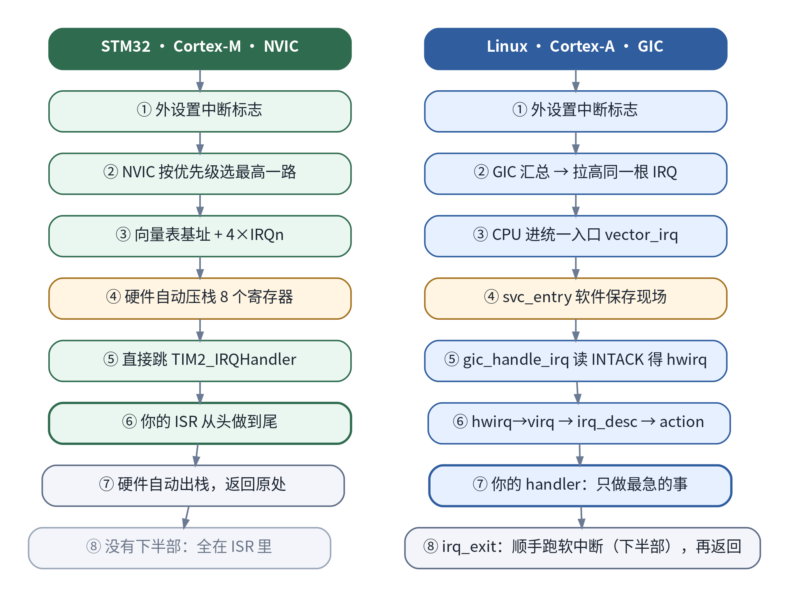

# i.MX6ULL 的 Linux 中断 vs STM32 中断

## 一、先说结论

同样的中断，两边的差别不在"控制器名字"，而在**分发方式和现场保护方式**：

| 维度 | STM32（Cortex-M） | Linux（Cortex-A） |
|---|---|---|
| 控制器 | NVIC | GIC |
| 怎么找到处理函数 | **硬件查向量表**，每个中断号一个地址，直接跳 | 所有中断先跳同一个入口，**软件读出中断号再查表分发** |
| 现场保护 | **硬件自动**压栈 8 个寄存器 | **软件**在 `entry-armv.S` 里保存 |
| 中断号 | 一维：IRQn → handler | 两套：hwirq（硬件）+ virq（内核），中间隔一层映射 |
| 能否嵌套 | 硬件优先级，可嵌套 | 处理期间关中断，默认不嵌套 |
| 上下文里能否睡眠 | 不能 | 不能（但可以挪到线程化中断/下半部） |

一句话记：**STM32 是"一个中断一个门"，Linux 是"所有中断一个门，进门再按号找人"**。



*图：左边硬件分发、右边软件分发；两边都在中断入口处保存现场，区别是"谁保存、保存到哪"。*

## 二、控制器：NVIC vs GIC

| 平台 | 缩写 | 全称 | 中文 |
|---|---|---|---|
| STM32（Cortex-M） | NVIC | Nested Vectored Interrupt Controller | 嵌套向量中断控制器 |
| Linux（Cortex-A） | GIC | Generic Interrupt Controller | 通用中断控制器 |

GIC 向上只给 CPU 四根线（VFIQ、VIRQ、FIQ、IRQ），日常驱动全走 IRQ：

```text
硬件中断源（很多个）
    ↓
中断控制器（GIC）
    ↓
分两根线给 CPU：IRQ 线 / FIQ 线
    ↓
CPU 进入：vector_irq 或 vector_fiq
```

> Linux 驱动里 `request_irq()` 注册的处理函数，全部从 `vector_irq` 进来。

NVIC 则相反：它内部就有一张**向量表**，中断号直接决定跳转地址，硬件帮你算好偏移，不需要软件"查表"。

## 三、中断怎么分发到具体函数

### STM32：向量表 + 硬件跳转

```text
外设置位中断标志 → NVIC 按优先级选出最高的一路 → 取向量表基址 + 4×IRQn → 直接跳 xxx_IRQHandler
```

处理函数名在启动文件里就固定了，你写 `TIM2_IRQHandler` 就是在填表。中间没有软件分发环节。

### Linux：统一入口 + 两级查表

```text
外设 → GIC → CPU 进 vector_irq
    ↓
gic_handle_irq 读 GIC_CPU_INTACK 得到 hwirq
    ↓
irq_domain 映射：hwirq → virq（设备树里 interrupts 属性决定）
    ↓
irq_desc[virq] → action 链表 → 你 request_irq 注册的 handler
```

差别在于中间多了两跳：**hwirq→virq 的映射** 和 **irq_desc/action 链表**。好处是硬件中断号可以被设备树重新编排、多个驱动能共享一个中断号；代价是路径长了。

## 四、代码对照

| 层级 | STM32 | Linux |
|---|---|---|
| 启动/向量表 | `startup_stm32f429xx.s` | `arch/arm/kernel/entry-armv.S` |
| 中断处理 | `stm32f4xx_it.c` | `drivers/irqchip/irq-gic.c` |
| 通用框架 | 无（硬件直跳） | `kernel/irq/handle.c`、`irqdesc.c` |

Linux 侧三个容易混的文件：

| 文件 | 作用 |
|---|---|
| `arch/arm/boot/compressed/head.S` | 解压 zImage 的自解压代码 |
| `arch/arm/kernel/head.S` | 真正的内核入口 `stext`，建页表、开 MMU |
| `arch/arm/kernel/entry-armv.S` | 异常向量表 + 中断/异常入口 |

`entry-armv.S` 是**内核已经跑起来、向量表已装好**之后才起作用的；它跟启动阶段的 `head.S` 是两码事（启动链见 [Linux 启动流程](./KERNEL-01-启动-Linux启动流程.md)）。

## 五、向量表差异

### STM32：每项一个函数地址

```asm
.section .isr_vector,"a",%progbits
g_pfnVectors:
    .word _estack                  /* 0x0000 SP 初值 */
    .word Reset_Handler            /* 0x0004 Reset */
    .word NMI_Handler              /* 0x0008 NMI */
    .word HardFault_Handler        /* 0x000C HardFault */
    .word MemManage_Handler
    .word BusFault_Handler
    .word UsageFault_Handler
    ...
    .word SysTick_Handler

    /* 外部中断 */
    .word WWDG_IRQHandler
    .word PVD_IRQHandler
    .word TAMP_STAMP_IRQHandler
    ...
    .word TIM2_IRQHandler
```

### Linux ARM：只有 8 个通用入口

```asm
__vectors_start:
    b reset
    b undefined
    b svc
    b prefetch_abort
    b data_abort
    b reserved
    b vector_irq
    b vector_fiq
```

> **IRQ 不区分具体设备**：UART、GPIO、SPI、I2C 全进 `vector_irq`。

ARM 异常向量（从低地址起）：

1. Reset（复位）
2. Undefined Instruction（未定义指令）
3. SVC（管理模式/系统调用）
4. Prefetch Abort（取指异常）
5. Data Abort（数据访问异常）
6. Reserved
7. IRQ（普通中断）
8. FIQ（快速中断）

### 为什么 FIQ 单独一路

FIQ 在 ARM 设计上优先级更高、有更多 banked 寄存器（r8–r12 不用压栈），进入和返回的开销都更小，留给对实时性要求极高的外设（某些音频、DMA 场景）。普通驱动一律走 IRQ。

## 六、上下文保存差异

| 平台 | 保存方式 | 保存内容 |
|---|---|---|
| STM32（Cortex-M） | 硬件自动压栈到 PSP/MSP | R0–R3、R12、LR、PC、xPSR |
| Linux ARM | 软件在 `entry-armv.S` 保存 | R0–R12、SP、LR、PC、CPSR，以及 banked 寄存器 |

硬件自动保存的好处是延迟固定、代码零成本；软件保存的好处是**可以按需保存**（比如中断只在 SVC 模式发生时要多存一些东西），代价是入口代码更复杂。

## 七、汇编入口细节

```asm
W(b) vector_irq
    ↓
vector_stub irq, IRQ_MODE, 4        /* 按进入中断前的模式分派 */
    .long __irq_usr       @ 0  (USR_26 / USR_32)
    .long __irq_invalid   @ 1  (FIQ_26 / FIQ_32)
    .long __irq_invalid   @ 2  (IRQ_26 / IRQ_32)
    .long __irq_svc       @ 3  (SVC_26 / SVC_32)
    .long __irq_invalid   @ 4
    ↓
__irq_svc:
    svc_entry             /* 保存现场 */
    irq_handler
    ↓
.macro irq_handler
#ifdef CONFIG_MULTI_IRQ_HANDLER
    ldr r1, =handle_arch_irq       /* 启动时由 GIC 驱动填进去 */
    mov r0, sp
    adr lr, BSYM(9997f)
    ldr pc, [r1]
#else
    arch_irq_handler_default
#endif
9997:
.endm
```

注意这里用的是**函数指针 `handle_arch_irq`**：汇编层不知道具体是哪个中断控制器，启动时由 `set_handle_irq(gic_handle_irq)` 把地址填进去。这就是 Linux 支持多种中断控制器的办法——汇编只认一个指针。

```c
/* drivers/irqchip/irq-gic.c */
void __init set_handle_irq(void (*handle_irq)(struct pt_regs *))
{
    if (handle_arch_irq)
        return;
    handle_arch_irq = handle_irq;
}
```

## 八、一个"旧接口"的遗迹：asm_do_IRQ

老内核（3.x/4.x 早期）走的是这条路，现在还能在很多教材里看到：

```c
asmlinkage void __exception_irq_entry
asm_do_IRQ(unsigned int irq, struct pt_regs *regs)
{
    handle_IRQ(irq, regs);
}

void handle_IRQ(unsigned int irq, struct pt_regs *regs)
{
    __handle_domain_irq(NULL, irq, false, regs);
}
```

调用链：`asm_do_IRQ()` → `handle_IRQ()` → `__handle_domain_irq(NULL, irq, false, regs)` → `irq_enter()` → （`irq_find_mapping`）→ `generic_handle_irq(irq)` → `irq_exit()`。

新内核里这条路被 `gic_handle_irq` 直连 `handle_domain_irq` 取代了，但**框架内部的顺序完全没变**：`irq_enter` → 分发 → `irq_exit`。

## 九、完整对比

| 特性 | STM32 | Linux |
|---|---|---|
| 中断源管理 | NVIC 内建，通道数固定 | GIC + `irq_domain`，可由设备树动态扩展 |
| 找处理函数 | 向量表硬件跳转 | 软件两级查表（hwirq→virq→action） |
| 现场保存 | 硬件 8 个寄存器 | 软件保存 + banked 寄存器 |
| 优先级 | NVIC 硬件优先级，可嵌套 | GIC 优先级 + 内核里默认关中断不嵌套 |
| 中断里能否睡眠 | 不能 | 不能 |
| 耗时活怎么办 | 自己拆状态机、在主循环里做 | 下半部（softirq/tasklet/workqueue）或线程化中断 |
| 中断服务函数数量 | 一个中断号一个 | 一个 virq 可挂多条 action（共享中断） |

## 十、从 STM32 迁移过来的思维转换

1. **"中断号"不再等于"处理函数"**：拿到的是 hwirq，还要经过设备树映射；调试时先确认 `/proc/interrupts` 里那一列到底是哪个 virq。
2. **中断函数要"能被打断"的心态**：STM32 里你常写一个大 ISR 从头做到尾；Linux 里要拆成"上半部 + 下半部"。
3. **不能靠优先级解决所有问题**：Linux 处理中断期间关中断，优先级更多体现在 GIC 和线程化中断的调度上。
4. **共享中断必须自证身份**：handler 要先读状态寄存器，确认是自己的中断再处理，否则返回 `IRQ_NONE`。
5. **"等"这个动作要搬家**：任何需要等待的操作（I2C 读、等锁、等内存）都不能留在中断上下文。
