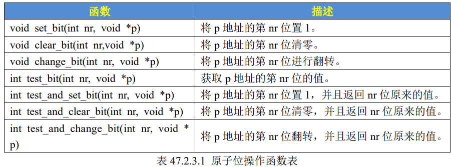

# Linux 并发与竞争：原子操作、自旋锁、信号量、互斥锁

## 一、先说结论

Linux 是抢占式的多任务系统，于是"两个人同时改同一个变量"不是理论问题，而是必然后果。解决手段按"等多长时间"排队：

| 机制 | 保护的粒度 | 等不到时怎么等 | 典型场景 |
|---|---|---|---|
| 原子操作 | **一个变量** | 不需要等 | 计数器、标志位 |
| 自旋锁 | 一段临界区 | **站着等**（占 CPU） | 短临界区、中断上下文 |
| 互斥锁 mutex | 一段临界区 | **睡着等**（让出 CPU） | 长临界区、进程上下文 |
| 信号量 sem | 一段临界区 / 计数资源 | 睡着等 | 资源池、可计数资源 |

一句话选型：**能用一个原子变量解决就别上锁；非要锁，再看"这段代码能不能睡"**——能睡用 mutex，不能睡（中断里）只能用自旋锁。

## 二、竞争从哪来

1. **多线程/多进程并发访问**：最基本的来源
2. **抢占式并发**：2.6 之后内核可抢占，调度器随时可能把当前线程换下去
3. **中断并发**：硬件中断优先级很高，随时插进来
4. **SMP 核间并发**：多核真的同时在跑两段内核代码

前两条是"同一 CPU 上的交错"，后两条是"真的并行"。这决定了**单核也需要加锁**——中断和抢占已经足够制造竞争了。

## 三、原子操作

### 靠什么保证"原子"

不是靠 C 语言，也不是靠内核代码写得小心，而是靠 **CPU 提供的独占访问指令 + 多核缓存一致性**：

- ARMv7（如 i.MX6ULL、Cortex-A7）：`LDREX` / `STREX`
- ARMv8（如 RK3568、Cortex-A55）：`LDAXR` / `STXR`

`STXR` 的语义可以理解成："**如果从我 `LDREX/LDAXR` 之后，这块内存没有被别人动过，我就写进去；被动过就写失败，返回非零**"。

```text
spin_lock()
    ↓
LDREX / LDAXR          建立独占监视
    ↓
STXR                   尝试写入
  ┌────┴────┐
成功        失败
  ↓          ↓
拿到锁    独占标记失效
  ↓          ↓
进临界区   重新 LDREX → STXR（循环）
```

两个核同时抢同一把锁，硬件保证只有一个 `STXR` 成功，另一个必须重来。这就是"忙等"的物理基础。

### 原子整型 API

```c
#include <asm/atomic.h>

atomic_t my_atomic;

atomic_set(&my_atomic, 0);        /* 原子写 */
atomic_read(&my_atomic);          /* 原子读 */
atomic_inc(&my_atomic);           /* v += 1 */
atomic_dec(&my_atomic);           /* v -= 1 */
atomic_add(5, &my_atomic);        /* v += 5 */
atomic_sub(3, &my_atomic);        /* v -= 3 */
```

`atomic_t` 的定义有硬性约束：

```c
typedef struct {
    int counter;        /* 只能是一个 32 位整型成员，不能拼别的字段 */
} atomic_t;
```

所以它只能保护"一个 32 位数值"，保护不了一段逻辑——需要保护逻辑时，往上换自旋锁或互斥锁。

### 原子位操作

内核还提供 `set_bit` / `clear_bit` / `test_and_set_bit` 这一组，用于按位操作标志位（一个 32 位变量可以当 32 个开关用）。



## 四、自旋锁

### 概念

访问共享资源前先拿锁，锁只能被一个人持有。拿不到时，**不睡，原地循环重试**——这就是"自旋"，像公用电话亭：里面有人，你只能在外面转圈等，不能走开（走开就意味着别人可能插队、或者你得重新排队）。

### API

```c
#include <linux/spinlock.h>

spinlock_t lock;
spin_lock_init(&lock);

unsigned long flags;
spin_lock_irqsave(&lock, flags);      /* 上锁，同时保存并关闭本地中断 */
/* 临界区 */
spin_unlock_irqrestore(&lock, flags); /* 解锁，并恢复中断状态 */
```

宏展开大致是：

```c
#define spin_lock_irqsave(lock, flags) \
    do {                                \
        flags = 保存当前中断状态;       \
        spin_lock(lock);                \
    } while (0)

#define spin_unlock_irqrestore(lock, flags) \
    do {                                        \
        spin_unlock(lock);                      \
        local_irq_restore(flags);               \
    } while (0)
```

为什么常用 `irqsave` 版本？因为**只加自旋锁不够**：锁能防住别的 CPU，却防不住本 CPU 上的中断。中断一进来又去拿同一把锁，就自己把自己锁死了。所以临界区还要顺带关本地中断。

### 为什么它会死锁

自旋锁在持锁期间是**禁止抢占**的。于是：

```text
线程 A 持锁 → 恰好睡眠（放弃 CPU）
    ↓
线程 B 被调度上来 → 想拿同一把锁 → 拿不到 → 自旋
    ↓
自旋期间抢占被禁止，B 下不去 → A 也回不来
    ↓
A 的锁永远不释放 → 死锁
```

### 四条铁律

1. **持锁时间要短**：自旋期间白烧 CPU，临界区大就换睡眠锁
2. **临界区里不能调用可能睡眠的函数**：`kmalloc(GFP_KERNEL)`、`mutex_lock`、`copy_to_user` 都可能睡
3. **不能递归申请**：同一线程两次 `spin_lock` 同一把锁，第二次会永远等自己
4. **按多核写代码**：不管手上是单核还是多核 SoC，都当多核处理（`spin_lock` 在单核上也会关抢占）

## 五、信号量

```c
#include <linux/semaphore.h>

struct semaphore sem;
sema_init(&sem, 1);

down_interruptible(&sem);   /* 获取；可被信号打断，返回 -EINTR */
up(&sem);                   /* 释放 */
```

初值为 1 时等价于"互斥"，初值为 N 时可以当"资源池"（比如限制同时 3 个任务访问设备）。拿不到时**睡**，不占 CPU。

`down_interruptible` 的返回值必须检查：被信号打断时会返回 `-ERESTARTSYS`，此时**并没有拿到信号量**，不能直接进临界区。

## 六、互斥锁

```c
#include <linux/mutex.h>

struct mutex mutex;
mutex_init(&mutex);

mutex_lock_interruptible(&mutex);
mutex_unlock(&mutex);
```

mutex 与自旋锁最大的区别：**拿不到锁时，mutex 把当前任务挂起睡眠，让出 CPU；自旋锁则原地循环**。

所以 mutex 只能用在**可以睡眠的上下文**（进程上下文），中断里绝对不能用。

mutex 还比信号量多一个能力：**优先级继承**（RT-mutex）。低优先级任务持有锁、高优先级任务在等时，低优先级任务会被临时提权，避免"优先级反转"把高优先级任务饿死。信号量没有这个机制——这也是"互斥优先用 mutex，别用初值为 1 的信号量"的原因。

## 七、还有哪些手段

| 机制 | 特点 | 场景 |
|---|---|---|
| 读写锁 `rwlock_t` / `rwsem` | 读可并发、写独占 | 读多写少 |
| RCU | 读侧零开销，写侧延迟释放 | 链表、路由表等读极多的结构 |
| per-CPU 变量 | 每个 CPU 一份副本，天然无竞争 | 统计计数 |
| 完成量 `completion` | 一次性事件通知 | 等硬件初始化完成（见 [等待队列](./KERNEL-09-同步-等待队列.md)） |

## 八、对比总结

| 机制 | 解决范围 | 等待方式 | 能否在中断里用 | 适用场景 |
|---|---|---|---|---|
| 原子操作 | 一个变量 | 无等待 | 能 | 计数器、标志位 |
| 自旋锁 | 一段逻辑 | 站着等（占 CPU） | **能** | 短临界区、中断上下文 |
| 互斥锁 | 一段逻辑 | 睡着等 | 不能 | 长临界区、进程上下文 |
| 信号量 | 一段逻辑/计数资源 | 睡着等 | 不能 | 可计数的资源保护 |

> `interruptible` 的准确含义：等待资源时，**可以被信号（signal）打断**，从而让 `Ctrl+C` 这类操作能叫醒一个卡住的进程。

## 九、踩坑清单

| 现象 | 原因 |
|---|---|
| 加了锁还是在多核下出错 | 只保护了写，没保护读；或用了普通变量做标志 |
| 中断一密集就死机 | 临界区没关本地中断，中断重入抢同一把锁 |
| 偶发"sleeping function called from invalid context" | 在自旋锁临界区或中断里调了会睡眠的函数 |
| 实时任务被普通任务卡住 | 用了信号量而非 mutex，缺优先级继承 |
| 单核测得好好的，多核就挂 | 代码只考虑了抢占，没考虑真并行 |
