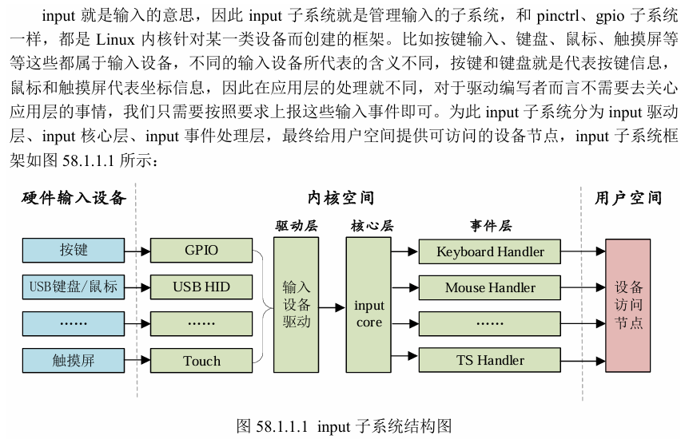

# input 子系统

## 一、先说结论

input 子系统是 Linux 内核中统一管理输入设备（按键、鼠标、触摸屏、游戏手柄等）的框架。它的设计目标只有一个：

> **驱动只管"发生了什么事"，不管"给谁、以什么格式"。**

所以驱动里只调 `input_report_key()` / `input_report_abs()` 上报事件，剩下的排队、分发、格式转换全由内核完成；用户层通过 `/dev/input/eventX` 读到统一的 `struct input_event`。

三层结构：**驱动层（写硬件）→ input core（分发）→ handler 层（evdev / keyboard / mouse，面向用户）**。

## 二、架构图



图里从左到右的每一栏，对应代码里的一层：

| 层 | 内核里的东西 | 干什么 |
|---|---|---|
| 硬件输入设备 | 按键、USB HID、触摸屏 | 产生电平/数据 |
| 驱动层 | `input_dev` + 你的驱动 | 把硬件动作翻译成"事件" |
| 核心层 | `input.c`（input core） | 维护设备链表、事件队列，按类型分发 |
| 事件层 | `evdev`、`keyboard`、`mouse`、`joydev` 等 handler | 把事件转成用户能用的接口 |
| 用户空间 | `/dev/input/eventX`、`/dev/input/mouse0` | `read()` 拿到 `input_event` |

**关键点：`/dev/input/eventX` 不是驱动建的，是 evdev handler 建的。** 一个 input 设备注册后，所有 handler 都会尝试绑定它，绑上就多一种访问方式（event 接口、mouse 接口、joydev 接口……）。

## 三、驱动要做的四件事

### 1. 申请并注册 input_dev

```c
struct input_dev *input;

input = devm_input_allocate_device(&pdev->dev);
if (!input)
    return -ENOMEM;

input->name = "my-key";
input->phys = "my-key/input0";
input->id.bustype = BUS_HOST;      /* 不填也行，但建议填 */
input->dev.parent = &pdev->dev;
```

### 2. 声明能力（这台设备能报什么）

```c
/* 按键：先声明"我这一类是按键"，再逐个声明具体键值 */
set_bit(EV_KEY, input->evbit);
set_bit(KEY_POWER, input->keybit);

/* 触摸屏：绝对坐标 */
set_bit(EV_ABS, input->evbit);
input_set_abs_params(input, ABS_X, 0, 1024, 0, 0);
input_set_abs_params(input, ABS_Y, 0, 600, 0, 0);
```

**能力位不声明，事件会被 core 直接丢掉**——这是"上报了但用户态收不到"的头号原因。

### 3. 注册

```c
ret = input_register_device(input);
```

这一步之后设备出现在 `/dev/input/eventX`，能力位也被写入 sysfs。

### 4. 中断里上报

```c
static irqreturn_t key_isr(int irq, void *dev_id)
{
    struct my_key *k = dev_id;
    int pressed = gpiod_get_value(k->desc);

    input_report_key(k->input, KEY_POWER, pressed);   /* 1=按下 0=抬起 */
    input_sync(k->input);                             /* ★ 一次"完整报文"的结束标志 */
    return IRQ_HANDLED;
}
```

## 四、report + sync：事件是"打包"发的

一次动作要发**两条**事件：`EV_KEY` + `EV_SYN`。

```text
input_report_key(dev, KEY_POWER, 1)
    ↓ 写入事件队列：[type=EV_KEY, code=KEY_POWER, value=1]
input_sync(dev)
    ↓ 写入事件队列：[type=EV_SYN, code=SYN_REPORT, value=0]
```

用户态一次 `read()` 通常读到**一组**事件（一次 sync 之间的所有事件算一个包）。触摸屏尤其明显：一次触摸要报 `ABS_X`、`ABS_Y`、`BTN_TOUCH`、`SYN_REPORT` 四条，缺了 sync 用户态就会"卡在半截状态"。

**所以规则很简单：一次硬件动作 = 若干 report + 一条 sync，sync 不能漏。**

## 五、用户态怎么读

```c
#include <linux/input.h>

struct input_event ev;
int fd = open("/dev/input/event2", O_RDONLY);

while (read(fd, &ev, sizeof(ev)) == sizeof(ev)) {
    if (ev.type == EV_KEY && ev.code == KEY_POWER)
        printf("power %s\n", ev.value ? "down" : "up");
    if (ev.type == EV_SYN)
        printf("--- 一个包结束 ---\n");
}
```

`struct input_event` 的四个字段：

```c
struct input_event {
    struct timeval time;   /* 时间戳（内核打的，不是你打的） */
    __u16 type;            /* EV_KEY / EV_ABS / EV_REL / EV_SYN */
    __u16 code;            /* KEY_POWER / ABS_X / ... */
    __s32 value;           /* 按键 1/0/2(重复)，坐标是坐标值 */
};
```

`value = 2` 是"长按重复"（autorepeat），很多程序只判 1/0，长按时会漏状态。

## 六、调试手段

```bash
cat /proc/bus/input/devices        # 列出所有 input 设备：Name、Handlers、EV/B/S/W 能力位
evtest /dev/input/event2           # 实时打印事件，最直观
ls /dev/input/                     # event0..N、mouse0、js0
```

`/proc/bus/input/devices` 的输出值得会读：

```text
I: Bus=0019 Vendor=0000 Product=0000 Version=0000
N: Name="my-key"
P: Phys=my-key/input0
S: Sysfs=/devices/platform/my-key/input/input2
U: Uniq=
H: Handlers=event2
B: PROP=0
B: EV=3
B: KEY=100000 0 0 0
```

- `Handlers=event2` → 就是 `/dev/input/event2`
- `EV=3` → 能力位（bit0=EV_SYN，bit1=EV_KEY）
- `KEY=...` → 按键位图，`KEY_POWER` 是 bit 116，对应第 4 个 64 位字的首位

## 七、常见坑

| 现象 | 原因 | 修法 |
|---|---|---|
| 有 `/dev/input/eventX` 但读不到事件 | 能力位没声明 | `set_bit(EV_KEY, ...)` + `set_bit(KEY_xxx, ...)` |
| 用户态状态"卡住" | 漏了 `input_sync()` | 每个动作后补 sync |
| 按键值不对 | `KEY_*` 编码和实际键不符 | 查 `include/uapi/linux/input-event-codes.h` |
| 重影/抖动 | 硬件抖动没消抖 | 驱动里加 10–20ms 定时器消抖，别在中断里 `msleep` |
| 触摸坐标反了 | 屏幕安装方向与坐标轴不一致 | 设备树 `touchscreen-swapped-x-y`，或驱动里换轴 |
| `input_register_device` 返回 `-ENOMEM` | `input_allocate_device` 没调 | 必须先 alloc |

## 八、一句话总结

**input 驱动只干三件事：声明能力位、上报事件、补一条 sync；排队、分发、建 `/dev/input/eventX` 全是 core 和 evdev handler 的活。**
