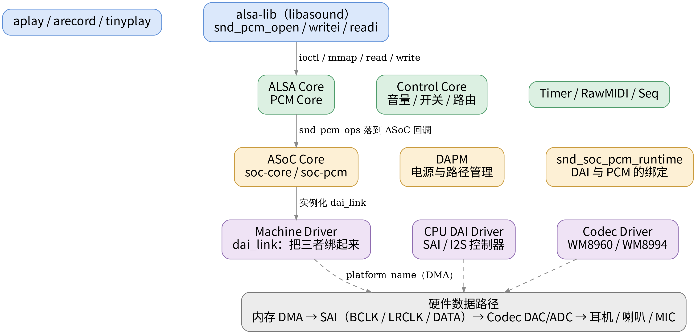

# Linux 音频栈

## 一、先说结论

Linux 音频是**两个框架叠在一起**：

| 框架 | 管什么 | 在哪个目录 |
|---|---|---|
| **ALSA Core** | 字符设备、环形缓冲区、控制项（音量/开关）、定时器 | `sound/core/` |
| **ASoC**（ALSA System on Chip） | SoC 三件套（Machine / CPU DAI / Codec）、DAPM 电源与路径管理 | `sound/soc/` |

- 在 PC 上你只见到 ALSA；在嵌入式里**ALSA Core + ASoC 同时存在**
- 用户态永远只见 ALSA：`/dev/snd/pcmC0D0p`。ASoC 是内核内部的一层"胶水"，对用户不可见
- 一句话分工：**ALSA Core 管"怎么把数据安全地送出去"，ASoC 管"这板子上谁接谁、什么时候上电"**

## 二、整体分层



从上往下读这张图：

```text
用户态      aplay / arecord / tinyplay
                ↓
            alsa-lib（libasound）：snd_pcm_open / writei / readi
                ↓
ALSA Core   PCM Core（字符设备 + 环形缓冲 + mmap）
            Control Core（音量、开关、路由）
            Timer / RawMIDI / Seq
                ↓
ASoC Core   soc-core / soc-pcm / DAPM / snd_soc_pcm_runtime
                ↓
三件套       Machine Driver（dai_link）
            CPU DAI Driver（SAI/I2S 控制器）
            Codec Driver（WM8960/WM8994）
                ↓
硬件        内存 DMA → SAI（BCLK/LRCLK/DATA）→ Codec DAC/ADC → 耳机/喇叭/MIC
```

## 三、每层职责

| 层 | 职责 | 不做什么 |
|---|---|---|
| 用户态工具 | 解析 WAV、把 PCM 数据喂给 libasound | 不碰寄存器 |
| alsa-lib | 封装 ioctl、参数协商、格式转换（plugin） | 不做路由决策 |
| ALSA Core | 建 `/dev/snd/*`、维护 runtime 与指针、提供 `snd_pcm_ops` 调用框架 | 不知道 Codec 是谁 |
| ASoC Core | 把 dai_link 实例化成 pcm_runtime、调 DAI/Codec 的 probe、跑 DAPM | 不直接读写 Codec 寄存器 |
| 三件套 | Machine 描述接线；CPU DAI 配 SAI；Codec 配芯片 | — |

## 四、核心文件

| 文件 | 作用 |
|------|------|
| `sound/core/sound.c` | `alsa_sound_init`，ALSA 核心初始化入口（注册 `/dev/snd` 字符设备区） |
| `sound/core/pcm_native.c` | PCM 字符设备操作：open / ioctl / mmap / read / write |
| `sound/core/pcm_lib.c` | `snd_pcm_lib_write/read`、指针推进、period 处理 |
| `sound/core/control.c` | control 设备（音量、开关、路由项） |
| `sound/soc/soc-core.c` | `snd_soc_register_card` / `snd_soc_instantiate_card`，DAI 与 component 注册 |
| `sound/soc/soc-pcm.c` | `soc_new_pcm()`，把 dai_link 变成 PCM 设备；trigger/hw_params 落到 DAI |
| `sound/soc/soc-dapm.c` | DAPM：widget 连接、上下电顺序 |
| `sound/soc/soc-component.c` | component 框架（4.19 起把 codec/platform 统一成 component） |

读源码的建议：**先 `soc_new_pcm()`，再 `snd_pcm_open()`，最后 `snd_pcm_lib_write()`**，这三处串起来就是整个数据通路。

## 五、一次播放的数据流

```text
aplay 读 WAV → snd_pcm_writei()
    ↓
alsa-lib → ioctl(SNDRV_PCM_IOCTL_WRITEI_FRAMES)
    ↓
snd_pcm_lib_write() → copy_from_user 拷进 runtime->dma_area（环形缓冲）
    ↓                      ↑
appl_ptr 前移            snd_pcm_trigger(START) → DMA 启动
    ↓
DMA 按 period 搬运：dma_area → SAI FIFO → I2S 线 → Codec DAC → 喇叭
    ↓
每搬完一个 period，DMA 中断 → snd_pcm_period_elapsed()
    ↓
hw_ptr 前移 → 若应用在等空间就唤醒它继续 writei
```

关键点：**应用写的是内存，DMA 读的也是同一块内存**。所谓"播放"就是把数据放进这块共享缓冲，然后让 DMA 自己去搬。

## 六、/dev/snd 与 /proc/asound：两个口，两种职责

| 路径 | 性质 | 用途 |
|---|---|---|
| `/dev/snd/*` | **功能接口** | 真正干活：打开 PCM、读写数据、调 control、mmap |
| `/proc/asound/*` | **状态接口** | 只读查看：有哪些卡、当前参数、运行状态 |

具体文件：

```text
/dev/snd/controlC0        控制接口（alsamixer 用的就是它）
/dev/snd/pcmC0D0p         card0 device0 playback
/dev/snd/pcmC0D0c         card0 device0 capture
/dev/snd/timer            定时器

/proc/asound/cards        所有声卡列表
/proc/asound/pcm          所有 PCM 设备列表
/proc/asound/card0/       某张卡的目录
```

**二者职责不同**：`/dev/snd` 是"能操作"的，`/proc/asound` 是"能看"的。排查时先看 `/proc`，确认对象存在再去 `/dev` 操作。

## 七、一句话总结

**用户态只跟 ALSA Core 打交道（`/dev/snd` 功能口 + `/proc/asound` 状态口），ASoC 是内核里替 SoC 把 Machine、CPU DAI、Codec 三件套粘起来的那层胶水。**
