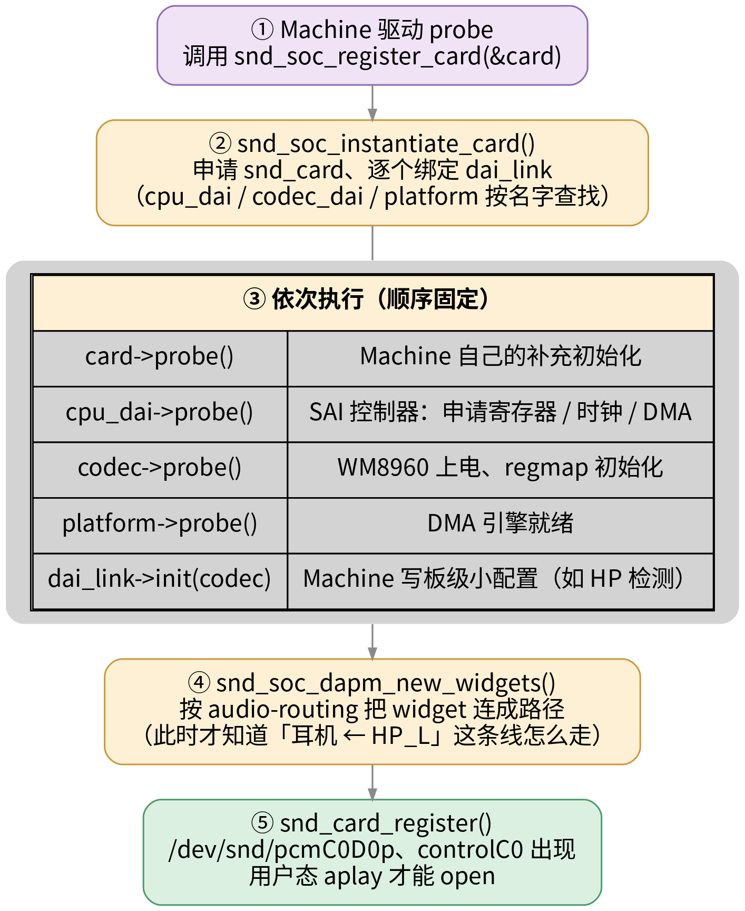

# Linux 声卡与 ALSA

## 一、先说结论

一张声卡（card）里装着若干个**设备（device）**，每个 device 是一路数据流或一组控制项：

| 概念 | 是什么 | 对应路径 | 负责 |
|---|---|---|---|
| **card** | 一张声卡 | `/proc/asound/card0` | 组织资源（PCM、control、timer） |
| **pcm** | 一路音频流 | `/dev/snd/pcmC0D0p` | 音频数据的搬运 |
| **control** | 一组控制项 | `/dev/snd/controlC0` | 音量、开关、路由选择 |
| **device / subdevice** | 编号 | `C0D0` / `sub0` | 定位到具体那一路、那一组 |

一句话：**card 是容器，pcm 是水龙头，control 是阀门面板，device/subdevice 是门牌号。**

## 二、四个概念的关系

```text
card0（一块板子的音频系统）
 ├── device 0 → pcm0p（播放）
 │                └── sub0（子流，通常只用 sub0）
 ├── device 0 → pcm0c（录音）
 ├── device 1 → pcm1p（第二路播放，比如 HDMI）
 └── control0（所有音量/开关/路由）
```

- 一个 card 可以有**多个 PCM device**（播放、录音、HDMI 各一个）
- 每个 PCM 可以有多个 **substream**，但绝大多数驱动只用一个（`sub0`）
- **control 是整卡共享的**，不按 device 分

## 三、编号怎么读

```text
/dev/snd/pcmC0D0p
         │ │ │ └── p = playback，c = capture
         │ │ └──── D0 = device 0
         │ └─────── C0 = card 0
         └───────── pcm
```

在命令行里对应：

| 写法 | 含义 | 特点 |
|---|---|---|
| `hw:0,0` | card0 device0，直通硬件 | **参数必须完全匹配**，否则 `open` 失败 |
| `plughw:0,0` | 同上，但经过插件层 | 自动转换格式/采样率/声道，省事 |
| `default` | 系统默认设备 | 由 `~/.asoundrc` 或 `/etc/asound.conf` 决定 |

> 调试顺序建议：**先用 `plughw` 确认通路有声，再用 `hw` 测硬件真实支持范围**。一直用 `plughw` 会掩盖"采样率不支持"这类问题。

## 四、声卡是怎么出现的



五步走完，用户态才能 `open`：

1. Machine 驱动 `probe` → `snd_soc_register_card(&card)`
2. `snd_soc_instantiate_card()` → 申请 `snd_card`、按名字绑定每个 `dai_link`
3. 依次执行 `card->probe` / `cpu_dai->probe` / `codec->probe` / `platform->probe` / `dai_link->init`
4. `snd_soc_dapm_new_widgets()` → 按 `audio-routing` 把路径连起来
5. `snd_card_register()` → `/dev/snd/pcmC0D0p`、`controlC0` 出现

**注意第 3 步的顺序是固定的**：Codec 的 probe 一定在 Machine 的 `dai_link->init` 之前，因为 `init` 里常常要调 Codec 的 control/寄存器。

## 五、/proc/asound 能看什么

```bash
cat /proc/asound/cards        # 有几张卡、每张卡的 driver 名
cat /proc/asound/devices      # 所有 pcm/control/timer 的编号
cat /proc/asound/pcm          # 每路 pcm 的名字与类型
ls  /proc/asound/card0/       # 该卡的 pcm0p、pcm0c、codec 目录
cat /proc/asound/card0/pcm0p/sub0/hw_params   # 当前硬件参数（没开时是 closed）
cat /proc/asound/card0/pcm0p/sub0/status      # RUNNING / SETUP / XRUN
```

`status` 这一项在排查"播放没声音"时特别有用：

- `closed`：没人打开
- `SETUP`：打开了但没启动
- `RUNNING`：DMA 在跑
- `XRUN`：缓冲区溢出/欠载

**如果 `status` 是 RUNNING 但没声音，问题就不在软件通路，而在时钟、pinmux 或 Codec 上电**——这是分界点。

## 六、常见问题

### Q：`/proc/asound/cards` 有卡，但 `aplay -l` 没有设备？

说明 card 注册了，但 PCM 没建起来。原因通常是：

- `dai_link` 里的 `cpu_dai_name` / `codec_dai_name` / `platform_name` 有一个没对上 → `snd_soc_instantiate_card` 中途失败
- 该 dai_link 被配成了 `SND_SOC_DAILINK_DEFS` 但没加进 `num_links`

看 `dmesg | grep -i asoc`，会直接打印哪条链路失败。

### Q：有多个 card，怎么知道哪个是我板子上的？

```bash
cat /proc/asound/cards
# 0 [WM8960          ]: wm8960-audio - wm8960-audio
# 1 [HDMI            ]: ...
```

方括号里是 card id，后面是 `model` 属性（设备树里 `model = "wm8960-audio"` 就是它）。

### Q：`hw:0,0` 打不开，`plughw:0,0` 可以？

典型的"参数不支持"。用 `--dump-hw-params` 看硬件真实范围，再用 `hw` 指定一个合法组合：

```bash
aplay --dump-hw-params -D hw:0,0 test.wav
```

## 七、一句话总结

**card 装 device，device 里是 pcm（数据）和 control（控制），编号 C0D0 就是门牌；声卡从 Machine probe 到 `snd_card_register` 五步走完，用户态才看得见 `/dev/snd/pcmC0D0p`。**
