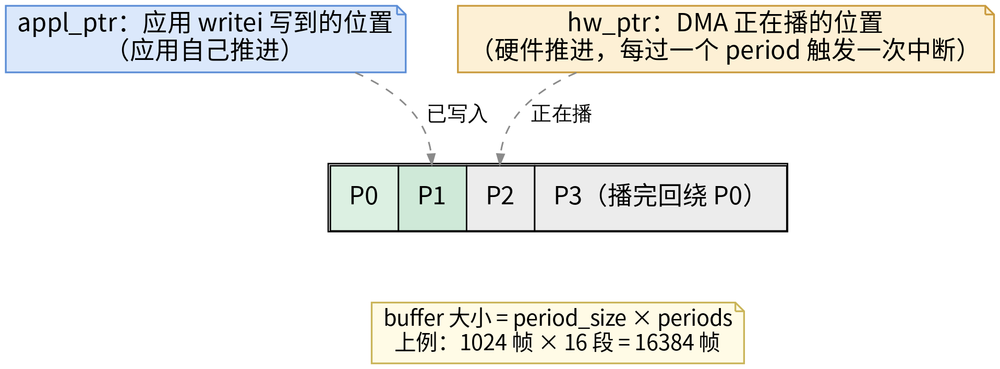
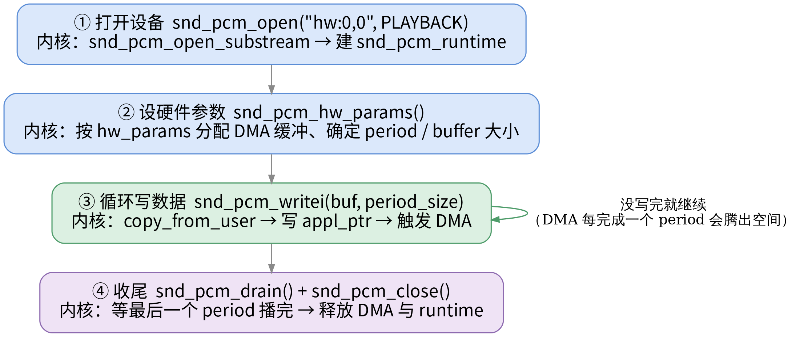

# 音频数据结构层次

> 参考：[博客园 - 音频数据结构](https://www.cnblogs.com/blfbuaa/p/19177289)

## 一、先说结论

"音频数据结构层次"其实有两套，别混：

| 层次 | 是什么 | 典型结构体 |
|---|---|---|
| **内核对象层次** | 一张卡 → 一路 PCM → 一条子流 → 一次运行 | `snd_card` → `snd_pcm` → `snd_pcm_substream` → `snd_pcm_runtime` |
| **参数层次** | 硬件固定参数 / 软件可调参数 / 运行时状态 | `hw_params` / `sw_params` / `status` |

而所有"缓冲""周期""帧"的说法，最后都落在 `snd_pcm_runtime` 里的**一块 DMA 内存 + 两个指针**上。

一句话记：**card 装 pcm，pcm 装 substream，substream 装 runtime，runtime 里是 buffer + hw_ptr/appl_ptr。**

## 二、内核对象层次（ALSA 侧）

```text
snd_card（一张声卡）
  └── snd_pcm（一路设备：pcm0p / pcm0c）
        ├── snd_pcm_str streams[2]   ← playback / capture
        └── snd_pcm_substream（子流，通常只用 sub0）
              ├── ops        ← snd_pcm_ops：open/close/hw_params/trigger/pointer
              └── runtime    ← 一次打开的运行上下文
                    ├── hw_params    ← 硬件参数（不可运行中改）
                    ├── sw_params    ← 软件参数（可运行中改）
                    ├── dma_area     ← 环形缓冲首地址（DMA 直接读这里）
                    ├── dma_bytes    ← 缓冲总字节数
                    ├── status.hw_ptr   ← DMA 播放位置（硬件推进）
                    ├── status.appl_ptr ← 应用写入位置（软件推进）
                    └── private_data    ← 驱动私有（如 SAI 的 DMA 描述符）
```

| 结构体 | 归属 | 作用 |
|---|---|---|
| `snd_card` | 整卡 | 组织资源、生成 `/proc/asound/card0` |
| `snd_pcm` | 一路设备 | 持有 playback/capture 两条 stream |
| `snd_pcm_substream` | 一条子流 | 承载 ops，一个打开实例对应一个 substream |
| `snd_pcm_runtime` | **一次打开** | 参数、缓冲、指针、状态全在这里 |
| `snd_pcm_hw_params` | runtime 内 | 采样率、格式、声道、period、buffer |
| `snd_pcm_sw_params` | runtime 内 | `avail_min`、`start_threshold`、`stop_threshold` |
| `snd_dma_buffer` | runtime 内 | `area` / `addr` / `bytes`，DMA 描述 |

## 三、内核对象层次（ASoC 侧）

```text
snd_soc_card（Machine 注册的那张卡）
  └── snd_soc_dai_link[]（每条链路：CPU DAI + Codec DAI + Platform）
        └── snd_soc_pcm_runtime（实例化后：一条链路 = 一个 pcm_runtime）
              ├── cpu_dai      ← snd_soc_dai（SAI 控制器）
              ├── codec_dai    ← snd_soc_dai（WM8960 的 aif1）
              ├── platform     ← DMA 引擎
              └── pcm          ← 就是上面那个 snd_pcm
```

| 结构体 | 作用 |
|---|---|
| `snd_soc_card` | Machine 驱动注册的卡，持有 `dai_link[]` |
| `snd_soc_dai_link` | "哪条 CPU DAI 接哪条 Codec DAI、用哪个 DMA" |
| `snd_soc_pcm_runtime` | 链路实例化后的运行时，把三件套绑在一起 |
| `snd_soc_dai` | 一条数字音频接口（有 `ops`、`playback`/`capture` 能力） |
| `snd_soc_component` | 可复用部件（Codec/Platform 统一抽象） |
| `snd_soc_dapm_widget` | DAPM 图上的一个节点（mux、mixer、PGA、HP、SPK…） |

**两套结构是一一对应的**：`snd_soc_pcm_runtime.pcm` 就是 ALSA 侧的 `snd_pcm`——ASoC 只是给它套了一层"我知道这条 PCM 由谁负责"。

## 四、frame / period / buffer



三个概念的关系：

| 概念 | 定义 | 例子（48kHz、S16_LE、2 声道） |
|---|---|---|
| **frame（帧）** | 一个采样时刻的所有声道数据 | 2 声道 × 2 字节 = 4 字节 |
| **period（周期）** | 一次 DMA 搬运的数据量，也是**一次中断的粒度** | 1024 帧 = 4 KB ≈ 21.3 ms |
| **buffer** | 整个环形缓冲 = period × periods | 1024 × 16 = 16384 帧 = 64 KB |

计算一定要会，否则看到 `-EINVAL` 不知道错在哪：

```text
period_bytes = period_size(frames) × frame_bytes
buffer_bytes = buffer_size(frames) × frame_bytes
buffer_size(frames) = period_size(frames) × periods
period_time  = period_size / rate
```

上例：`period_time = 1024 / 48000 ≈ 21.3 ms`，`buffer_time = 16384 / 48000 ≈ 341 ms`。

两个指针：

- **appl_ptr**：应用 `writei` 写到哪里，由应用推进
- **hw_ptr**：DMA 播到哪里，由硬件推进，每过一个 period 触发一次中断

**播放时 appl_ptr 不能超过 hw_ptr 一圈**（写满了就没空间）；**录音时反过来**（读空了就没数据）。越过边界就是 xrun。

## 五、参数三层：hw / sw / status

| 层 | 什么时候设 | 能不能运行中改 | 典型内容 |
|---|---|---|---|
| `hw_params` | `open` 之后、`prepare` 之前，**一次定死** | 不能（要改必须 close 重开） | rate、format、channels、period_size、periods |
| `sw_params` | `hw_params` 之后，可在运行中改 | 能 | `avail_min`、`start_threshold`、`stop_threshold`、时间戳模式 |
| `status` | 运行时只读 | — | `state`、`hw_ptr`、`appl_ptr`、`avail` |

为什么分两层：**硬件能力是死的（DMA 一旦启动物理地址和长度就固定），软件策略是活的（什么时候启动、留多少余量随时可调）**。

`sw_params` 里三个阈值最常见：

```c
snd_pcm_sw_params_set_start_threshold(pcm, sw, buffer_size);  /* 攒够一整缓冲再启动 */
snd_pcm_sw_params_set_avail_min(pcm, sw, period_size);        /* 有一个 period 空间就唤醒 */
snd_pcm_sw_params_set_stop_threshold(pcm, sw, buffer_size);   /* 溢出时停 */
```

## 六、放音四步



1. **open**：`snd_pcm_open("hw:0,0", PLAYBACK)` → 内核建 `snd_pcm_runtime`，此时还没有缓冲
2. **hw_params**：定参数 → 内核按 period/buffer 分配 DMA 内存（`snd_pcm_lib_malloc_pages`）
3. **writei**：把数据拷进 `dma_area`，appl_ptr 前移；触发 `START` 后 DMA 开始搬
4. **drain + close**：等最后一个 period 播完，释放 DMA 与 runtime

## 七、设置硬件参数的代码

```c
snd_pcm_hw_params_t *hwparams;
snd_pcm_t *pcm;

/* 分配参数对象 */
snd_pcm_hw_params_malloc(&hwparams);

/* 初始化参数对象（获取当前硬件配置） */
snd_pcm_hw_params_any(pcm, hwparams);

/* 设置访问类型：交错模式 */
snd_pcm_hw_params_set_access(pcm, hwparams, SND_PCM_ACCESS_RW_INTERLEAVED);

/* 设置数据格式：有符号 16 位小端 */
snd_pcm_hw_params_set_format(pcm, hwparams, SND_PCM_FORMAT_S16_LE);

/* 设置采样率：44100 Hz */
unsigned int rate = 44100;
snd_pcm_hw_params_set_rate(pcm, hwparams, rate, 0);

/* 设置声道数：2（立体声） */
snd_pcm_hw_params_set_channels(pcm, hwparams, 2);

/* 设置周期大小：1024 帧 */
snd_pcm_uframes_t period_size = 1024;
snd_pcm_hw_params_set_period_size(pcm, hwparams, period_size, 0);

/* 设置周期数：16 */
unsigned int periods = 16;
snd_pcm_hw_params_set_periods(pcm, hwparams, periods, 0);

/* 使配置生效 */
snd_pcm_hw_params(pcm, hwparams);

/* 释放参数对象 */
snd_pcm_hw_params_free(hwparams);
```

`set_rate` / `set_period_size` 的最后一个参数是"方向"（0 = 就近取，-1 = 只能更小，1 = 只能更大）。**传 0 时硬件可能给你一个近似值，所以要回读确认**：

```c
snd_pcm_hw_params_get_rate(hwparams, &rate, 0);
```

## 八、完整放音示例

```c
/***********************************************************
 * PCM 播放最简示例
 ***********************************************************/
#include <stdio.h>
#include <stdlib.h>
#include <alsa/asoundlib.h>

int main(void)
{
    snd_pcm_t *pcm;
    snd_pcm_hw_params_t *hwparams;
    unsigned char buffer[8192];
    snd_pcm_uframes_t period_size = 1024;
    int ret;

    /* 1. 打开 PCM 设备 */
    ret = snd_pcm_open(&pcm, "default", SND_PCM_STREAM_PLAYBACK, 0);
    if (ret < 0) {
        fprintf(stderr, "打开设备失败: %s\n", snd_strerror(ret));
        return -1;
    }

    /* 2. 设置硬件参数 */
    snd_pcm_hw_params_malloc(&hwparams);
    snd_pcm_hw_params_any(pcm, hwparams);
    snd_pcm_hw_params_set_access(pcm, hwparams, SND_PCM_ACCESS_RW_INTERLEAVED);
    snd_pcm_hw_params_set_format(pcm, hwparams, SND_PCM_FORMAT_S16_LE);
    snd_pcm_hw_params_set_rate(pcm, hwparams, 44100, 0);
    snd_pcm_hw_params_set_channels(pcm, hwparams, 2);
    snd_pcm_hw_params_set_period_size(pcm, hwparams, period_size, 0);
    snd_pcm_hw_params_set_periods(pcm, hwparams, 16, 0);

    ret = snd_pcm_hw_params(pcm, hwparams);
    if (ret < 0) {
        fprintf(stderr, "设置参数失败: %s\n", snd_strerror(ret));
        snd_pcm_hw_params_free(hwparams);
        snd_pcm_close(pcm);
        return -1;
    }
    snd_pcm_hw_params_free(hwparams);

    /* 3. 循环写入数据 */
    while (1) {
        /* 从文件或其他来源读取音频数据到 buffer */
        /* read_audio_data(buffer, period_size * 4); */
        ret = snd_pcm_writei(pcm, buffer, period_size);
        if (ret < 0) {
            fprintf(stderr, "写入失败: %s\n", snd_strerror(ret));
            break;
        }
    }

    /* 4. 关闭设备 */
    snd_pcm_drain(pcm);
    snd_pcm_close(pcm);
    return 0;
}
```

## 九、异步播放示例

同步 `writei` 会阻塞等空间；用 `SIGIO` 可以让内核"有空间了再叫你"。**注意：异步不是"不用设参数"，open 与 hw_params 照样要做。**

```c
/***********************************************************
 * PCM 异步播放示例
 ***********************************************************/
#include <stdio.h>
#include <stdlib.h>
#include <fcntl.h>
#include <unistd.h>
#include <signal.h>
#include <alsa/asoundlib.h>

static snd_pcm_t *pcm;
static unsigned char *buffer;
static snd_pcm_uframes_t period_size = 1024;
static int fd;

/* 异步回调：内核通知"有一个 period 的空间了" */
void playback_callback(snd_async_handler_t *handler)
{
    snd_pcm_t *handle = snd_async_handler_get_pcm(handler);
    snd_pcm_sframes_t avail;
    int ret;

    avail = snd_pcm_avail_update(handle);
    while (avail >= (snd_pcm_sframes_t)period_size) {
        ret = read(fd, buffer, period_size * 4);   /* 16bit × 2ch = 4 字节/帧 */
        if (ret <= 0)
            return;
        snd_pcm_writei(handle, buffer, period_size);
        avail = snd_pcm_avail_update(handle);
    }
}

int main(int argc, char *argv[])
{
    snd_pcm_hw_params_t *hwparams;
    snd_async_handler_t *async_handler;
    sigset_t sset;
    int ret;

    if (argc != 2) {
        printf("用法: %s <pcm文件>\n", argv[0]);
        return -1;
    }

    /* 屏蔽 SIGIO，等一切都准备好再打开 */
    sigemptyset(&sset);
    sigaddset(&sset, SIGIO);
    sigprocmask(SIG_BLOCK, &sset, NULL);

    fd = open(argv[1], O_RDONLY);
    if (fd < 0) {
        perror("打开文件失败");
        return -1;
    }

    /* 打开 PCM 并设置参数（与"完整放音示例"第 1、2 步完全相同） */
    ret = snd_pcm_open(&pcm, "default", SND_PCM_STREAM_PLAYBACK, 0);
    if (ret < 0)
        return -1;

    snd_pcm_hw_params_malloc(&hwparams);
    snd_pcm_hw_params_any(pcm, hwparams);
    snd_pcm_hw_params_set_access(pcm, hwparams, SND_PCM_ACCESS_RW_INTERLEAVED);
    snd_pcm_hw_params_set_format(pcm, hwparams, SND_PCM_FORMAT_S16_LE);
    snd_pcm_hw_params_set_rate(pcm, hwparams, 44100, 0);
    snd_pcm_hw_params_set_channels(pcm, hwparams, 2);
    snd_pcm_hw_params_set_period_size(pcm, hwparams, period_size, 0);
    snd_pcm_hw_params_set_periods(pcm, hwparams, 16, 0);
    snd_pcm_hw_params(pcm, hwparams);
    snd_pcm_hw_params_free(hwparams);

    buffer = malloc(period_size * 4);

    /* 注册异步回调 */
    snd_async_add_pcm_handler(&async_handler, pcm, playback_callback, NULL);

    /* 初始填充：把缓冲先喂满，避免一开始就欠载 */
    snd_pcm_sframes_t avail = snd_pcm_avail_update(pcm);
    while (avail >= (snd_pcm_sframes_t)period_size) {
        if (read(fd, buffer, period_size * 4) <= 0)
            break;
        snd_pcm_writei(pcm, buffer, period_size);
        avail = snd_pcm_avail_update(pcm);
    }

    /* 取消 SIGIO 屏蔽，开始异步播放 */
    sigprocmask(SIG_UNBLOCK, &sset, NULL);
    printf("异步播放中...按回车键退出\n");
    getchar();

    /* 清理 */
    sigprocmask(SIG_BLOCK, &sset, NULL);
    snd_pcm_drain(pcm);
    snd_pcm_close(pcm);
    free(buffer);
    close(fd);
    return 0;
}
```

## 十、完整录音示例

```c
/***********************************************************
 * PCM 录音最简示例
 ***********************************************************/
#include <stdio.h>
#include <stdlib.h>
#include <fcntl.h>
#include <unistd.h>
#include <alsa/asoundlib.h>

int main(int argc, char *argv[])
{
    snd_pcm_t *pcm;
    snd_pcm_hw_params_t *hwparams;
    unsigned char buffer[8192];
    snd_pcm_uframes_t period_size = 1024;
    int fd, ret;

    if (argc != 2) {
        printf("用法: %s <输出文件>\n", argv[0]);
        return -1;
    }

    /* 打开输出文件 */
    fd = open(argv[1], O_WRONLY | O_CREAT | O_TRUNC, 0644);
    if (fd < 0) {
        perror("打开文件失败");
        return -1;
    }

    /* 1. 打开 PCM 设备（录音） */
    ret = snd_pcm_open(&pcm, "hw:0,0", SND_PCM_STREAM_CAPTURE, 0);
    if (ret < 0) {
        fprintf(stderr, "打开设备失败: %s\n", snd_strerror(ret));
        close(fd);
        return -1;
    }

    /* 2. 设置硬件参数 */
    snd_pcm_hw_params_malloc(&hwparams);
    snd_pcm_hw_params_any(pcm, hwparams);
    snd_pcm_hw_params_set_access(pcm, hwparams, SND_PCM_ACCESS_RW_INTERLEAVED);
    snd_pcm_hw_params_set_format(pcm, hwparams, SND_PCM_FORMAT_S16_LE);
    snd_pcm_hw_params_set_rate(pcm, hwparams, 44100, 0);
    snd_pcm_hw_params_set_channels(pcm, hwparams, 2);
    snd_pcm_hw_params_set_period_size(pcm, hwparams, period_size, 0);
    snd_pcm_hw_params_set_periods(pcm, hwparams, 16, 0);
    snd_pcm_hw_params(pcm, hwparams);
    snd_pcm_hw_params_free(hwparams);

    printf("开始录音...（按 Ctrl+C 停止）\n");

    /* 3. 循环读取数据 */
    while (1) {
        ret = snd_pcm_readi(pcm, buffer, period_size);
        if (ret < 0) {
            fprintf(stderr, "读取失败: %s\n", snd_strerror(ret));
            break;
        }
        /* 写入文件：16 位双声道 = 4 字节/帧，ret 返回的是帧数 */
        write(fd, buffer, ret * 4);
    }

    /* 4. 关闭 */
    snd_pcm_close(pcm);
    close(fd);
    printf("录音完成！\n");
    return 0;
}
```

## 十一、xrun：最常见的一类错误

| 返回值 | 名字 | 场景 | 原因 |
|---|---|---|---|
| `-EPIPE` | **underrun**（放音）/ overrun（录音） | 应用喂数据太慢 | appl_ptr 被 hw_ptr 追上 |
| `-ESTRPIPE` | suspend | 系统挂起后恢复 | 设备被 suspend |
| `-EAGAIN` | 非阻塞模式下暂时没空间 | `O_NONBLOCK` | 正常，等下一次 |

标准恢复姿势：

```c
if (ret == -EPIPE) {
    snd_pcm_prepare(pcm);          /* 播放欠载：重新 prepare 即可继续 */
} else if (ret == -ESTRPIPE) {
    while (snd_pcm_resume(pcm) == -EAGAIN)
        sleep(1);                   /* 等驱动恢复 */
    snd_pcm_prepare(pcm);
}
```

`prepare` 之后 **`hw_params` 不用重设**（参数还在），但缓冲里的数据会丢，要重新 `writei`。

## 十二、一句话总结

**card→pcm→substream→runtime，参数分 hw（定死）和 sw（可调）；所有声音最终落在一块 DMA 环形内存上，appl_ptr 追 hw_ptr 就是欠载，反之就是溢出。**
