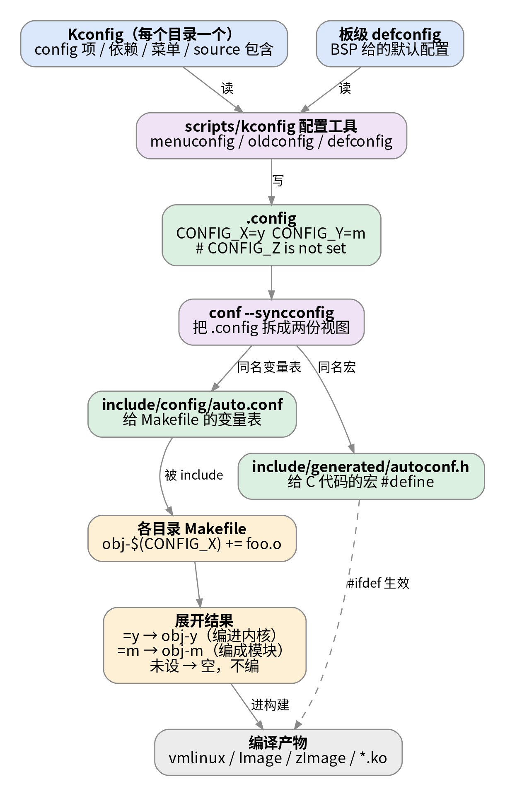

# Kconfig 讲解

## 一、先说结论

**Kconfig 负责"问"，Makefile 负责"编"，`.config` 是两者之间唯一的交接物。**

```text
Kconfig（定义有哪些选项、依赖谁） → menuconfig 问你 → .config（你的答案）
                                                      ↓ 拆成两份
                          auto.conf（给 Makefile 用）    autoconf.h（给 C 代码用）
```

所以驱动添加流程永远是四步：

```text
Kconfig → .config → Makefile → 编译产物
```



图里最关键的一句话：**`.config` 里的 `CONFIG_xxx` 会被"复制"两遍**——一份变成 Makefile 的变量（决定编不编），一份变成 C 的宏（决定代码里 `#ifdef` 走哪条分支）。两边不一致时，就会出现"文件编进去了但代码没生效"这种怪事。

## 二、`.config` 的三种值

```text
CONFIG_SND_SOC=y        # 编进内核（vmlinux 里）
CONFIG_SND_SOC=m        # 编成模块（.ko，可 insmod）
# CONFIG_SND_SOC is not set   # 不编（注意它是注释形式，不是 =n）
```

`=n` 不会出现在 `.config` 里，一律写成 `# ... is not set`。所以你 `grep CONFIG_X` 查不到，不代表它没被定义，只代表它没开。

## 三、Kconfig 语法

### 1. config —— 定义一个配置项

```kconfig
config SND_SOC_MY_DUMMY_CODEC
```

只写这一行等于"定义了一个名字"，没有类型、没有提示，menuconfig 里看不到。它必须配一个类型：

```kconfig
config SND_SOC_MY_DUMMY_CODEC
    tristate "My dummy codec"     # 类型 = tristate，提示语 = 引号里那句
```

`CONFIG_` 前缀是自动加的，代码里写 `config SND_SOC_...`，`.config` 里就是 `CONFIG_SND_SOC_...`。

### 2. tristate —— 三态（驱动最常用）

```kconfig
config SND_SOC_MY_DUMMY_CODEC
    tristate "My dummy codec"
```

在 menuconfig 里是：

| 显示 | `.config` 值 | 结果 |
|---|---|---|
| `<M> My dummy codec` | `=m` | 编成 `.ko` |
| `[*] My dummy codec` | `=y` | 编进内核 |
| `< > My dummy codec` | 未设 | 不编 |

### 3. bool —— 二态

```kconfig
config SND_SOC_TOPOLOGY
    bool "Support topology"
```

只有 y / 未设两种，适合"要么有要么没有"的开关（框架级、架构级）。

### 4. 其它类型

```kconfig
config SND_SOC_DUMMY_MAX_CARDS
    int "Max dummy cards"
    range 1 8
    default 4          # → CONFIG_...=4

config SND_SOC_DUMMY_NAME
    string "Card name prefix"
    default "dummy"    # → CONFIG_...="dummy"

config SND_SOC_DUMMY_BASE
    hex "Register base"
    default 0x1000     # → CONFIG_...=0x1000
```

写法是 **先 `config 名字`，再一行类型 + 提示语**。原文把 `integer` 写在 `config` 前面的写法是错的，Kconfig 里没有 `integer` 这个关键字，只有 `int`。

### 5. depends on —— 依赖（最重要）

```kconfig
config SND_SOC_MY_CODEC
    tristate "My codec"
    depends on SND_SOC
```

意思：`CONFIG_SND_SOC` 没开，这个选项**在 menuconfig 里根本看不到**（不是灰掉，是不出现）。

```kconfig
depends on I2C && SND_SOC    # 两个都要
depends on I2C || SPI        # 二选一
depends on !SND_SOC_SIMPLE   # 取反
```

依赖不满足时看不见，这是新手最常见的困惑："我明明写了 config，为什么 menuconfig 里搜不到？"——先查 `depends on`。

### 6. select —— 反向依赖（慎用）

```kconfig
config SND_SOC_AC97_CODEC
    tristate "AC97 codec"
    select SND_AC97_BUS
```

方向是反的：`depends on` 是"我要你"，`select` 是"我要你开"——**打开 A 强行把 B 打开**。

> ⚠️ `select` 的坑：它**不检查 B 自己的依赖**。如果 B 依赖 C 而 C 没开，B 会被强行选上但编不过。所以社区规范是：**能用 `depends on` 就别用 `select`**；`select` 只用于"我这段代码编不过就一定是缺这个符号"的情况（如 `select CRYPTO`）。

### 7. default —— 默认值

```kconfig
config TEST_FEATURE
    bool
    default y
```

带条件的默认：

```kconfig
config SND_SOC_I2C_AND_SPI
    tristate
    default m if I2C=m
    default y if I2C=y
```

读法：**`default 值 if 条件`**——条件成立才用这个默认值。多处 `default` 从上往下取第一个成立的。

### 8. help —— 帮助文本

```kconfig
config SND_SOC_MY_DUMMY_CODEC
    tristate "My dummy codec"
    depends on SND_SOC
    help
      Minimal dummy codec driver.
      Used for bring-up testing only.
```

规则：`help` 单独一行，**正文必须比 `help` 多缩进**（通常两个空格）。在 menuconfig 里按 `?` 显示。

> 注意 help 正文里**不要写以 Tab 开头的行**，Kconfig 解析器对 Tab 的处理在不同版本上不一致，统一用空格。

### 9. menu / menuconfig —— 菜单

```kconfig
menu "CODEC drivers"

config SND_SOC_WM8960
    tristate "WM8960 codec"

endmenu
```

`menuconfig` 是"既是开关又是菜单入口"：

```kconfig
menuconfig SOUND
    bool "Sound card support"
    depends on HAS_IOMEM

if SOUND
    source "sound/Kconfig"
endif
```

内核里的 `Device Drivers → Sound card support` 就是它。**注意 `if SOUND` 包住 `source`**，这样关掉 SOUND 后整棵音频子树都不出现。

### 10. choice / endchoice —— 单选

```kconfig
choice
    prompt "Default codec sample rate"
    default 48000

config SAMPLE_RATE_44100
    bool "44100"

config SAMPLE_RATE_48000
    bool "48000"

endchoice
```

适合"只能选一个"的场景（启动介质、默认速率）。

### 11. if / endif —— 条件区

```kconfig
if SND_SOC

config SND_SOC_MY_CODEC
    tristate "My codec"

endif
```

等价于给区内每个 `config` 都加一句 `depends on SND_SOC`。

### 12. source —— 包含子 Kconfig

```kconfig
source "sound/Kconfig"
```

`source` 是**文本级别展开**：顶层 Kconfig source 进来，子目录 Kconfig 再 source 孙目录，最终长成整棵菜单树。所以"搜不到某个选项"时，顺着 source 链确认那个 Kconfig 到底有没有被包含进来。

## 四、一个 Codec 驱动的标准 Kconfig

```kconfig
# sound/soc/codecs/Kconfig

config SND_SOC_MY_DUMMY_CODEC
    tristate "My dummy codec"
    depends on I2C && SND_SOC
    help
      Minimal dummy codec driver for bring-up.

# sound/soc/codecs/Makefile
obj-$(CONFIG_SND_SOC_MY_DUMMY_CODEC) += my_dummy_codec.o
```

对应关系：

| 位置 | 写什么 | 谁读 |
|---|---|---|
| `Kconfig` | `config` + `tristate` + `depends on` | kconfig 工具 |
| `Makefile` | `obj-$(CONFIG_...) += xxx.o` | Makefile |
| 源码 | `#ifdef CONFIG_...` 或 `IS_ENABLED()` | 编译器 |

## 五、常用操作命令

```bash
make menuconfig                  # 图形菜单（文本界面）
make oldconfig                   # 保留旧 .config，只问新增项
make olddefconfig                # 保留旧值，新项一律取默认，不问
make savedefconfig               # 把当前 .config 精简成 defconfig（只留非默认项）
make xxx_defconfig               # 用板级默认配置覆盖 .config
```

**改完 menuconfig 想提交给团队时，提交 `savedefconfig` 生成的精简版**，不要提交 `.config`（里面全是全量项，几千行，没法 review）。

## 六、`obj-y` 是怎么变成编译动作的

```makefile
obj-$(CONFIG_SND_SOC_MY_DUMMY_CODEC) += my_dummy_codec.o
```

展开规则：

| `.config` | 展开后 | 结果 |
|---|---|---|
| `=y` | `obj-y += my_dummy_codec.o` | 编入内置列表，最终链进 `vmlinux` |
| `=m` | `obj-m += my_dummy_codec.o` | 编成 `my_dummy_codec.ko` |
| 未设 | `obj- += my_dummy_codec.o`（空变量） | 整行作废，不编 |

`obj-y` 的每一个 `.o` 由 `scripts/Makefile.build` 收集，最后在顶层 Makefile 里 `$(LD) -r` 合并成 `built-in.o`，逐级向上合并。

## 七、一句话总结

**Kconfig 只决定"选项存在与否和依赖"、`.config` 存答案、`auto.conf` 与 `autoconf.h` 把答案分给 Makefile 和编译器；搜不到选项查 `depends on`，编了却没生效查两个视图是不是被旧 `.config` 覆盖了。**
