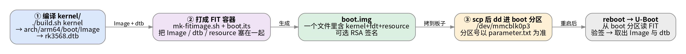

# RK3568 编译 Linux 内核 / 驱动模块 / 应用

## 一、先说结论

RK3568 的 SDK 是一整套（u-boot + kernel + buildroot），**编译入口不是直接 `make`，而是顶层 `build.sh`**：

```text
./build.sh kernel        → 编内核，出 kernel/Image + dtb
mk-fitimage.sh           → 把 Image+dtb+resource 打成一个 boot.img
scp + dd 到 boot 分区     → 重启，U-Boot 读 FIT
```



记住三个"和 i.MX6ULL 不一样"的地方：

| 差异点 | i.MX6ULL | RK3568 |
|---|---|---|
| 编译入口 | 内核目录 `make zImage` | 顶层 `./build.sh kernel` |
| 镜像形态 | `zImage` + `dtb` 两个文件 | 一个 `boot.img`（FIT 容器，内含 kernel/dtb/resource） |
| 烧写方式 | 覆盖 boot 分区里的文件 | `dd` 整个 `boot.img` 到 boot 分区 |

## 二、编译内核

```bash
# 在 SDK 顶层目录
./build.sh kernel
```

`build.sh` 会读板级配置（如 `BoardConfig-rk3568-atk-evb1-ddr4-v10.mk`），里面定义 `KERNEL_DEFCONFIG`、`KERNEL_DTS`、`ARCH`、`CROSS_COMPILE` 等，然后调用内核目录的 `make.sh`。

想手动走一遍等价流程：

```bash
cd kernel
./make.sh                                    # 用 RK 的脚本编内核
cd ../
device/rockchip/common/mk-fitimage.sh kernel/boot.img device/rockchip/rk356x/boot.its
```

**为什么要多一步 `mk-fitimage.sh`**：RK 平台把 kernel、dtb、`resource.img`（开机 logo 等）打包成一个 FIT 容器，U-Boot 只认这个容器。所以 `kernel/Image` 编出来不能直接烧，必须打成 `boot.img`。

## 三、拷贝并烧写

```bash
# 宿主机 → 板子（先拷到 tmp，避免中途断电写坏 boot 分区）
scp kernel/boot.img root@192.168.55.71:/tmp/

# 板子上执行：写进 boot 分区
dd if=/tmp/boot.img of=/dev/mmcblk0p3 status=progress
sync
reboot
```

`status=progress` 只有较新的 `dd`（coreutils ≥ 8.24）支持，busybox 的 `dd` 没有这个参数，会报 `unrecognized option`——那就去掉它，用 `time dd ...` 看耗时。

> ⚠️ `of=` 写错一个分区就可能让板子起不来（比如写成 `mmcblk0` 会把整个 eMMC 覆盖，包括分区表）。写之前先 `cat /proc/partitions` 确认分区号和大小。

## 四、先看清分区表再动手

| 命令 | 回答什么问题 |
|---|---|
| `cat /proc/partitions` | 内核认出了哪些块设备和分区、各多大 |
| `fdisk -l /dev/mmcblk0` | 分区表的起始扇区、结束扇区、名字、类型 |
| `lsblk` | 块设备树状图（谁挂在谁下面、挂载点） |
| `df -h` | 每个已挂载文件系统用了多少、还剩多少 |

典型判断：

```text
mmcblk0     整个 eMMC
├─ mmcblk0p1  uboot / loader 区
├─ mmcblk0p2  misc
├─ mmcblk0p3  boot   ← boot.img 写这
├─ mmcblk0p4  recovery
└─ mmcblk0p5  rootfs
```

具体编号**以 `parameter.txt` 为准**，不同 SDK 版本会挪位置。

## 五、编译驱动模块（外部 .ko）

Makefile：

```makefile
KERNELDIR := /home/alientek/workspace/rk3568_linux_sdk/kernel
CURRENT_PATH := $(shell pwd)
ARCH := arm64
CROSS_COMPILE := ../prebuilts/gcc/linux-x86/aarch64/gcc-linaro-6.3.1-2017.05-x86_64_aarch64-linux-gnu/bin/aarch64-linux-gnu-

obj-m := chrdevbase.o

build: kernel_modules

kernel_modules:
	$(MAKE) -C $(KERNELDIR) M=$(CURRENT_PATH) ARCH=$(ARCH) CROSS_COMPILE=$(CROSS_COMPILE) modules

clean:
	$(MAKE) -C $(KERNELDIR) M=$(CURRENT_PATH) ARCH=$(ARCH) CROSS_COMPILE=$(CROSS_COMPILE) clean
```

```bash
make                  # 产出 chrdevbase.ko
```

关键点：

- `ARCH=arm64`，不是 `arm`（RK3568 是 Cortex-A55，64 位）；
- `KERNELDIR` 必须是**编译过的那棵树**，否则报 `missing scripts/...`；
- `CROSS_COMPILE` 用的是 SDK 自带的 `prebuilts`，不要换成系统里的 `aarch64-linux-gnu-gcc`（版本/ABI 可能不匹配，表现为 `Invalid module format`）。

## 六、装载与卸载

```bash
scp chrdevbase.ko root@192.168.55.71:/lib/modules/4.19.232/
```

板子上：

```bash
depmod                       # 生成 modules.dep，让 modprobe 能找到依赖
modprobe chrdevbase          # 按名字加载（会处理依赖）
# 或 insmod chrdevbase.ko    # 按路径加载（不处理依赖）

lsmod | grep chrdevbase      # 确认已加载
dmesg | tail -20             # 看 probe 打印

modprobe -r chrdevbase       # 卸载
```

`modprobe` 与 `insmod` 的区别：前者查 `modules.dep`（要做过 `depmod`），会顺带加载依赖模块；后者只加载你给的那一个文件。**第一次调试用 `insmod` 更省事**（不用 depmod），正式部署才用 `modprobe`。

## 七、编译应用

SDK 的应用工具链在 buildroot 的输出里：

```bash
ls buildroot/output/rockchip_rk3568/host/usr/bin | grep aarch64
```

编译：

```bash
./../../buildroot/output/rockchip_rk3568/host/usr/bin/aarch64-buildroot-linux-gnu-gcc \
    chrdevbaseApp.c -o chrdevbaseApp
```

```bash
scp chrdevbaseApp root@192.168.55.71:/tmp/
ssh root@192.168.55.71 'chmod +x /tmp/chrdevbaseApp && /tmp/chrdevbaseApp'
```

## 八、关于 sysroot（交叉编译"库找不到"的根因）

有些工具链编出来的 gcc **自带 sysroot**（指向 buildroot 产出的 staging 目录），有些没有。sysroot 的作用就一句话：

> 让交叉编译器在**目标板的根文件系统**里找头文件和库，而不是在宿主机 `/usr/include`、`/usr/lib` 里找。

没配 sysroot 时的典型症状：

```text
fatal error: alsa/asoundlib.h: No such file or directory
/usr/bin/ld: cannot find -lasound: File format not recognized
```

第二条尤其典型——它找到的是**宿主机 x86 的 `libasound.so`**，架构不对。要么用带 sysroot 的工具链，要么手工补：

```bash
aarch64-buildroot-linux-gnu-gcc hello.c -o hello \
    --sysroot=$SDK/buildroot/output/rockchip_rk3568/staging \
    -I$SDK/buildroot/output/rockchip_rk3568/staging/usr/include \
    -L$SDK/buildroot/output/rockchip_rk3568/staging/usr/lib
```

## 九、一句话总结

**RK3568 一切从头 `./build.sh`：kernel 出 `Image`+`dtb`，`mk-fitimage.sh` 合成 `boot.img`，`dd` 进 boot 分区；模块用 `ARCH=arm64` + SDK 自带 `prebuilts` 工具链，应用用 buildroot 的 `aarch64-*-gcc` 并确保 sysroot 指向 staged 库。**
