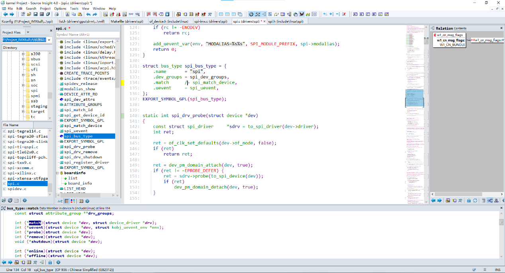

# Source Insight 使用方法

## 一、先说结论

Source Insight 的价值只有一个：**在几万文件的内核源码里，两下点到函数定义、一眼看清谁调用了它**。

它不编译、不调试、不跑程序，就是"看得最快的阅读器"。所以配置只需要把三件事调顺：

```text
编码能正确显示中文   →  跳转/返回键顺手  →  引用高亮能开
```



图里能看出它的核心布局：左边 Project/File 树用于按目录浏览内核源码（`drivers/spi/` 这种层级），右边 **Relation Window** 在光标停到某个结构体/函数时自动列出"谁引用了我"，底部是当前符号的定义预览。

## 二、建一个内核工程

1. **Project → New Project**，起名如 `IMX6ULL_linux`；
2. 源码目录填内核根目录（**不要**包含 `.git`、`Documentation`、`arch` 里你不需要的架构）；
3. 勾选 **"Add tree"**，只加 `arch/arm`、`drivers`、`include`、`sound`、`kernel`、`fs`、`mm` 等你关心的目录；
4. 建完执行 **Project → Rebuild Project**（第一次要索引几分钟）；
5. 之后改代码用 **Project → Synchronize Files**（只更新改动文件，秒级）。

**别整个内核树全加**：几万个文件索引一次要很久，而 `arch/mips`、`arch/powerpc` 这类你永远不会看。

## 三、改编码（中文注释乱码）

1. **Options → Preferences → File** 标签
2. 最下方 **Default encoding** 选 `Chinese Simplified (GB2312) CP:936`

什么时候需要这一条：源码文件是 GB2312/GBK 编码（老 BSP 常见）。如果源码是 UTF-8（新内核基本都是），**保持 UTF-8 不要改**，否则改成 GB2312 后中文反而乱。

判断文件编码：

```bash
file -i drivers/xxx/xxx.c
# charset=utf-8  → 保持 UTF-8
# charset=iso-8859-1 / unknown-8bit → 多半是 GBK
```

## 四、快捷键

**Options → Key Assignments** 里可以改任意命令的键。

三个最值得绑的：

| 命令 | 作用 | 建议键 |
|---|---|---|
| `Go Back` | 返回上一个跳转点 | `Alt + ←` |
| `Edit: Comment Lines` | 注释选中行 | `Ctrl + /` |
| `Edit: Un-Comment Lines` | 取消注释 | `Ctrl + \` |

`Go Back` 是最常用的——看内核代码就是不断"跳进去、退出来"，没有这个键会迷路。

## 五、显示行号、字体

- 行号：**View → Line Numbers**（编译报错要知道行号，必开）
- 统一字体：**View → Mono Font View**，再 **Options → Preferences → Set All Panel Fonts & Colors → Font...**
  - 字体 `Consolas`，字号小四（12pt）左右，等宽字体对齐 `printk` 里的格式串才不歪

## 六、引用高亮（它最值钱的功能）

**Options → File Type Options → 勾选 "Highlight references to selected symbol"**

效果：光标点在某个变量/函数上，同一符号的所有出现位置都会被高亮。配合 `Ctrl + 鼠标左键`（Jump to definition）和 `Alt + ←`（返回），就形成了"看代码的闭环"。

这比 `grep` 强的地方：`grep` 给你一堆文件行号，Source Insight 给你**在原地高亮 + 一键跳转 + 随时返回**。

## 七、几个实用操作

| 操作 | 快捷键/入口 |
|---|---|
| 跳到定义 | `Ctrl + 左键`，或右键 `Jump to Definition` |
| 查所有引用 | 右键 `Lookup References` |
| 全局搜符号 | `Ctrl + /`（Search → Lookup References in Project） |
| 文件内查找 | `Ctrl + F` |
| 跳到指定行 | `Ctrl + G` |
| 打开 Relation Window | `View → Relation Window` |

## 八、和别的工具怎么分工

| 工具 | 强在哪 | 弱在哪 |
|---|---|---|
| Source Insight | 符号跳转、引用关系、阅读体验 | 只适合 Windows、要建索引、不编译 |
| `grep -rn` | 零配置、脚本化 | 只有文本匹配，没有语义 |
| `cscope` / `ctags` + vim | Linux 原生、可远程 | 配置门槛高，界面朴素 |
| VS Code + C/C++ 插件 | 跨平台、能跳转能编辑 | 大工程索引慢，吃内存 |

**实际用法**：Windows 上用 Source Insight 读代码，Linux 上用 `grep` 做确认，两边对照——因为最终编的是 Linux 那份源码。

## 九、一句话总结

**建工程只加你关心的目录、编码按文件真实编码选、把 `Go Back` 和注释键绑顺手、打开引用高亮；它的定位是"读得快"，不是"编得动"。**
