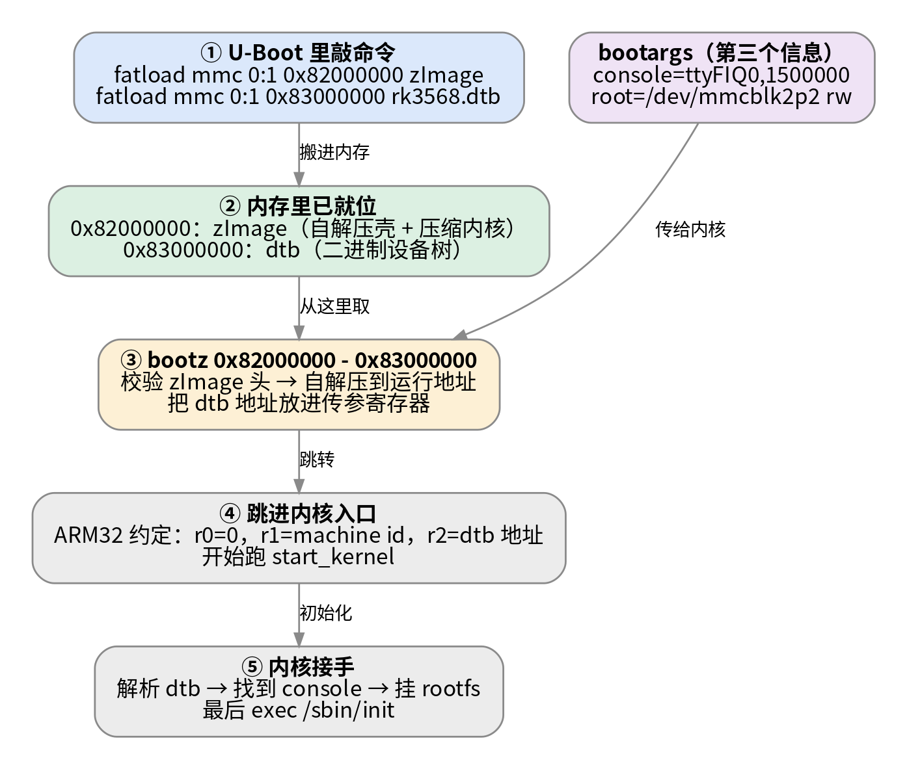

# U-Boot 启动 Linux 内核指令

## 一、先说结论

U-Boot 启动内核，不管用哪条命令，本质都是**准备三样东西、然后跳过去**：

| 三样东西 | 从哪来 |
|---|---|
| 内核镜像 | 从 eMMC/SD 的 boot 分区读进 DDR |
| 设备树 dtb | 同上（RK 已打进 `boot.img`；i.MX 是独立 `.dtb`） |
| 启动参数 bootargs | `setenv bootargs ...`，U-Boot 会把它塞进 dtb 的 `/chosen/bootargs` |



两种镜像形态对应两种命令：

| 形态 | 命令 | 说明 |
|---|---|---|
| `zImage` + 独立 `dtb` | `bootz` | ARM32 经典方式（i.MX6ULL） |
| 一个 FIT 容器 `boot.img`/`boot.itb` | `bootm` | RK 平台方式，内核+dtb+resource 打包在一起 |

## 二、指令 1：zImage + dtb 分开加载

```bash
fatload mmc 0:1 0x82000000 zImage
fatload mmc 0:1 0x83000000 rk3568.dtb
setenv bootargs console=ttyFIQ0,1500000 root=/dev/mmcblk2p2 rw
bootz 0x82000000 - 0x83000000
```

四行分别是：读内核 → 读设备树 → 写启动参数 → 跳转执行。

## 三、指令 2：FIT 一体镜像

```bash
fatload mmc 0:1 0x82000000 boot.itb
bootm 0x82000000
```

FIT（Flattened Image Tree）本质是一个 **its 描述 + 多个镜像 + 哈希/签名** 打包成的容器，`bootm` 会自己解出 kernel、fdt、ramdisk 三块，所以不需要你分别指定地址。

## 四、fatload 语法

```text
fatload <interface> <dev[:part]> <addr> <filename> [bytes]
```

| 参数 | 含义 | 示例 |
|---|---|---|
| `interface` | 介质类型 | `mmc` / `usb` / `sata` / `nand` |
| `dev[:part]` | 设备号 : 分区号 | `0:1` = 第 0 个 mmc 设备的第 1 个分区 |
| `addr` | 载入的 DDR 地址 | `0x82000000` |
| `filename` | 分区里的文件名（**fat 文件系统才需要文件名**） | `zImage` |
| `bytes` | 可选，只读前 N 字节 | 一般不用 |

`mmc 0:1` 的两个数字都要对：`0` 是设备号（`mmc list` 可以看），`1` 是分区号（`mmc part` 看）。分区号从 1 开始，不是 0。

对比 `mmc read`（裸扇区读，不认文件系统）：

```bash
mmc dev 0 1                    # 选设备 0 分区 1
mmc read 0x82000000 0x800 0x4000   # 从扇区 0x800 读 0x4000 个块
```

`fatload` 走文件系统、`mmc read` 走扇区——前者方便，后者能读任意位置。

## 五、地址为什么要选 0x82000000 / 0x83000000

三个约束：

1. **必须在 DDR 范围内**（RK3568 一般从 0x00000000 起有 2G/4G）；
2. **不能压到 U-Boot 自己**（U-Boot 通常跑在低地址，比如 0x00000000 附近或 0xa0000000）；
3. **内核解压后要有地方放**：zImage 是"自解压壳 + 压缩内核"，解压后体积是原来的 3~4 倍。

所以常见约定是：内核放 `0x82000000`、dtb 放 `0x83000000`（隔 16MB），中间留够解压空间。**如果你把 dtb 放在内核解压目标区内，内核一解压就把 dtb 覆盖了**，表现为"启动到一半设备树解析出错"。

## 六、bootz / booti / bootm 的区别

| 命令 | 认什么镜像 | 架构 | 是否压缩 | 参数格式 |
|---|---|---|---|---|
| `bootz` | zImage（带自解压头） | ARM32 | 压缩 | `bootz <kernel> <initrd> <dtb>` |
| `booti` | Image（裸二进制） | ARM64 | 不压缩 | `booti <kernel> <initrd> <dtb>` |
| `bootm` | uImage / FIT | 通用 | 视镜像 | `bootm <addr>` |

`bootz 0x82000000 - 0x83000000` 里那个 `-` 是占位符，表示**没有 initrd**。写成空字符串或省略会解析失败。

搞错命令的典型报错：

```text
Bad Linux ARM zImage magic!        # 用 bootz 去 boot 一个 Image/uImage
Wrong Image Format for bootm command
```

## 七、bootargs 里每项在说什么

```bash
setenv bootargs console=ttyFIQ0,1500000 root=/dev/mmcblk2p2 rw
```

| 参数 | 含义 |
|---|---|
| `console=ttyFIQ0,1500000` | 内核日志输出到 `ttyFIQ0`，波特率 1500000（RK 平台串口叫 FIQ0；i.MX 叫 `ttyS0`） |
| `root=/dev/mmcblk2p2` | 根文件系统在这个分区（RK 上 eMMC 常枚举为 `mmcblk2`；具体看 `ls /dev/mmcblk*`） |
| `rw` | 以读写挂载（默认 `ro`） |
| `init=/sbin/init` | 指定 1 号进程（默认就是它，一般不用写） |
| `loglevel=7` | 打印级别（7 = 全打，含 debug） |
| `earlycon` | 尽早启用串口控制台（在正式 console 注册前就能看到输出） |

**`root=` 写错是最常见的"启动了但 panic"**：

```text
VFS: Cannot open root device "mmcblk2p2" or unknown-block(0,0)
Kernel panic - not syncing: VFS: Unable to mount root fs
```

## 八、bootcmd / bootdelay：让开机自动跑

```bash
setenv bootcmd 'fatload mmc 0:1 0x82000000 zImage; fatload mmc 0:1 0x83000000 rk3568.dtb; bootz 0x82000000 - 0x83000000'
setenv bootdelay 3
saveenv
```

- `bootcmd` 是倒计时结束后自动执行的脚本，多条命令用 `;` 分隔；
- `bootdelay` 是倒计时秒数，期间按任意键进命令行（**调试期建议设 3，别设 0**，否则板子起不来时你连 U-Boot 都进不去）；
- `saveenv` 把环境变量写进存储（eMMC 的环境分区 / SPI Flash），**不执行就只在本次有效**。

## 九、`console=` 背后的两条注册链

内核从"完全没输出"到"能打印"，中间经历了两套注册：

```text
start_kernel
   ↓
setup_arch              # 解析 dtb、建立内存映射
   ↓
parse_early_param       # 解析 earlycon / earlyprintk
   ↓
earlycon 初始化          # ← 最早能打印的阶段（用 dtb 里的 stdout-path 或命令行 earlycon）
   ↓
driver_init / 各 initcall
   ↓
串口 platform_driver probe（UART 控制器驱动）
   ↓
register_console()      # 把串口挂进 printk 的输出列表
   ↓
完整的 printk console
   ↓
内核启动 /sbin/init → getty 起 shell
```

两个容易混的注册：

| 函数 | 注册给谁 | 少了它会怎样 |
|---|---|---|
| `register_console()` | printk 系统（日志输出口） | 串口能收发，但内核日志不显示 |
| `tty_register_driver()` | tty 子系统（字符设备） | `/dev/ttyS0` 不存在，应用打不开串口 |

所以"内核一点输出都没有"要先分清是**串口驱动没 probe**（连 tty 都没有），还是**console 没注册**（有 tty 但日志不去那儿）。前者查 pinctrl/时钟，后者查 `console=` 或 `stdout-path`。

## 十、常见报错对照

| 现象 | 原因 | 修法 |
|---|---|---|
| `Bad Linux ARM zImage magic!` | 用 `bootz` 加载了 Image/uImage | 换 `booti`/`bootm`，或换镜像 |
| `Wrong Image Format` | FIT 索引不对 / 镜像损坏 | 重新打包，核对 `load addresses` |
| `Error: invalid device tree` | dtb 地址传了 0 / 地址串了 | `bootz <k> - <dtb>` 三个参数都要对 |
| 卡在 `Starting kernel ...` 不动 | 内核解压地址与 dtb 重叠，或串口 console 没配对 | 换 DDR 地址布局、核对 `console=` |
| `VFS: Cannot open root device` | `root=` 分区写错 / rootfs 没烧 | `ls /dev/mmcblk*` 确认分区，重烧 rootfs |
| `bootcmd` 改了不生效 | 没 `saveenv` | 执行 `saveenv` 后重启验证 |

## 十一、一句话总结

**`fatload` 把内核和 dtb 搬进 DDR（地址别重叠），`setenv bootargs` 说清楚 console 和 rootfs，`bootz/booti/bootm` 按镜像形态选一个跳过去；要开机自动跑就写进 `bootcmd` 并 `saveenv`。**
