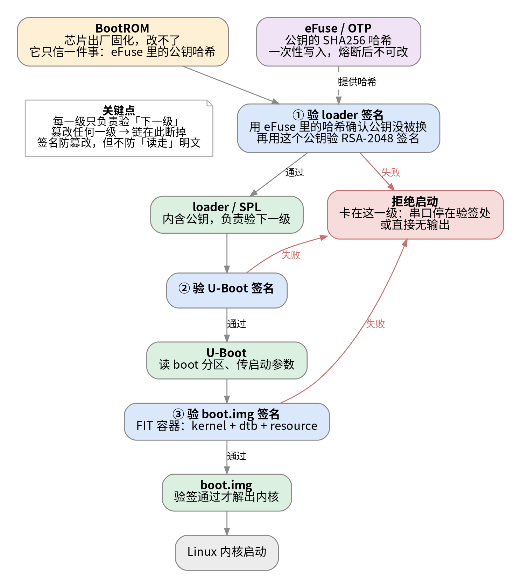

# Secure Boot 的核心思想

## 一、先说结论

**Secure Boot = 用一个"改不掉的起点" + "一次性的公钥指纹" + "每级验下一级的签名"，把"只允许跑我签过名的固件"变成硬件强制。**

三个组件各解决一个问题：

| 组件 | 解决什么 | 为什么必须是它 |
|---|---|---|
| BootROM（芯片内固化的启动代码） | "从哪开始信任" | 它在硅片里，改不了，是唯一可靠的根 |
| eFuse / OTP（一次性存储） | "公钥放哪不被替换" | 只能写一次，写完熔断，攻击者改不了 |
| 逐级签名验证 | "后面每一级都被覆盖" | BootROM 只验第一级，第一级再验第二级……形成链 |

## 二、要防的是什么

设备卖到客户现场，固件在 eMMC 里。攻击者能做的事：

1. 把 `boot.img` 换成一个带后门的（**刷机**）；
2. 把 U-Boot 换掉，让它不校验任何东西；
3. 把整个 eMMC 拆下来dump、改、写回。

没有 Secure Boot 时，这些全部成功——因为 SoC 上电后**只管从存储里取代码执行，不问来源**。

Secure Boot 要保证的唯一一件事：

> 从复位向量到 Linux 内核，**每一段被执行的代码，都是持有私钥的人签过名的**；任何一段被改，链就在那里断掉。

## 三、信任链长什么样



读这张图只记住三句话：

1. **根在 BootROM**，它只信 eFuse 里的那一个哈希；
2. **每一级只验下一级**（不是 BootROM 验全部）；
3. **任何一级失败，就停在那一级**，后面的代码根本不会被执行。

### 为什么"逐级验"而不是"根验全部"

BootROM 的代码是硅片里写死的，容量极小（几 KB），它**不可能认识** FIT 格式、不可能解 gzip、不可能验 30MB 的内核。所以它只能做一件事：验"第一级 loader"的签名——因为 loader 的格式是固定的、体积极小。

loader 跑起来后有了完整的内存和代码，就可以验更复杂的 U-Boot；U-Boot 再去验 FIT 容器。这就是信任的"委托"：**我信你，是因为我验过你；你验的东西，我间接也信。**

## 四、签名与验证到底在算什么

```text
签名（私钥，离线做）：
  h = SHA256(固件)
  sig = RSA_sign(私钥, h)          →  sig 附在固件头里

验证（公钥，设备上做）：
  h1 = SHA256(固件)
  h2 = RSA_verify(公钥, sig)       →  用公钥从签名里还原出 h
  比较 h1 == h2 ？                 →  相等才算通过
```

三个常被混的概念：

| 手段 | 保证 | Secure Boot 用不用 |
|---|---|---|
| 哈希 | 完整性（改一位就变） | 用（作为签名的对象） |
| 签名 | 来源真实性（只有持私钥者能签） | **用（核心）** |
| 加密 | 机密性（别人看不到内容） | **不用**（固件本来就是公开的） |

这点很重要：**Secure Boot 不加密固件**。你的 `boot.img` 照样能被任何人读出来、逆向。它只保证"改了就跑不起来"。

## 五、eFuse / OTP 里存的不是公钥，是公钥的哈希

```text
eFuse 里：SHA256(publicKey)     ← 32 字节，省空间
loader 里：publicKey 本身        ← 几百字节，跟固件一起发布
```

验证时的两步：

1. 拿 loader 里内嵌的公钥，算 `SHA256`，和 eFuse 里的比对——**确认这个公钥没被换成攻击者的**；
2. 再用这个（已确认的）公钥去验签名。

为什么绕这一圈：eFuse 空间非常贵（RK3568 只有 8Kbit，且大部分被 Rockchip 自己占用），塞不下完整公钥；而哈希只有 32 字节，且**哈希不可逆**——攻击者即使读到 eFuse，也反推不出公钥、更算不出私钥。

## 六、熔断（burn）是不可逆的分界线

```text
未熔断：Secure Mode = 0，随便刷，方便开发
熔断后：Secure Mode = 1，eFuse 里的哈希永久生效，换密钥 = 换芯片
```

所以工程上的标准做法是：

| 阶段 | 做法 |
|---|---|
| 开发 | 编"带签名但**不**烧哈希"的镜像，验证签名链路能跑通 |
| 小批量 | 找一块板子做熔断试验，确认换固件会被拒绝 |
| 量产 | 才打开"首次开机自动烧哈希并熔断"的开关 |

**在开发板上误熔断，这块芯片就废了**——它只认那一把私钥，你把私钥丢了或想换密钥，都没有第二次机会。

## 七、和另外两个"启动安全"的区别

经常被混为一谈的三件事：

| 机制 | 验什么 | 什么时候验 | 防什么 |
|---|---|---|---|
| **Secure Boot** | bootloader、kernel、dtb 的签名 | 启动时，**逐级** | 刷入未授权固件 |
| **AVB**（Android Verified Boot） | vbmeta 里的各分区哈希 | 启动时，一次性汇总校验 | 分区被改（rootfs、vendor） |
| **dm-verity** | 文件系统每个数据块 | **运行时**，按块懒加载校验 | 运行中改文件 |

Secure Boot 管"能不能起来"，AVB 管"分区对不对"，dm-verity 管"跑起来之后文件有没有被改"。三者可以叠加，也可以只上第一个。

## 八、Secure Boot 做不到什么

这条必须写清楚，否则容易过度承诺：

| 威胁 | 能不能防 |
|---|---|
| 换掉固件刷后门 | ✅ 能（链断了起不来） |
| 修改已签名的固件一个字节 | ✅ 能（哈希变了） |
| 读走固件做逆向 | ❌ 不能（不加密） |
| root 之后 dump 运行时内存 | ❌ 不能（那是 TEE/密钥绑定的活） |
| 利用已签名固件里的漏洞 | ❌ 不能（签名只保证"是我发的"，不保证"没洞"） |
| 侧信道 / 故障注入攻击 | ❌ 不能（要靠芯片的抗攻击设计） |

一句话：**Secure Boot 是"发行渠道"的锁，不是"内容保密"的锁。**

## 九、和 MCU 上的"安全启动"差在哪

做过 STM32 的人容易类比，但两者强度差一个量级：

| 项 | 常见 MCU 方案 | SoC（RK/ST/NXP）Secure Boot |
|---|---|---|
| 信任根 | 自定义 bootloader（可被整片重刷） | BootROM（硅片内，不可改） |
| 公钥存哪 | Flash 里，可被擦 | eFuse/OTP，一次性不可改 |
| 保护能力 | 能防"随手改"，防不住"有心人" | 能防"有心人换固件" |
| 对应机制 | 读保护（RDP）、选项字节、自定义 CRC 校验 | 签名验证 + 熔断 + 防回滚 |

MCU 上做"验签"通常是：bootloader 里存公钥哈希 → 校验 app 区签名。**但攻击者可以把 bootloader 一起换掉**，所以只能算"防误操作"，不算安全启动。真正的信任根必须是不可改的 ROM。

## 十、一句话总结

**Secure Boot 的本质是"用不可改的 BootROM 做根、用一次性的 eFuse 存公钥指纹、用逐级签名把信任一路委托到内核"；它防篡改不防读取，熔断不可逆，所以开发阶段千万别烧。**
