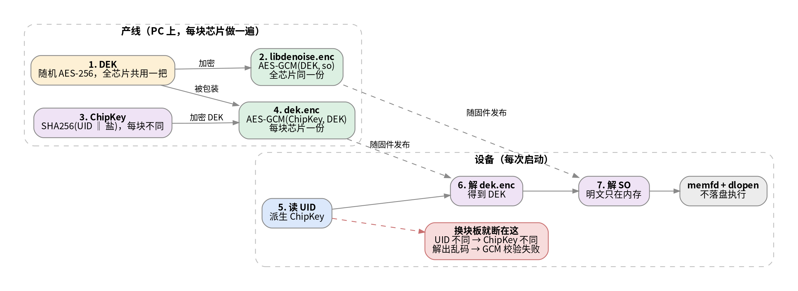

# RK3568 安全启动 + SO 库芯片绑定流程

> 适用平台：RK3568（Rockchip，FIT 方案 + OTP）
> 依据：Rockchip《Linux Secure Boot 开发指南》V4.0.0、《RK356X SecurityBoot 和 AVB 操作指南》V1.2.0、RK3568 Datasheet
> 说明：命令可直接照着执行，路径以你手里的 SDK 版本为准微调。

## 一、先说结论

这套方案是**两把独立的锁**，解决两个不同的问题：

| 目标 | 手段 | 一句话 |
|---|---|---|
| ① 固件不许被换 | Secure Boot | 芯片只跑"用你的私钥签过名"的固件 |
| ② SO 库不许拷走换板用 | 芯片绑定（DEK 包装） | 解开 SO 的钥匙由**芯片 UID** 派生，换板解不出 |
| ③（可选）试用期限制 | RTC + TEE 存授权 | 芯片没有安全时钟，只能"防回拨"近似实现 |

两个必须先知道的坑：

- **`--burn-key-hash` 一旦执行，OTP 熔断不可逆**：开发阶段绝对不要加，量产才加；
- **`--spl-new` 必须加**：不带它就用 rkbin 里的旧 SPL，那里面没有你的公钥，验签永远失败。

原理（信任链怎么逐级验、eFuse 为什么存哈希）见 [Secure Boot 的核心思想](./BOOT-02-安全-SecureBoot核心思想.md)；本文只讲 **RK3568 上怎么落地**。

## 二、整体流程

```text
烧录阶段（PC）：
  生成 RSA-2048 密钥对 → 私钥离线签名 SPL/U-Boot/boot.img
  → 下载固件到 eMMC → 首次开机 SPL 把公钥哈希写入 OTP 并熔断

每次启动（板子）：
  BootROM（用 OTP 里的哈希验签）→ SPL →（验签）U-Boot
  →（FIT 验签 + 防回滚）boot.img → Linux
  → 应用加载 libdenoise.enc
  → 用芯片 UID 派生密钥（或 OP-TEE 密钥）解开 SO → 只在内存执行
```

第一段链路的图见上一篇；第二段（SO 库芯片绑定）的密钥设计：



## 三、前置准备

| 项目 | 要求 |
|---|---|
| 开发机 | Ubuntu 18.04/20.04 x86_64 |
| SDK | 含 `rkbin`、`u-boot`、`kernel`、`buildroot` |
| 工具 | `rkbin/tools/rk_sign_tool`、`openssl`、`device-tree-compiler`（`fdtput` ≥ 1.4.5） |
| 硬件 | RK3568 开发板，OTP 供电正常（核心板默认已接好） |
| 烧写 | Windows 用 AndroidTool（RKDevTool）；Linux 用 `upgrade_tool` |

```bash
fdtput --version
# 期望：Version: DTC 1.4.5 或更高；不够就 sudo apt-get install device-tree-compiler
```

`fdtput` 版本过低会让打包阶段报一些看不懂的 dtb 操作错误，先确认这一条能省很多时间。

## 四、阶段一：生成安全启动密钥（只做一次）

```bash
cd u-boot
mkdir -p keys

# 1. 用 Rockchip 工具生成 RSA-2048 密钥对
../rkbin/tools/rk_sign_tool kk --bits 2048 --out .

# 2. 放到 U-Boot 指定的固定位置（名字不可改，its 文件里写死了）
ln -s privateKey.pem keys/dev.key
ln -s publicKey.pem  keys/dev.pubkey

# 3. 用私钥生成自签名证书（等价于公钥，打包时要用）
openssl req -batch -new -x509 -key keys/dev.key -out keys/dev.crt

ls -l keys/     # 应有 dev.crt  dev.key  dev.pubkey
```

报 `Can't load /home/xxx/.rnd into RNG` 时，`touch ~/.rnd` 再重试。

> 🔐 **私钥 = 命根子**。`dev.key` 泄露，攻击者就能给你的固件"合法签名"，Secure Boot 形同虚设。离线加密保管，不进 Git、不外发。
>
> 这三个文件名是 FIT 签名体系的固定约定：SPL 里打包**公钥**，其哈希随后烧进 OTP。

## 五、阶段二：配置并编译签名固件

### 5.1 打开安全启动配置

编辑 `configs/rk3568_defconfig`（RK3566 也改这个）：

```makefile
# 必选：FIT 签名校验
CONFIG_FIT_SIGNATURE=y
CONFIG_SPL_FIT_SIGNATURE=y

# 可选：防版本回滚（建议开启）
CONFIG_FIT_ROLLBACK_PROTECT=y          # boot.img 防回滚
CONFIG_SPL_FIT_ROLLBACK_PROTECT=y      # uboot.img 防回滚
```

建议先 `make menuconfig` 勾选，再 `make savedefconfig` 回写——手改 defconfig 容易漏依赖，编译阶段才报错。

### 5.2 编译并签名（关键命令）

```bash
./make.sh rk3568 --spl-new \
    --boot_img boot.img \
    --recovery_img recovery.img \
    --rollback-index-uboot 1 \
    --rollback-index-boot 2 \
    --burn-key-hash
```

| 参数 | 作用 |
|---|---|
| `--spl-new` | 用当前编译的 SPL 打包 loader。**必加**，否则公钥不在里面 |
| `--boot_img boot.img` | 待签名的 boot.img（kernel + DTB + ramdisk） |
| `--recovery_img recovery.img` | 待签名的 recovery.img（没有可去掉） |
| `--rollback-index-uboot 1` | uboot.img 最小版本号 |
| `--rollback-index-boot 2` | boot.img 最小版本号 |
| `--burn-key-hash` | **首次开机由 SPL 自动把公钥哈希写入 OTP 并熔断** |

正常输出：

```text
### spl/u-boot-spl.dtb: burn-key-hash=1
start to sign rk3568_spl_loader_v1.x.bin
sign loader ok.
Image(signed, version=0, rollback-index=1): uboot.img (FIT with uboot, trust...) is ready
Image(signed, version=0, rollback-index=2): boot.img (FIT with kernel, fdt, resource...) is ready
```

产物三个：`loader.bin`、`uboot.img`、`boot.img`。**只要私钥不变，这三个可以之后单独重签、单独烧写。**

> 🔧 开发阶段先去掉 `--burn-key-hash`：先验证签名链路能跑通，确认无误后，量产镜像才加它。

### 5.3 只重签 boot.img（后续只改内核时）

```bash
./make.sh rk3568 --spl-new
./scripts/fit.sh --boot_img boot.img        # 单独签名 boot.img
```

内核改了、U-Boot 没动，就别重编 U-Boot——重签一个 boot.img 够。

## 六、阶段三：烧录与 OTP 熔断

### 6.1 下载固件

- Windows：AndroidTool 按分区烧 `loader.bin / uboot.img / boot.img`；
- Linux：`upgrade_tool` 同理；
- 量产：直接烧整包 `update.img`（工厂工具）。

### 6.2 首次开机自动熔断

RK3568 用片上 **OTP**：不需要任何额外烧录工具，**烧录动作已经打包进固件**——第一次重启时 loader 负责把公钥哈希写进 OTP。

首次熔断的串口 log：

```text
# SecureCheckHeader 0, 0, 0
# SecureWriteOTP
# enable secure flag!
# otp write key success!!
SecureInit ret = 0, SecureMode = 1
```

### 6.3 验证是否生效

再次重启，SPL 阶段应看到：

```text
## Verified-boot: 1          # 1 = 已熔断（0 = 未熔断）
sha256, rsa2048:dev+         # SPL 签名校验通过
rollback index: 1 >= 0(min), OK
### Checking atf-1 ... sha256+ OK
### Checking uboot ... sha256+ OK
### Checking fdt ... sha256+ OK
```

U-Boot 阶段验 boot.img：

```text
### Loading kernel from FIT Image at 3d8122c0 ...
Verifying Hash Integrity ... sha256, rsa2048:dev+ OK
Verifying Rollback-index ... 2 >= 1, OK
```

**反向验证**：随便改一个分区再烧（比如给 `boot.img` 补一个字节），如果芯片拒绝启动、卡在 SPL，说明 Secure Boot 真的生效了。

### 6.4 OTP 特性

| 项目 | RK3568 OTP |
|---|---|
| 容量 | 8Kbit（1KB），其中约 7Kbit 给安全应用 |
| 写入方式 | Loader/SPL 首次开机时写入，无外部工具 |
| 读取 | 可读，但只允许 A55 安全模式访问 |
| 改写 | 一次性，熔断后不可改 |
| 用途 | 公钥哈希 + 安全标志位 |

> ⚠️ 官方指南明确：**OTP 主要由 Rockchip 内部使用，客户自定义密钥请优先放 RPMB/Security 分区**。所以"把 AES 密钥烧进 OTP"在 RK3568 上**不是推荐做法**。

## 七、阶段四：SO 库芯片绑定（DEK 包装）

### 7.1 为什么必须 DEK 包装

两种常见错误设计：

1. **所有芯片同一把 AES 密钥** → SO 拷到同型号其他板照样能解，绑定等于没有；
2. **密钥直接存 OTP** → OTP 空间宝贵且官方不建议占用，而且熔断后不能换。

正确做法是 **DEK（Data Encryption Key）包装**，也就是"密钥信封"：

```text
DEK      = 随机 AES-256，负责加密 SO        （全芯片共用同一份密文）
ChipKey  = 每块芯片独有，负责加密 DEK

发布文件：
  libdenoise.enc = AES-GCM(DEK, libdenoise.so)   ← 全芯片同一份
  dek.enc        = AES-GCM(ChipKey, DEK)          ← 每块芯片一份

运行时：
  读自身 UID → 派生 ChipKey → 解 dek.enc 得 DEK → 解 libdenoise.enc
  → 明文进内存 → dlopen 执行
```

效果：把两个文件拷到另一块板，UID 不同 → ChipKey 不同 → `dek.enc` 解出乱码 → GCM 认证失败。

### 7.2 读芯片 UID

```bash
# 方法一：nvmem sysfs（SDK 默认开 CONFIG_ROCKCHIP_OTP / CONFIG_ROCKCHIP_EFUSE）
cat /sys/bus/nvmem/devices/rockchip-otp0/nvmem | xxd -p
cat /sys/bus/nvmem/devices/rockchip-efuse0/nvmem | xxd -p

# 方法二：部分 SDK 会导出 serial-number
cat /proc/device-tree/serial-number
```

输出形如 `4c0000a2xxxx...`，前几字节是批次信息，后面才是 UID。**具体字节偏移以 TRM 为准**，产测脚本里要先把偏移固化下来（本文按"取 16 字节 UID"处理）。

### 7.3 产线加密（PC 上执行）

```bash
# ① 随机生成 DEK（256 位，一次性，妥善保存）
DEK=$(openssl rand -hex 32)
echo "DEK=$DEK" > dek.master          # 绝密，只存产线安全机器

# ② 用 DEK 加密 SO（全芯片共用这一份密文）
#    生产用 AES-256-GCM（带认证）；openssl 命令行做 GCM 繁琐，
#    这里用 CBC 演示结构，产品代码请用 EVP 的 GCM 接口（见 7.4）
openssl enc -aes-256-cbc -K $DEK -iv 00000000000000000000000000000000 \
    -in libdenoise.so -out libdenoise.enc

# ③ 从板子抄回 UID
UID_HEX=xxxxxxxxxxxxxxxxxxxxxxxxxxxxxxxx    # 128bit UID 的 hex

# ④ 由 UID 派生 ChipKey：SHA256(UID ‖ 固定盐)
SALT="zhengyuan-atomic-rk3568-v1"
CHIP_KEY=$(echo -n "${UID_HEX}${SALT}" | sha256sum | cut -d' ' -f1)

# ⑤ 用 ChipKey 加密 DEK（每块芯片生成一份 dek.enc）
#    注意 DEK 先转回 32 字节二进制，保证与运行时 C 代码的格式一致
echo -n "$DEK" | xxd -r -p | openssl enc -aes-256-cbc -K $CHIP_KEY \
    -iv 00000000000000000000000000000000 -out dek.enc

# ⑥ 把 libdenoise.enc（通用）+ dek.enc（本芯片专属）一起写入本设备
```

产线流程：

```text
待产设备（RK3568）
   │ ① 读 UID
   ▼
产测 PC（跑脚本）
   │ ② 派生 ChipKey
   ▼
生成 dek.enc
   │ ③ 与通用 libdenoise.enc 一起写入设备
   ▼
完成
```

### 7.4 运行时解密加载（设备端 C 代码）

```c
/* app_loader.c —— 用 OpenSSL EVP 实现，结构示意 */
#define _GNU_SOURCE        /* memfd_create 需要 */
#include <openssl/evp.h>
#include <openssl/sha.h>
#include <fcntl.h>
#include <unistd.h>
#include <stdio.h>
#include <stdlib.h>
#include <string.h>
#include <sys/mman.h>
#include <dlfcn.h>

#define UID_LEN    16      /* UID 长度，按 TRM 定 */
#define UID_OFFSET 0x40    /* UID 在 OTP 中的字节偏移，以 TRM 为准 */
#define SALT       "zhengyuan-atomic-rk3568-v1"

/* 1) 读芯片 UID（nvmem sysfs） */
int read_chip_uid(unsigned char *uid) {
    int fd = open("/sys/bus/nvmem/devices/rockchip-otp0/nvmem", O_RDONLY);
    if (fd < 0) return -1;
    if (lseek(fd, UID_OFFSET, SEEK_SET) < 0) { close(fd); return -1; }
    ssize_t n = read(fd, uid, UID_LEN);
    close(fd);
    return (n == UID_LEN) ? 0 : -1;
}

/* 2) KDF: ChipKey = SHA256(UID || SALT) */
void derive_chip_key(const unsigned char *uid, unsigned char *key32) {
    EVP_MD_CTX *ctx = EVP_MD_CTX_new();
    EVP_DigestInit_ex(ctx, EVP_sha256(), NULL);
    EVP_DigestUpdate(ctx, uid, UID_LEN);
    EVP_DigestUpdate(ctx, SALT, strlen(SALT));
    unsigned int len = 0;
    EVP_DigestFinal_ex(ctx, key32, &len);
    EVP_MD_CTX_free(ctx);
}

/* 3) AES-256-GCM 解密：dek.enc -> DEK；libdenoise.enc -> 明文 */
int aes_gcm_decrypt(const unsigned char *key, const unsigned char *iv,
                    const unsigned char *ct, size_t ct_len,
                    const unsigned char *tag, unsigned char *pt) {
    EVP_CIPHER_CTX *ctx = EVP_CIPHER_CTX_new();
    int len = 0, total = 0;
    EVP_DecryptInit_ex(ctx, EVP_aes_256_gcm(), NULL, NULL, NULL);
    EVP_CIPHER_CTX_ctrl(ctx, EVP_CTRL_GCM_SET_IVLEN, 12, NULL);
    EVP_DecryptInit_ex(ctx, NULL, NULL, key, iv);
    EVP_DecryptUpdate(ctx, pt, &len, ct, ct_len);
    total = len;
    EVP_CIPHER_CTX_ctrl(ctx, EVP_CTRL_GCM_SET_TAG, 16, (void *)tag);
    if (EVP_DecryptFinal_ex(ctx, pt + total, &len) <= 0) {  /* 认证失败 */
        EVP_CIPHER_CTX_free(ctx);
        return -1;
    }
    EVP_CIPHER_CTX_free(ctx);
    return total + len;
}

/* 4) 解密到 memfd，再 dlopen（明文不落盘） */
void *load_denoise(void) {
    unsigned char uid[UID_LEN], chip_key[32], dek[32];
    if (read_chip_uid(uid) != 0) return NULL;
    derive_chip_key(uid, chip_key);

    /* 读入 dek.enc、libdenoise.enc（iv/tag/密文 的布局按你的文件格式解析） */
    if (aes_gcm_decrypt(chip_key, iv_dek, dek_enc, dek_enc_len, tag_dek, dek) < 0)
        return NULL;

    int fd = memfd_create("denoise", 0);          /* 匿名内存文件 */
    unsigned char *so_buf = malloc(so_len);
    if (aes_gcm_decrypt(dek, iv_so, so_enc, so_enc_len, tag_so, so_buf) < 0)
        return NULL;
    write(fd, so_buf, so_len);

    /* dlopen 不接受 fd，必须通过 /proc/self/fd/N 加载 memfd 里的库 */
    char path[64];
    snprintf(path, sizeof(path), "/proc/self/fd/%d", fd);
    void *h = dlopen(path, RTLD_NOW | RTLD_LOCAL);
    return h;
}
```

要点：

- 明文 SO **只在内存**（memfd），不落盘；
- 用 **AES-256-GCM**：带认证标签，密文被改直接失败（CBC 做不到这一点）；
- IV 随机、随密文一起存（GCM 标准 12 字节）。

### 7.5 这个方案的边界（诚实版）

| 威胁 | 能否防住 |
|---|---|
| 把加密文件拷到另一块板 | ✅ UID 不同，解不出 |
| 修改密文文件 | ✅ GCM 认证失败 |
| root 之后 dump 运行时内存明文 | ❌ 明文在用户态内存 |
| 攻击者拿到 UID + 逆向出 KDF | ❌ UID 可读、算法在代码里 |

结论：**UID 派生 = 防"拷文件"级保护**。对手会逆向，就上第八节的 OP-TEE，把密钥和解密搬进安全世界。

## 八、阶段五（可选，防逆向级）：OP-TEE KeyBox / RPMB

把密钥放进 **TrustZone 安全世界**，Linux 用户态永远碰不到：

- 密钥存 **RPMB**（eMMC 安全分区，只能由 TEE 访问，内容加密存放）或 Security 分区；
- SDK 自带 **KeyBox** 实例（`buildroot/package/rockchip/tee-user-app`）：
  - **CA**（`keybox_app`）：Linux 用户态，向 TEE 发请求；
  - **TA**（`.ta` 文件）：安全世界，真正读写 RPMB 里的密钥；
- 官方安全建议：必须搭配 FIT/AVB 使用；**TA 文件要签名**（防第三方在你机器上跑自定义 TA）；默认限制"只能在 Ramdisk 里 PID=1 的程序读 Key"。

关键配置：

```makefile
# buildroot
BR2_PACKAGE_TEE_USER_APP=y
BR2_PACKAGE_TEE_USER_APP_COMPILE_CMD="6432"      # 64 位 CA + 32 位 TA
BR2_PACKAGE_TEE_USER_APP_TEE_VERSION="v2"

# kernel
CONFIG_TEE=y
CONFIG_OPTEE=y
```

```dts
optee: optee {
    compatible = "linaro,optee-tz";
    method = "smc";
    status = "okay";
};
```

配套的 **System-Encryption**（整分区加密，dm-crypt 思路）：密钥随 `misc.img` 下发 → Ramdisk 首次启动读密钥写进 RPMB 并清空 `misc.img` → 之后内核 Device-Mapper 实时解密。这是官方推荐的"客户密钥放 RPMB"标准路径。

## 九、阶段六（可选）：时间授权

RK3568 **没有**片上硬件安全时钟（防篡改 RTC）。做"30 天试用"的可行替代：

| 方案 | 做法 | 弱点 |
|---|---|---|
| 外部 RTC + 防回拨 | 板载电池 RTC + 记录"上次合法时间"，检测倒退就锁定 | 拔电池可重置，需配合防拆 |
| TEE 内授权状态 | 到期时间戳存 RPMB（TEE 签名保护），应用问 TEE 要状态 | 改不了 RTC 芯片，但改不了 RPMB 记录 |
| 联网时间戳 | 首次激活向服务器取签名时间戳 | 需联网，离线设备不适用 |

务实组合：**外部 RTC + TEE 存授权状态**，能挡住"改系统时间"这类 99% 的攻击。

## 十、常见错误清单

1. **忘了 `--spl-new`** → 用旧 SPL，不含你的公钥，验签必失败；
2. **调试阶段就加 `--burn-key-hash`** → OTP 熔断，想换密钥芯片直接废；
3. **改动 `keys/` 三个文件名** → its 静态引用，打包直接失败；
4. **对 PEM 文本 `sha256sum` 当 OTP 值** → 官方流程不让你手算，交给工具；
5. **所有芯片同一把 AES 密钥** → 绑定失效，必须 DEK 包装；
6. **密钥写进 OTP** → 空间宝贵且官方不建议；
7. **CBC + 固定 IV** → 模式泄露、无完整性，换 GCM；
8. **以为 Secure Boot 能防 root** → 它只防篡改固件，防逆向要 TEE；
9. **`dek.enc` 里 DEK 的字节序/长度与代码不一致** → 解密后长度不对，`EVP_DecryptFinal` 失败；
10. **忘了给 `dlopen` 传 `/proc/self/fd/N`** → memfd 没有路径，`dlopen` 直接返回 NULL。

## 十一、参考

- Rockchip《Linux Secure Boot 开发指南》V4.0.0（RK-KF-YF-379）：密钥生成、`make.sh` 编译、OTP 烧写、KeyBox、System-Encryption
- Rockchip《RK356X SecurityBoot 和 AVB 操作指南》V1.2.0（RK-YH-YF-289）：defconfig 配置、`--burn-key-hash`、启动 log 判定
- Rockchip RK3568 Datasheet：OTP 规格（8Kbit，约 7Kbit 安全应用，Secure OTP 仅安全模式访问）
- Rockchip《Secure Boot Application Note》V1.9：BootROM 验签 loader 流程

## 十二、一句话总结

**先 `--spl-new` 把公钥塞进 SPL、`--burn-key-hash` 留给量产、`Verified-boot: 1` 才算熔断成功；SO 库用 DEK 包装——内容加密一次、DEK 按芯片各包一份，换板就断在解 DEK 那一步。**
