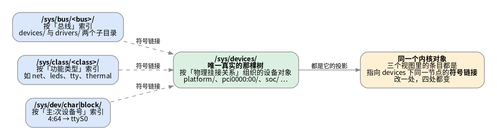

# Linux 文件目录结构

## 一、先说结论

Linux 根目录下的每个目录，回答的是**不同的问题**：

| 目录 | 回答什么 | 你能改吗 |
|---|---|---|
| `/sys` | 内核把设备/驱动"导出成文件"给你控制 | 部分属性**可写**（echo 进去就是操作硬件） |
| `/proc` | 内核的运行时状态（进程、内存、中断、设备树） | 多数只读；少数如 `/proc/sys/*` 可写 |
| `/dev` | 设备节点（字符/块设备），真正"操作设备"的入口 | 由 devtmpfs/mdev 自动维护 |
| `/run` | 启动以来的运行时数据（pid 文件、socket、锁） | tmpfs，重启清空 |
| `/etc` | 配置 | 可改，改完要重启对应服务 |
| `/usr` | 程序、库、共享数据 | 只读思路，别手改 |
| `/var` | 日志、缓存、状态 | 会写满，注意清理 |
| `/tmp` | 临时文件 | tmpfs 常见，重启就没 |
| `/mnt`、`/media` | 手动挂载点 | 挂载时用 |
| `/opt` | 厂商/第三方整套软件 | 例如 `/opt/QDesktop` |

最容易混的是**前三行**：`/sys` 是控制面、`/proc` 是状态面、`/dev` 是操作面。

## 二、`/sys`：设备模型导出的"控制面板"

### 四个视图，指向同一棵树



```text
/sys/devices/             ← 唯一真实的树（按物理挂接关系）
/sys/bus/<bus>/devices    ← 符号链接，按总线索引
/sys/bus/<bus>/drivers    ← 驱动列表，含 bind/unbind
/sys/class/<class>/       ← 符号链接，按功能类型索引
/sys/dev/char|block/      ← 符号链接，按主:次设备号索引
```

用 `ls -l` 就能看出它们是链接：

```bash
ls -l /sys/class/net/          # eth0 -> ../../devices/platform/.../net/eth0
ls -l /sys/bus/platform/devices/ | head
ls -l /sys/dev/char/4:64       # -> ../../devices/.../tty/ttyS0
```

### 为什么要有三套索引

| 视图 | 你什么时候用它 |
|---|---|
| `bus/.../devices` | "这个设备挂在哪个总线上" |
| `bus/.../drivers` | "哪个驱动在管它"（`bind`/`unbind` 可以手动挂/摘驱动） |
| `class/...` | "系统里有哪些同类设备"（`net`、`leds`、`tty`、`thermal`） |
| `dev/char` `dev/block` | 只有设备号（如 `mknod`、`udev` 场景），要反查是哪个设备 |

### `/sys` 里能写什么

属性文件分两类：

```bash
# 只读：看了就看了
cat /sys/class/thermal/thermal_zone0/temp
cat /sys/class/net/eth0/address

# 可写：echo 进去就是执行操作
echo none > /sys/class/leds/work/trigger     # 关掉心跳灯
echo 1 > /sys/class/gpio/export              # 导出 GPIO
echo 120 > /sys/class/gpio/gpio120/value     # 拉高
```

**判断能不能写**：`ls -l` 看权限位；内核里对应的 `DEVICE_ATTR` 宏决定了它是 `0444`（只读）还是 `0644`（可写）。

### 一个真实例子：从 LED 到驱动

```bash
ls /sys/class/leds/                    # 有几个 LED
ls /sys/class/leds/work/               # 这个 LED 暴露了哪些属性
cat /sys/class/leds/work/trigger       # 当前触发方式
echo heartbeat > /sys/class/leds/work/trigger   # 改成心跳
```

这些文件不是"配置"，是驱动里 `led_classdev` 注册出来的属性——每一次 `cat`/`echo` 都会真的调到驱动函数。

## 三、`/proc`：运行时状态

```bash
cat /proc/cpuinfo          # CPU 型号、核数、频率
cat /proc/meminfo          # 内存明细
cat /proc/interrupts       # 每个中断号被谁触发了几次
cat /proc/devices          # 已注册的字符/块设备主设备号
cat /proc/partitions       # 块设备与分区
cat /proc/loadavg          # 1/5/15 分钟负载
cat /proc/cmdline          # 内核启动参数（bootargs 实际生效的那份）
```

### `/proc/device-tree`：设备树的运行时视图

```bash
ls /proc/device-tree/                      # 顶层节点
ls /proc/device-tree/sound/                # 某节点的属性
cat /proc/device-tree/model | tr '\0' '\n' # 字符串属性（\0 结尾，要转）
```

它是内核启动时把 dtb **展开成目录**的结果，**只读**。用途是"确认板子上跑的那份设备树到底写了什么"，和源码里的 dts 对照，能立刻发现"改了没编进去"。

数字属性是 4 字节大端，要 `hexdump` 才看得懂：

```bash
hexdump -C /proc/device-tree/sound/simple-audio-card,cpu
```

### `/proc/sys`：能改的内核参数

```bash
cat /proc/sys/vm/min_free_kbytes
echo 30000 > /proc/sys/vm/min_free_kbytes    # 临时改（重启失效）
sysctl -w vm.min_free_kbytes=30000           # 有 sysctl 时更规范
```

要永久生效得写 `/etc/sysctl.conf`。

## 四、`/dev`：设备节点

```bash
ls -l /dev/ | head
# crw-rw---- 1 root root 4,  64 ... ttyS0
# brw-rw---- 1 root disk 179, 0 ... mmcblk0
```

- `c` = 字符设备（串口、I2C、音频 PCM）；
- `b` = 块设备（eMMC、SD 卡、U 盘）；
- 中间两列是**主设备号, 次设备号**（`4, 64` 就是 `/sys/dev/char/4:64` 那个链接）。

节点是 `devtmpfs`（内核自动建）或 `mdev`/`udev`（用户态按规则建）产生的。**驱动注册了设备却没有节点**时，手工补：

```bash
mknod /dev/mydev c 240 0
```

## 五、`/run`、`/tmp`、`/var`

```bash
mount | grep -E "/run|/tmp"     # 一般能看到 tmpfs
ls /run/                        # pid 文件、socket、锁
ls /var/log/                    # 日志（会变大）
```

- `/run` 与 `/tmp` 通常是 **tmpfs**（内存文件系统）：读写快、重启清空、**占内存**。往 `/tmp` 拷大镜像要留意内存；
- `/var/log` 在嵌入式上常被塞满，`df -h` 一看就知道，清 `messages`/`syslog` 即可。

## 六、一个有代表性的板子布局

```text
/
├── bin/  sbin/  usr/          可执行文件与库
├── etc/                      配置（interfaces、rc.local、fstab）
├── dev/                      设备节点（ttyS0、mmcblk0p1...）
├── proc/  sys/               内核导出（状态 / 控制）
├── run/  tmp/                tmpfs
├── var/log/                  日志
├── lib/modules/<ver>/        内核模块（insmod/modprobe 找这）
├── mnt/  media/              挂载点（NFS、U 盘、SD 卡）
└── opt/                      厂商软件（QDesktop 之类）
```

## 七、一句话总结

**`/sys` 是控制面（能 echo 进去操作硬件）、`/proc` 是状态面（看内核现在什么样）、`/dev` 是操作面（真正 open/read/write 的入口）；三者都指向同一批内核对象，只是索引方式不同——bus 按总线、class 按类型、dev 按设备号。**
