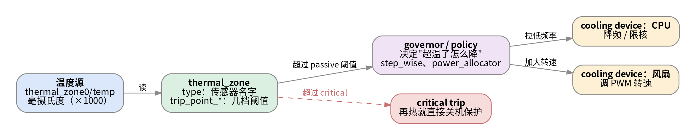

# Linux 开发板查看 CPU 温度

## 一、先说结论

温度只有一条命令：

```bash
cat /sys/class/thermal/thermal_zone0/temp
# 45000   ← 毫摄氏度，即 45.0 ℃
```

**单位是"千分之一度"**，所以要除以 1000。这是 thermal 框架的统一约定（用整数避免内核里做浮点）。

能看到这个文件，说明内核里 **thermal 驱动 + 设备树里的 zone 都配好了**；看不到，就不是"命令不对"，而是框架没起来。

## 二、读数：三种写法

```bash
# 1. 原始值
cat /sys/class/thermal/thermal_zone0/temp

# 2. 转摄氏度（板子上有 bc 时）
echo "scale=1; $(cat /sys/class/thermal/thermal_zone0/temp) / 1000" | bc

# 3. 没有 bc 时用 shell 算术（整数，够用）
t=$(cat /sys/class/thermal/thermal_zone0/temp); echo $((t/1000)).$((t%1000/100))

# 4. 持续监控
watch -n 2 'cat /sys/class/thermal/thermal_zone0/temp'
```

## 三、多个传感器：`thermal_zone*`

一块 SoC 上往往不止一个温度点（CPU 大核、小核、GPU、NPU 各一个 zone）：

```bash
ls /sys/class/thermal/
# thermal_zone0  thermal_zone1  cooling_device0 ...

for z in /sys/class/thermal/thermal_zone*; do
    echo "$(basename $z): $(cat $z/type) = $(( $(cat $z/temp) / 1000 )) ℃"
done
```

`type` 告诉你这个 zone 是谁：

```bash
cat /sys/class/thermal/thermal_zone0/type
# cpu-thermal / soc-thermal / gpu-thermal
```

## 四、温度为什么要"降频"：thermal 框架

温度不只是给人看的，**内核会拿它做保护动作**：



四个角色：

| 角色 | 对应 sysfs | 干什么 |
|---|---|---|
| 传感器 | `thermal_zoneX/temp` | 报告温度 |
| zone | `thermal_zoneX/` | 一个"温控区域"，含若干 trip 点 |
| trip point | `trip_point_0_type`/`_temp` | 阈值：passive（开始降频）、critical（关机） |
| cooling device | `/sys/class/thermal/cooling_deviceX/` | 可以"变凉"的东西：降 CPU 频、开风扇、限 GPU |
| governor | `thermal_zoneX/policy` | 策略：怎么在阈值和 cooling 之间调节 |

看某个 zone 的全部阈值：

```bash
for f in /sys/class/thermal/thermal_zone0/trip_point_*; do
    echo "$(basename $f) = $(cat $f)"
done
# trip_point_0_type = passive      ← 到这个温度开始降频
# trip_point_0_temp = 80000
# trip_point_1_type = critical     ← 到这里直接关机
# trip_point_1_temp = 115000
```

`policy`：

```bash
cat /sys/class/thermal/thermal_zone0/policy
# step_wise / power_allocator / user_space
```

`user_space` 表示"交给用户态守护进程自己调"，很多 SDK 用它跑自己的温控策略。

## 五、怎么判断"是不是真的在过热"

三种证据一起看：

```bash
# ① 温度曲线（是不是持续爬升到 80℃ 以上）
while true; do echo "$(date +%T) $(( $(cat /sys/class/thermal/thermal_zone0/temp)/1000 ))℃"; sleep 1; done

# ② CPU 频率有没有被压下来（说明 governor 动手了）
cat /sys/devices/system/cpu/cpu0/cpufreq/scaling_cur_freq
cat /sys/devices/system/cpu/cpu0/cpufreq/scaling_max_freq

# ③ 内核日志里有没有 thermal 事件
dmesg | grep -i thermal
```

频率被压到 `scaling_max_freq` 以下，同时温度贴着 trip 点，就是"降频保护在工作"。这时"跑分变低"不是 bug，是温控。

## 六、常见的"看不到温度"

| 现象 | 原因 | 修法 |
|---|---|---|
| `No such file or directory` | thermal 驱动没编/没匹配 | 查 `dmesg | grep thermal`、设备树里有没有 `thermal-zones` |
| 只有 `cooling_device*` 没有 `thermal_zone*` | 只配了 cooling，没有传感器 | 补 zone 节点 |
| 读出来恒定不变（如 25000） | 读的是"虚拟传感器"/驱动用了固定值 | 换 `type` 对着看，确认是真实 sensor |
| 温度明显偏高十几度 | 传感器在 SoC 内部，不等于外壳温度 | 以 trip 点和降频行为为准 |

## 七、一句话总结

**`/sys/class/thermal/thermal_zoneX/temp` 是毫摄氏度，除 1000 得摄氏度；超过 `passive` 阈值内核就开始降频，超过 `critical` 直接关机——"温度高但频率也被压了"是保护在工作，不是故障。**
