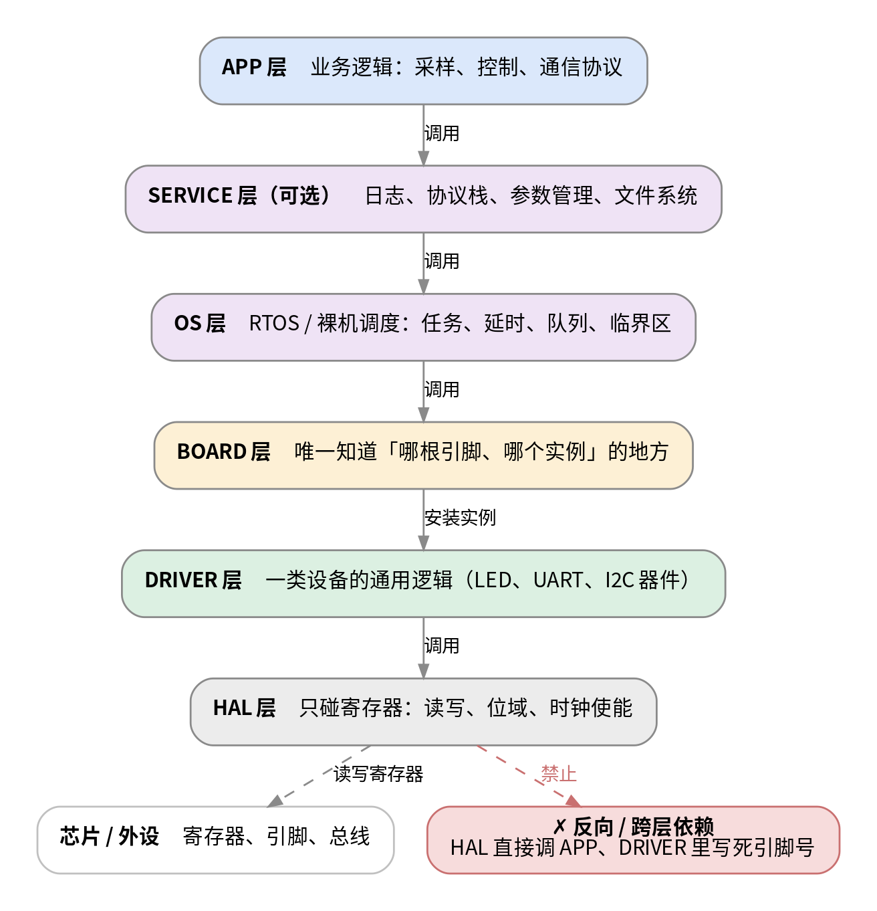

# 低性能 MCU 软件设计分层

## 一、先说结论

在资源紧张的 MCU 上分层，目的不是"好看"，而是**换东西的时候只改一层**：

| 你换什么 | 只需要改 |
|---|---|
| 换芯片（STM32 → GD32） | HAL（寄存器差异） |
| 换板子（同一芯片，引脚不同） | BOARD（哪根脚接了什么） |
| 换需求（功能逻辑变） | APP |

五层，依赖方向**只能向下**：



## 二、每层到底管什么

| 层 | 该做的事 | 绝不该做的事 |
|---|---|---|
| **APP** | 业务逻辑：采集周期、控制算法、状态机、协议语义 | 直接碰寄存器、直接写 `GPIOA->ODR` |
| **SERVICE**（可选） | 日志、参数存取、协议栈、文件系统、事件总线 | 依赖具体引脚 |
| **OS** | 任务/延时/队列/信号量/临界区（RTOS 或裸机调度） | 业务判断 |
| **BOARD** | 把"板子上的物理资源"和"驱动实例"绑起来；引脚表、时钟配置 | 写设备逻辑 |
| **DRIVER** | 一类设备的通用行为：`led_on/off`、`uart_send`、`i2c_read_reg` | **写死某根引脚号** |
| **HAL** | 只碰寄存器：置位/清零、位域、时钟使能、中断使能 | 知道"这根线接的是红灯还是绿灯" |

一句话记：**HAL 只知道寄存器，DRIVER 只知道设备，BOARD 才知道板子。**

## 三、依赖方向（唯一硬规则）

```text
APP → SERVICE → OS → BOARD → DRIVER → HAL
```

允许的调用：

| 允许 | 说明 |
|---|---|
| 上层调下层 | 正常 |
| 同层横向调（少） | 例如 DRIVER 之间通过 BOARD 传进来的句柄交互，尽量避免 |
| 下层回调上层 | **只能通过注册函数指针**（`driver` 注册 `on_rx_cb`），不能直接 `include app.h` |

明确禁止：

| 禁止 | 后果 |
|---|---|
| HAL 调 APP/DRIVER | 换芯片时 HAL 里全是业务代码，没法替换 |
| DRIVER 写死引脚号 | 同一驱动不能给两块板复用 |
| APP 直接写寄存器 | 换芯片要改业务代码 |
| 下层 `#include` 上层头文件 | 编译依赖成环，改一处全重编 |

## 四、具体怎么写：从 HAL 到 APP

### HAL：只碰寄存器

```c
/* hal_gpio.h —— 只描述"引脚 + 动作"，不描述"接了什么" */
typedef enum { HAL_GPIO_INPUT, HAL_GPIO_OUTPUT } hal_gpio_dir_t;

void hal_gpio_set_mode(uint32_t pin, hal_gpio_dir_t dir);
void hal_gpio_write(uint32_t pin, uint8_t level);
uint8_t hal_gpio_read(uint32_t pin);
```

```c
/* hal_gpio.c —— 全部实现都在寄存器上 */
void hal_gpio_set_mode(uint32_t pin, hal_gpio_dir_t dir) {
    uint32_t port = pin / 32, bit = pin % 32;
    volatile uint32_t *moder = GPIO_MODER(port);   /* 具体地址由芯片头文件给 */
    *moder = (*moder & ~(3u << (bit * 2))) | ((dir & 3u) << (bit * 2));
}

void hal_gpio_write(uint32_t pin, uint8_t level) {
    uint32_t port = pin / 32, bit = pin % 32;
    volatile uint32_t *odr = GPIO_ODR(port);
    if (level) *odr |= (1u << bit);
    else       *odr &= ~(1u << bit);
}
```

注意三个细节：`volatile`（寄存器）、位域读改写（先清再置）、`pin` 的编号规则（全局编号，把"端口+位"编码成一个数，方便上层只传一个值）。

### DRIVER：一类设备的通用逻辑

```c
/* driver_led.h */
typedef struct led_dev *led_handle_t;
led_handle_t led_create(uint32_t pin);
void led_on(led_handle_t h);
void led_off(led_handle_t h);
```

```c
/* driver_led.c —— 不出现任何具体引脚号 */
struct led_dev { uint32_t pin; };

led_handle_t led_create(uint32_t pin) {
    static struct led_dev pool[LED_MAX];
    static int used = 0;
    if (used >= LED_MAX) return NULL;
    struct led_dev *d = &pool[used++];
    d->pin = pin;
    hal_gpio_set_mode(pin, HAL_GPIO_OUTPUT);
    hal_gpio_write(pin, 0);
    return d;
}

void led_on(led_handle_t h)  { hal_gpio_write(h->pin, 1); }
void led_off(led_handle_t h) { hal_gpio_write(h->pin, 0); }
```

**为什么不用 `malloc`**：MCU 上堆碎片是长期隐患，静态池 + `used` 计数既确定又省。

### BOARD：唯一知道"哪根脚接什么"的地方

```c
/* board.h —— 板级资源定义，换板只改这里 */
#define BOARD_LED_RUN_PIN    35     /* PA3 之类，按你的编号规则 */
#define BOARD_LED_ERR_PIN    36
#define BOARD_BTN_PIN        12
```

```c
/* board.c */
static led_handle_t led_run, led_err;

void board_init(void) {
    led_run = led_create(BOARD_LED_RUN_PIN);
    led_err = led_create(BOARD_LED_ERR_PIN);
}

void board_led_run_on(void)  { led_on(led_run); }
void board_led_run_off(void) { led_off(led_run); }
```

中间这层"板级封装函数"很关键：**APP 只认 `board_led_run_on()`，不认 `led_on(led_run)`**——以后把运行灯换成 RGB，APP 一行都不用改。

### APP：只有业务

```c
void app_task(void *arg) {
    board_init();
    while (1) {
        board_led_run_on();
        os_delay_ms(1000);
        board_led_run_off();
        os_delay_ms(1000);
    }
}
```

## 五、什么时候可以砍层

层数不是越多越好，按规模裁：

| 项目规模 | 建议 |
|---|---|
| < 1 万行、单人维护 | 合并 HAL + DRIVER（一个 `bsp_gpio.c` 就够） |
| 1~5 万行、有 RTOS | 保持五层 |
| > 5 万行、多人协作、要联网/升级 | 在 APP 与 OS 之间加 **SERVICE**（协议栈、日志、参数、OTA） |
| 一次性验证代码（点灯、读 sensor） | **别分层**，一个 `main.c` 最快 |

判断标准很简单：**"这个代码我半年后还要改吗？会换硬件吗？"** 两个都是"否"，就别搭架子。

## 六、目录结构示例

```text
project/
├── app/            # 业务：main.c、状态机、算法
├── service/        # 日志、参数、协议（可选）
├── os/             # RTOS 适配层（freertos_port.c）或裸机调度
├── board/          # board.h（引脚表）、board.c（实例组装）
├── driver/         # led.c、uart.c、i2c_dev.c
├── hal/            # hal_gpio.c、hal_uart.c、hal_i2c.c
└── vendor/         # 芯片厂商库/CMSIS（尽量别改，方便升级）
```

编译时按层加 `-I`，**下层不给上层的头文件路径**——物理上堵住反向依赖，比口头约定有效。

## 七、四个常见反模式

| 反模式 | 表现 | 为什么坏 |
|---|---|---|
| 驱动里写死引脚 | `led_on()` 里直接 `GPIOA->ODR |= 1<<3` | 换个板子就得改驱动 |
| APP 里写寄存器 | `main.c` 里出现 `TIM2->CR1` | 换芯片等于重写业务 |
| 下层 include 上层 | `driver_led.c` `#include "app_state.h"` | 编译依赖成环 |
| BOARD 层做业务 | `board.c` 里判断"按键按了要进入菜单" | 板级代码被需求绑死 |

## 八、这套分层的收益（具体算一下）

| 变更 | 不分层 | 分层 |
|---|---|---|
| STM32 → GD32 | 全项目 grep 改寄存器，1~2 周 | 只换 `hal/`，1~2 天 |
| 同一芯片换板（引脚变了） | 到处找 `GPIOA` | 改 `board.h` 的宏 |
| 加一个 LED | 复制粘贴一段点灯代码 | `led_create(NEW_PIN)` |
| 把 LED 换成分立三极管驱动（电平反相） | 改所有点灯处 | 改 `hal_gpio_write` 或加一层 `led_invert` 标志 |

最后一条最能说明分层的价值：**"电平反相"这种硬件变更，在分层结构里是一个点的修改，在扁平结构里是几十处的修改。**

## 九、一句话总结

**HAL 只碰寄存器、DRIVER 只管一类设备、BOARD 才写引脚号、APP 只写业务；依赖只能向下、下层回调上层只能靠函数指针——换芯片改 HAL、换板改 BOARD、换需求改 APP。**
