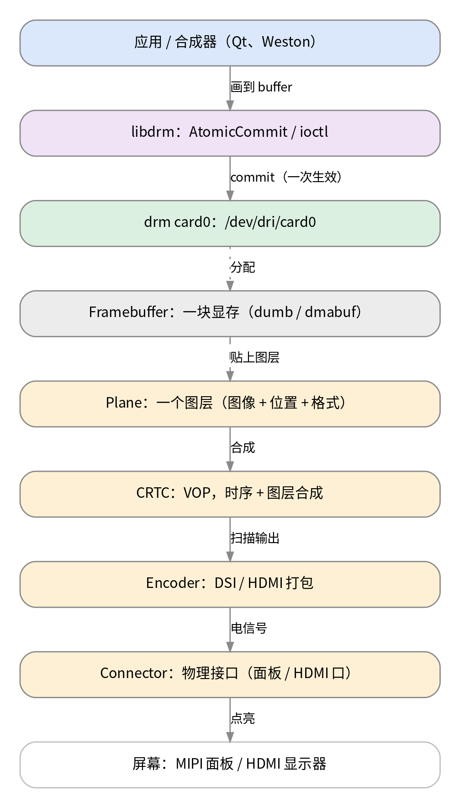

# Linux 图形系统的本质

## 一、先说结论

Linux 的图形系统，本质就是**操作显示设备这个普通外设**：有人往一块显存里写像素，内核按面板时序把这块显存扫到屏幕上。

围绕它长出来的整套生态（Xorg、Weston、Qt、GTK），解决的是另外四件事：**多窗口、合成、输入分发、GPU 加速**。

三个"不是必须"先记住：

| 不是必须 | 说明 |
|---|---|
| 桌面环境不是必须 | 没有面板、任务栏也能显示 |
| 显示服务器不是必须 | 直接写 `framebuffer`、或 Qt 的 EGLFS 直出 |
| GPU 不是必须 | 纯 CPU 画 + 显示控制器扫描也能出画面 |

一句话记：**显示 = 一块内存被谁写、什么时候翻到屏幕上。**

## 二、一条像素到屏幕的路



四步，缺一不可：

| 步骤 | 谁做 | 做什么 |
|---|---|---|
| 1. 分配显存 | 应用 / 图形栈 | 拿到一块能被显示控制器读的内存（`dumb buffer` 或 `dmabuf`） |
| 2. 画 | 应用（CPU 或 GPU） | 把界面渲染成这个格式的像素（ARGB8888、RGB565…） |
| 3. 合成（可选） | 合成器 / 显示控制器 | 多个图层叠在一起（窗口、鼠标、视频层） |
| 4. 扫描输出 | 显示控制器（VOP/DC） | 按 h/v 时序把显存逐行送到 DSI/HDMI，并**在消隐期换页** |

第 4 步的"消隐期换页"就是**避免撕裂**的关键：如果在扫描到屏幕中间时换显存，上半屏是新帧、下半屏是旧帧。双缓冲 + 垂直同步就是在等这个时间窗。

## 三、DRM / KMS 是什么

| 名词 | 全称 | 管什么 |
|---|---|---|
| **DRM** | Direct Rendering Manager | 显卡/显示设备的统一内核接口：显存分配、命令提交、对象管理 |
| **KMS** | Kernel Mode Setting | 显示模式设置：分辨率、刷新率、时序、图层合成、换页 |
| **GEM** | Graphics Execution Manager | DRM 里的显存对象管理（handle → 实际 buffer） |

DRM 把显示设备抽象成一组对象，这也是你调试时看到的东西：

| 对象 | 一句话 | 常见坑 |
|---|---|---|
| `card0` | 整个设备（`/dev/dri/card0`） | 没有它 = 驱动没 probe 成功 |
| `Framebuffer` | 一块显存 + 像素格式 + 宽高 | 格式和面板不符 → 颜色错/花屏 |
| `Plane` | 一个图层（图像 + 位置 + 缩放 + alpha） | 数量有限，多了要软件合成 |
| `CRTC` | 扫描输出单元（RK 上就是 VOP） | 时序错 → 黑屏但背光亮 |
| `Encoder` | 把像素流打包成 DSI/HDMI 信号 | DSI 初始化序列错 → 点不亮 |
| `Connector` | 物理接口 + 接了什么（EDID/面板） | 热插拔检测、EDID 读不到 |

**为什么强调 atomic commit**：老接口是一个属性一个 ioctl 地改，改到一半屏幕就开始扫，会闪。`atomic` 把"这一帧的所有改动"打包成一次提交，内核在合适的时机一次性生效。

```bash
# 看当前显示设备与连接器状态（libdrm 自带工具）
modetest -c                 # 列出 card / connector / 支持的模式
modetest -M rockchip -s 40:1920x1080   # 直接把某个 connector 设成某模式
```

嵌入式调试里 `modetest` 是最有用的一条命令：**它能绕过所有图形栈，直接验证"内核 + 硬件"这段通不通**。

## 四、不用显示服务器也能显示

这是最容易混淆的地方。三条路，复杂度递增：

| 方式 | 谁写显存 | 依赖 | 典型用途 |
|---|---|---|---|
| 写 `/dev/fb0`（fbdev） | 应用自己 `mmap` + `memcpy` | 只要内核开了 fbdev | 老代码、简单 UI、控制台 |
| libdrm + KMS | 应用自己，但用 DRM 接口设模式 | libdrm | `modetest`、自研显示程序 |
| EGL + GBM + KMS | GPU 渲染到 GBM buffer，再 KMS 上屏 | Mesa/GPU 驱动 | Qt EGLFS、Weston |
| X / Wayland | 客户端画，服务器合成 | 显示服务器 | 桌面、多窗口 |

`fbdev`（`/dev/fb0`）是 DRM 之前的旧框架，现在多数 SoC 由 DRM 提供 **fbdev 模拟**（`CONFIG_DRM_FBDEV_EMULATION`）来兼容老程序。它没有 vsync 控制、没有多图层，**能用但不推荐做产品界面**。

## 五、为什么 DRM 在 `drivers/gpu/` 下面

历史原因，不是分类错误：

1. DRM 诞生时只为一件事件——**让多个程序安全、高效地直接使用 GPU 渲染**（名字里的 "Direct Rendering"）；
2. 那时"设置显示模式"是另一个模块 fbdev 干的；
3. 后来发现两者必须协同（换页要和扫描同步、图层要交给硬件合成），KMS 被并进 DRM；
4. 目录结构沿用下来，于是今天的 `drivers/gpu/drm` 实际是**整个图形/显示子系统**，不只是 GPU。

所以查"屏幕不亮"也要去 `drivers/gpu/drm/`，不要以为是"GPU 的事"就不看。

## 六、X11 与 Wayland 的本质区别

两者都是"显示服务器"，但**像素归谁管**完全不同：

| 维度 | X11（Xorg） | Wayland（Weston 等） |
|---|---|---|
| 客户端画到哪 | X server 的 pixmap（间接渲染），或 DRI3 直渲后共享 buffer | **自己的 buffer**，通过 `dmabuf` 交给合成器 |
| 合成谁做 | 可选：没有合成器时窗口直接画到屏幕 | **合成器永远在**，它就是显示服务器 |
| 每帧拷贝 | 间接渲染时可能多一次拷贝 | 零拷贝（`dmabuf` 直接给硬件图层） |
| 撕裂 | 无合成器时容易撕裂 | 合成器按 vsync 提交，天生不撕裂 |
| 输入 | 全局坐标系，任何客户端能读全屏输入 | 合成器分发，客户端只拿到自己窗口内的事件 |
| 网络透明 | 有（`ssh -X` 能把窗口显示到远端） | 没有（要靠 waypipe/RDP 一类额外方案） |
| 安全隔离 | 弱：客户端能抓全屏、注入输入 | 强：默认拿不到别人画面 |

一句话记：**X11 是"服务器替客户端画"，Wayland 是"客户端自己画、合成器只负责拼"。**

## 七、现象对应到哪一层

排查时就按这条链往下切，别一上来就怀疑应用：

| 现象 | 大概率在这层 | 先看什么 |
|---|---|---|
| 完全没有 `/dev/dri/card0` | 内核驱动 | `dmesg \| grep -i drm`、设备树 `status` |
| 有 card0，`modetest -c` 看不到 connector | 设备树 / 面板节点 | dts 里 panel、dsi、`status = "okay"` |
| 背光亮、屏幕全黑 | KMS 时序 / DSI 初始化 | `modetest` 直接设模式；panel 初始化序列 |
| 花屏、颜色错 | 像素格式 / 显存 stride | framebuffer 格式、`pitch` 是否对齐 |
| 画面撕裂 | 没等 vsync 换页 | 是否双缓冲 + atomic commit + page flip 事件 |
| 动画卡顿掉帧 | 合成路径 / GPU | 有没有走 GPU 合成、是否每帧全屏重绘 |
| 触摸位置偏 | 输入坐标变换 | 触摸屏 `swapaxes`/`invert`/旋转配置 |
| 应用起不来报 `could not connect to display` | 显示服务器 | `DISPLAY`/`WAYLAND_DISPLAY` 是否设置 |

（RK3568 的 VOP/DSI/HDMI 具体源码位置见 [RK3568 源码结构](./../07-开发板操作与环境/BOARD-12-源码-RK3568源码结构.md)。）

## 八、一句话总结

**Linux 图形系统就是"往显存写像素 + 按时序扫到屏幕"：DRM/KMS 是内核这层的接口（card/plane/crtc/encoder/connector + atomic commit），Xorg/Wayland 只是在此之上解决多窗口与合成，不要把它们当成显示的必要条件。**
