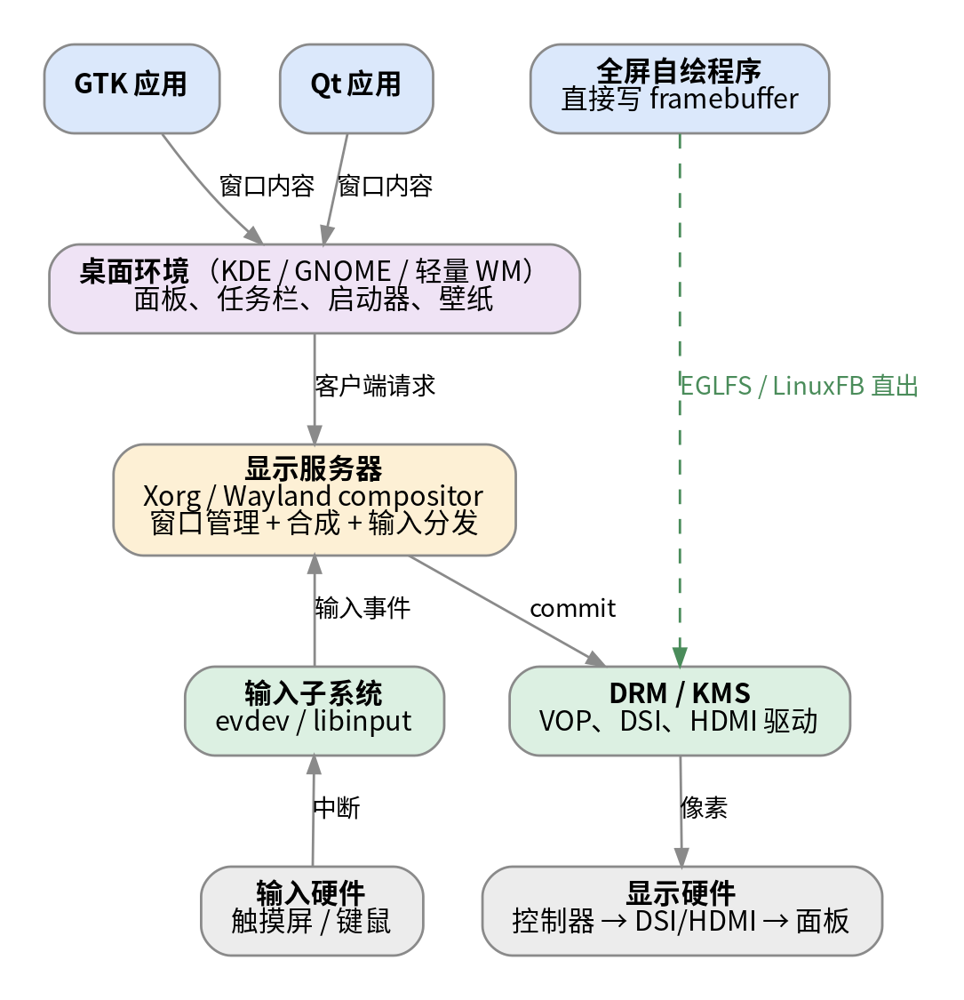

# 图形界面与 Qt

## 一、先说结论

跑一个 Qt 程序，**需要的不是一个桌面，而是"一条能到 DRM 的路"**：

| 你可能以为 | 实际 |
|---|---|
| 要先装 KDE/GNOME 才能显示 | 不用，Qt 可以直接全屏输出 |
| 要先跑 Xorg 才能显示 | 不用，`QT_QPA_PLATFORM=eglfs` 就绕过了 |
| Qt 自己会画到屏幕上 | 不会，Qt 把像素交给**平台插件**，插件再交给 DRM/服务器 |

**Qt 的"平台插件"（QPA，Qt Platform Abstraction）决定它接到哪一层**——这是理解 Qt 在嵌入式上怎么显示的唯一关键。

## 二、一条完整的链路



| 层 | 职责 | 没有它会怎样 |
|---|---|---|
| 桌面环境（KDE/GNOME） | 面板、任务栏、启动器、壁纸、快捷键 | 只是"没有桌面样子"，应用照样能跑 |
| 显示服务器（Xorg/Wayland） | 窗口管理、合成、输入分发 | 只能一个全屏应用，无法多窗口 |
| DRM/KMS | 显存、时序、图层、换页 | 什么都显示不了 |
| 输入子系统 | 把触摸/键鼠变成 `/dev/input/eventN` 事件 | 有画面但点不动 |

图里两条路径的差别，就是嵌入式选型的核心：

- **走中间（桌面 + 服务器）**：多窗口、可切换、开发方便，代价是内存与 CPU（Xorg 常占几十 MB）。
- **走右边绿虚线（EGLFS/LinuxFB 直出）**：一个应用独占全屏，没有服务器进程，启动快、内存省，**产线设备基本都用这条**。

## 三、四个角色别搞混

| 角色 | 是什么 | 例子 |
|---|---|---|
| **显示服务器** | 管窗口、合成、输入的常驻进程 | Xorg（X11）、Weston（Wayland） |
| **窗口管理器（WM）** | 管窗口边框、拖动、层叠顺序 | X11 下的 openbox/mutter；Wayland 下由合成器内建 |
| **合成器** | 把多个窗口画面合成为一帧 | X11 下是 picom；Wayland 下合成器就是服务器 |
| **桌面环境（DE）** | 服务器 + WM + 面板 + 设置 + 文件管理器的一整套 | KDE、GNOME、XFCE |

关系是**包含**：桌面环境 ⊃ 显示服务器 + 窗口管理器 + 一堆应用。

所以"我只想跑一个 Qt 界面"时，**后三个全可以不要**。

## 四、没有桌面时怎么跑 Qt

### 方式一：只起服务器，不起桌面

```bash
# 纯命令行（无 display manager），手工起 Xorg
startx &            # 屏幕上可能只有灰底 + 一个 xterm

# 另开一个终端（ssh 或串口）
export DISPLAY=:0
./my_qt_app         # 只出现应用窗口，没有面板、任务栏、壁纸
```

`startx` 起的是 Xorg（`DISPLAY=:0`），Qt 走 `xcb` 插件连上去。这就是"桌面环境不是必须"的实证。

### 方式二：连服务器都不要（EGLFS）

```bash
export QT_QPA_PLATFORM=eglfs
./my_qt_app
```

Qt 直接把窗口渲染成 GBM buffer，用 `atomic commit` 交给 KMS 上屏。**没有 Xorg、没有 Weston、没有窗口管理器**，一个进程独占屏幕。

### 方式三：老式帧缓冲（LinuxFB）

```bash
export QT_QPA_PLATFORM=linuxfb:fb=/dev/fb0
./my_qt_app
```

只写 `/dev/fb0`，最省事也最简陋：无 vsync、无多图层、缩放靠 CPU。仅在 EGL/GPU 不可用时用。

## 五、Qt 的平台插件（QPA）一览

| 插件 | `QT_QPA_PLATFORM=` | 接到哪 | 适用 |
|---|---|---|---|
| **xcb** | `xcb` | Xorg | 桌面调试、有 X 的环境 |
| **wayland** | `wayland` | Wayland 合成器 | 现代桌面发行版 |
| **eglfs** | `eglfs` | EGL + KMS/GBM（或 fbdev） | **嵌入式全屏首选** |
| **linuxfb** | `linuxfb` | `/dev/fb0` | 无 GPU/EGL 时的兜底 |
| **vnc** | `vnc` | 自己起 VNC 服务 | 无屏幕时远程看界面 |
| **minimal/offscreen** | `minimal` | 不显示 | 单元测试、CI |

查看当前 Qt 支持哪些插件：

```bash
ls /usr/lib/qt/plugins/platforms/       # 或 Qt 安装目录下 plugins/platforms
# libqeglfs.so  libqlinuxfb.so  libqxcb.so ...
```

**报 "no Qt platform plugin could be initialized" 时，先看这个目录里有没有你设的那个 `.so`。**

## 六、EGLFS 在 RK3568 上怎么配

```bash
export QT_QPA_PLATFORM=eglfs
export QT_QPA_EGLFS_INTEGRATION=eglfs_kms        # 用 KMS/GBM，而不是 fbdev
export QT_QPA_EGLFS_KMS_CONFIG=/etc/qt/eglfs.json
export QT_QPA_EGLFS_PHYSICAL_WIDTH=154           # 毫米，影响 DPI 计算
export QT_QPA_EGLFS_PHYSICAL_HEIGHT=86
./my_qt_app -platform eglfs
```

`eglfs.json` 用来指定用哪个 card、哪个 connector、要不要旋转/缩放：

```json
{
  "device": "/dev/dri/card0",
  "outputs": [
    { "name": "DSI-1", "mode": "1920x1080", "rotation": 90 }
  ]
}
```

四个常见配置坑：

| 现象 | 原因 |
|---|---|
| 起不来，报 `EGL not available` | 板子上没有 GPU 驱动 / libmali 没装对 |
| 画面方向不对 | `rotation` 与面板实际方向不一致（竖屏面板要 90/270） |
| 只显示在 HDMI 上，DSI 黑 | `outputs` 里只列了 HDMI，或 connector 名写错（`modetest -c` 查真名） |
| 帧率被锁很低 | 没开 vsync 或 eglfs 走了软件渲染（查 `QT_LOGGING_RULES=qt.qpa.*=true`） |

## 七、输入从哪来

EGLFS 模式下没有服务器，**Qt 自己从 `/dev/input/eventN` 读事件**（evdev 插件）：

```bash
export QT_QPA_EVDEV_TOUCHSCREEN_PARAMETERS=/dev/input/event1:rotate=270
export QT_QPA_EVDEV_MOUSE_PARAMETERS=/dev/input/event2
export QT_QPA_EVDEV_KEYBOARD_PARAMETERS=/dev/input/event0
```

| 需求 | 参数 |
|---|---|
| 触摸坐标翻转/交换 | `:rotate=90`、`:invertx`、`:inverty`、`:swapxy` |
| 只接一个触摸屏 | 直接写死的设备节点，避免热插拔时抢设备 |
| 键鼠 | 不设参数也行，Qt 会自动枚举 `/dev/input/event*` |

先用 `evtest` 确认设备对不对：

```bash
evtest /dev/input/event1        # 摸屏幕看有没有 ABS_X/ABS_Y 上报
```

**"画面正常但点不动"** 的排查顺序：`evtest` 有没有事件 → `eventN` 是不是触摸屏 → Qt 参数里的 rotate 对不对。

## 八、常见启动报错

| 报错 | 原因 | 处理 |
|---|---|---|
| `could not connect to display` | 没设 `DISPLAY` / Xorg 没起 | `export DISPLAY=:0`，或改用 eglfs |
| `Could not load the Qt platform plugin "xcb"` | 缺 `libqxcb.so` 或其依赖 | `ldd libqxcb.so` 看缺哪个库 |
| `no Qt platform plugin could be initialized` | 设的平台名不存在 | 查 `plugins/platforms/` 实际有哪些 |
| `EGL Error: Could not create the egl surface` | EGL/GPU 驱动问题 | 先跑 `eglinfo`/`es2_info` 验证 |
| `Failed to open /dev/dri/card0` | 权限或驱动没 probe | 加用户到 `video` 组；`dmesg` 看驱动 |
| 中文显示成方块 | 缺字体 | 装 `fontconfig` + 中文字体，或 `-fontdir` 指定 |

打开 Qt 自己的日志，能把上面这些一次性看清：

```bash
export QT_LOGGING_RULES="qt.qpa.*=true"
./my_qt_app 2>&1 | head -40
```

## 九、一句话总结

**Qt 显示靠平台插件：`xcb` 连 Xorg、`wayland` 连合成器、`eglfs` 直接接 DRM/KMS；桌面环境只是"锦上添花"，产线设备用 `QT_QPA_PLATFORM=eglfs` 独占全屏最省资源。**
