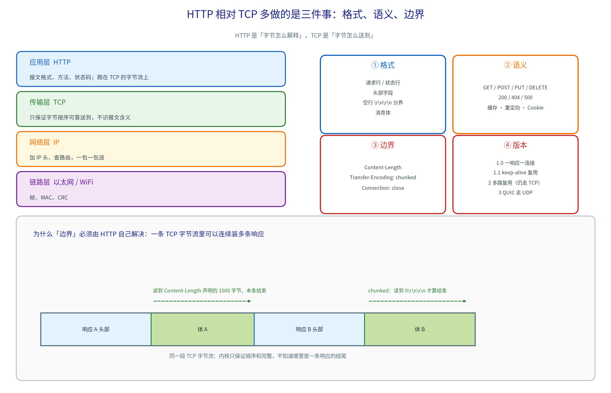
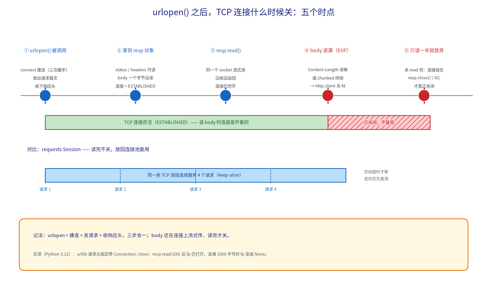

# HTTP 与 TCP 的分工：urlopen 什么时候建连、什么时候关 笔记

> 承接「TCP/IP 我懂，HTTP 不懂，也不知道它怎么用传输层」这个卡点。
> 上篇讲 socket 是接口（见 [socket 与协议栈的关系](./NET-05-socket与协议栈的关系.md)），这篇讲 HTTP 在这条接口上多做了什么，以及 `urlopen` 的建连、收发、关连分别落在哪一步。

---

## 一、HTTP 在 TCP 之上多做的三件事

TCP 只承诺「字节按序、不丢、不重地送到」，剩下三件事全得应用层自己做：



**① 格式**：报文长成什么样。请求行（`POST /api HTTP/1.1`）+ 头部字段 + **一个空行 `\r\n\r\n`** + 消息体。那个空行不是排版需要——它是「头部到此结束、后面是体」的唯一分隔符，没有它，接收方永远不知道头部在哪停。

**② 语义**：这批字节代表什么意思。方法（GET 取、POST 交）、状态码（200 成功、404 没有、500 服务器炸了）、缓存、重定向、Cookie。**HTTP 天生无状态**，每个请求都是独立的，服务器不记得上一个请求是谁——所以才有 Cookie / token / session 这些外挂来补记忆。

**③ 边界**：一条响应到哪结束。这是最容易被忽略、也最容易出 bug 的一环，原因见下图底部：

- 一条 TCP 连接上可以**连续装多条响应**（keep-alive 时就是这样）；
- TCP 只保证字节完整，**不知道哪里是一条响应的结尾**；
- 所以 HTTP 必须自己声明结束位置，三种办法：
  - `Content-Length: 1000` —— 明确字节数，读够就停；
  - `Transfer-Encoding: chunked` —— 分块发送，以 `0\r\n\r\n` 作为终结标记（长度事先不知道时用）；
  - `Connection: close` —— 不声明长度，靠「服务器关连接」这个动作表示结束（最原始、也最耗资源）。

---

## 二、三个版本，分别和传输层什么关系

| 版本 | 连接模型 | 并发方式 | 传输层 |
|---|---|---|---|
| HTTP/1.0 | 一个请求一条 TCP，用完就关 | 靠开多条连接 | TCP |
| HTTP/1.1 | 默认 keep-alive，一条连接串行发多个请求 | 串行（队头阻塞） | TCP |
| HTTP/2 | 一条连接多路复用，二进制分帧 | 并行流，仍受 TCP 丢包阻塞 | TCP |
| HTTP/3 | 同上，但连接建立更快、丢包互不影响 | 并行流 | **QUIC / UDP** |

记住一点：**HTTP/1.1 起，「关不关连接」不再由协议强制，而是由 `Connection` 头协商**——这也是下面 urllib 与 requests 行为差异的根源。

---

## 三、urlopen 到底做了哪几步

`urllib.request.urlopen(url)` 不是「只建连接」，也不是「纯收发」，而是**三步合一**：

1. `connect()` —— 建 TCP 连接（三次握手），HTTPS 再多一次 TLS 握手；
2. 发请求 —— 按 HTTP 格式拼好请求行/头/体，写进 socket；
3. 收响应头 —— 只读到 `\r\n\r\n` 为止，**返回时 body 还没开始读**。

所以你 `urlopen` 一返回就能看状态码和头部，正是因为头部已经收完了：

```python
from urllib.request import urlopen

resp = urlopen("https://example.com/api", timeout=5)
print(resp.status, resp.headers["Content-Type"])   # 此时只收到了响应头
body = resp.read()                                  # body 在这之后才流式读进来
```

---

## 四、read 的时候连接还开着吗

**开着。** 这是关键结论：`urlopen` 返回后连接依然是 `ESTABLISHED`，body 是在这条连接上流式传的，`read()` 只是从同一个 socket 往外搬字节。



五个时点，逐一看连接状态：

| 时点 | 发生了什么 | TCP 连接 |
|---|---|---|
| ① `urlopen()` 调用中 | 建连 + 发请求 + 收响应头 | 刚建立，`ESTABLISHED` |
| ② 返回 `resp` | `status` / `headers` 可读，body 零字节 | 仍然开着 |
| ③ `resp.read()` | 从同一 socket 流式读，边收边返回 | **仍然开着** |
| ④ body 读满（EOF） | `Content-Length` 读够，或 chunked 终结，或对端 FIN | **此刻关闭**（`http.client` 自动 `_close_conn`） |
| ⑤ 只读一半就放弃 | 不读了，连接挂在半空 | 直到 `resp.close()` 或对象被回收才关 |

在云主机上实测（Python 3.12，服务端 `Content-Length: 1000`）：

```
status: 200 | resp 响应头 Connection: None
fp 一开始: <_io.BufferedReader name=6>
read(100) -> 100 字节; length 余: 900
只读 100 后 fp 是否关闭: False      ← 连接还开着
把剩余读完 -> 900
读完 fp: None | r.isclosed(): True   ← 读到 EOF 才关
```

---

## 五、为什么 urllib 一定是短连接

翻一下 `urllib/request.py` 的 `AbstractHTTPHandler.do_open()`，有两句写死的行为：

```python
headers["Connection"] = "close"     # 每个请求都明确要求“用完就关”
...
r = h.getresponse()
if h.sock:
    h.sock.close()                  # 拿到响应头后就把 socket 对象关掉
    h.sock = None
```

第二句看着矛盾：刚收完头就关 socket，body 还怎么读？答案是 **fd 没真关**——body 的读对象是 `sock.makefile()` 造出来的，它持有底层 fd，`sock.close()` 只是解除 socket 对象这层引用，真正 `close(fd)` 发生在读对象关闭时，也就是 `_close_conn()` 被调用的那一刻（读满 / EOF / 显式 `resp.close()`）。

结论：**urllib 一个请求一条连接，读完就关，没有复用**。想复用必须自己拿 `http.client.HTTPConnection` 手工管，或者直接上 requests。

> 「读到一半停下，服务端到底知不知道」这类问题的答案，见 [NET-06](./NET-06-传输层-接收窗口与反压.md)：内核替你先收下并回 ACK，服务端根本感知不到应用读了没有。

---

## 六、requests 为什么能复用

`requests.get()` 每次调用是短连接（内部临时建 Session 又丢掉），但**显式用 `Session` 就会池化**：读完 body 的连接不关，放回池子给下一个请求用。

```python
import requests

s = requests.Session()          # 连接池跟着它活着
s.get("https://example.com/a")  # 建连
s.get("https://example.com/b")  # 复用同一条 TCP，省掉握手
```

实测（同一个服务端记客户端端口）：

```
session 复用的客户端端口: [42658, 42658, 42658]   ← 同一条连接
不带 Session 三次:        [42672, 42674, 42680]   ← 三条连接
```

对照表：

| | `urlopen` | `requests.get` | `requests.Session` |
|---|---|---|---|
| 是否带连接池 | 否 | 否（一次性 Session） | 是 |
| 默认 `Connection` 头 | `close` | `keep-alive` | `keep-alive` |
| body 读完后 | 关 fd | 连接随响应对象丢弃 | 归还池子复用 |
| 适合场景 | 一次性抓取、脚本 | 少量请求 | 高频调用、爬虫、客户端 |

---

## 七、几个真会踩的坑

1. **`resp` 不关**：`urlopen` 返回的对象不显式 `close()`（或不用 `with`），连接和 fd 会挂到 GC 才释放，循环里抓几百次就可能 `Too many open files`。
2. **只读一部分就 break**：连接既没关也没读完，服务端可能一直等你读（尤其 chunked）；要么读完，要么 `resp.close()`。
3. **大文件别 `read()`**：`read()` 一次性把整个 body 拉进内存；固件、日志这类大文件要流式写盘：

```python
from urllib.request import urlopen

with urlopen("https://example.com/fw.bin", timeout=30) as resp, \
        open("fw.bin", "wb") as f:
    for chunk in iter(lambda: resp.read(65536), b""):   # 读到 b"" 为止
        f.write(chunk)
```

4. **重定向是内部重连**：遇到 3xx，urllib 会关掉旧连接、对新地址再走一遍「建连 + 请求 + 收头」，所以「一次 `urlopen` = 一条连接」不一定成立（`requests` 同理）。
5. **`timeout` 管不到慢速 body**：`timeout` 是 socket 层单次操作超时，不是「整个请求总时长」；body 一点点往外挤（slowloris 式）也能拖很久，需要自己加总时长控制。
6. **复用的连接被对端关了**：keep-alive 空闲超时后服务器发 FIN，池子里的连接变成死连接，下个请求报 `RemoteDisconnected` / `Connection reset`，requests 一般会自动重试一次，但幂等性要自己确认。

---

## 八、把两条线接起来

```
你的代码：requests.get() / urlopen()
   ↓  拼 HTTP 报文（一、格式 + 二、语义）
socket：sendall() / recv()  ← 本文第三、四节的建连与关连就发生在这层
   ↓
内核 TCP/IP：分段、重传、按序（见 NET-02、NET-05）
```

看到「连接什么时候关」这类问题，落到最底层永远是：**`close()` 是应用层动作，`FIN` 是它触发的后果；读到 EOF 说明对端（或协议栈替对端）已经发了 FIN。**

想动手验证：用 [Python 网络请求示例脚本](../12-Python/code/Python网络请求学习代码.py) 起一个本地服务，再配 `ss -tnp` 看连接状态，比只读概念快得多。
