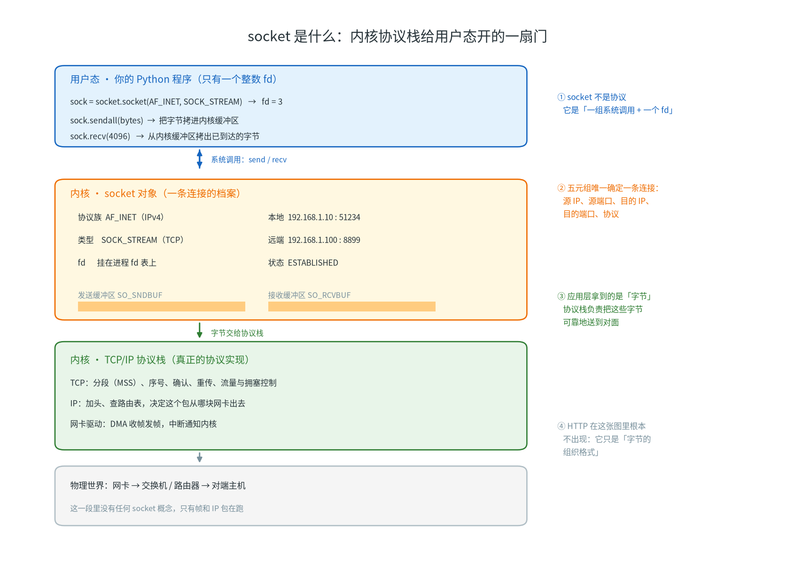
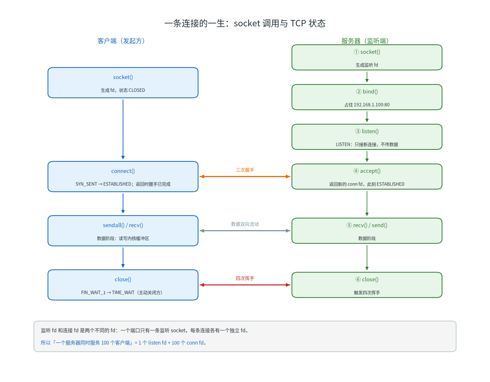

# socket 与 TCP/IP 的关系 笔记

> 从「TCP/IP 我懂、但 socket 到底是个啥」这个卡点写起：socket 是内核协议栈对用户态开的一扇门。
> 内容：socket 对象与 fd、五元组、一条连接的完整生命周期、send/recv 的真实语义、阻塞与多路复用、和 HTTP 库的关系。

---

## 一、先回答：socket 不是协议，是接口

TCP/IP 是**内核里跑的协议实现**，socket 是它**对外开放的一组系统调用 + 一个 fd**。你的程序从头到尾只碰 socket，从不碰协议栈内部。

```
你的程序（HTTP 报文、业务逻辑）
      ↓  只有这一层交界
socket：send() / recv() —— 一个 fd 上的读写
      ↓
内核 TCP/IP 协议栈（分段、重传、路由）
      ↓
网卡
```



三句话记住分工：

- **TCP/IP 负责「送到」**：分段、序号、确认、重传、路由；
- **socket 负责「交接」**：把字节从用户态搬进内核，再把到达的字节搬出来；
- **HTTP 负责「格式」**：这串字节怎么组织成一条消息（详见 [HTTP 请求问答](../12-Python/Python-06-网络-HTTP请求与urllib.md)）。

---

## 二、socket 在内核里长什么样

你在 Python 里拿到的 `sock` 对象，落到内核里就是一张表项——**一条连接的档案**：

| 字段 | 示例 | 说明 |
|---|---|---|
| 协议族 | `AF_INET` | IPv4；IPv6 用 `AF_INET6` |
| 类型 | `SOCK_STREAM` | TCP；`SOCK_DGRAM` 是 UDP |
| 本地端点 | `192.168.1.10:51234` | 源 IP + 源端口 |
| 远端端点 | `192.168.1.100:8899` | 目的 IP + 目的端口 |
| 状态 | `ESTABLISHED` | 落在 TCP 状态机的哪一步 |
| 发送/接收缓冲区 | 各几十 KB | 真正暂存字节的内存（`SO_SNDBUF` / `SO_RCVBUF`） |

**五元组** = 源 IP + 源端口 + 目的 IP + 目的端口 + 协议。它唯一确定一条连接，也是「一台机器同时开几万条连接」能成立的原因：源端口不同，五元组就不同。

**socket 就是一个 fd**：在 Linux 里它挂在进程的文件描述符表上，所以能 `read`/`write`、能被 `select`/`poll`/`epoll` 监听、能被 `dup`、能被子进程继承。`send`/`recv` 就是这条 fd 上的 `write`/`read` 特化版。

---

## 三、一条连接的一生：调用与 TCP 状态



| 调用 | 内核做了什么 | TCP 状态 |
|---|---|---|
| `socket()` | 建空壳：分配对象、缓冲区，返回 fd | `CLOSED` |
| `bind()` | 把本地 IP:端口 记到这个 socket 上 | `CLOSED` |
| `listen()` | 变成监听 socket，建两个连接队列 | `LISTEN` |
| `connect()` | 发 SYN、等 SYN+ACK、回 ACK —— **握手在这步完成** | `SYN_SENT → ESTABLISHED` |
| `accept()` | 从「已完成握手」队列取一条，**返回一个新 fd** | 新 fd 即 `ESTABLISHED` |
| `send()` / `recv()` | 只搬字节，不参与协议 | `ESTABLISHED` |
| `close()` | 引用计数减一，减到 0 才发 FIN | `FIN_WAIT_1 → TIME_WAIT` |

**服务器：**

```python
import socket

srv = socket.socket(socket.AF_INET, socket.SOCK_STREAM)
srv.setsockopt(socket.SOL_SOCKET, socket.SO_REUSEADDR, 1)   # 重启时不必等 TIME_WAIT
srv.bind(("0.0.0.0", 8899))      # ② 占端口：0.0.0.0 表示所有网卡
srv.listen(128)                  # ③ 变成监听 socket，backlog=128
conn, peer = srv.accept()        # ④ 阻塞直到有连接；握手早已由内核完成
data = conn.recv(4096)           # ⑤ 只搬字节
conn.sendall(data[::-1])         #    回一份数据
conn.close()                     # ⑥ 关的是这条连接，不是监听 socket
srv.close()
```

**客户端：**

```python
import socket

c = socket.create_connection(("127.0.0.1", 8899), timeout=3)  # 建连 + 握手
c.sendall(b"hello")
print(c.recv(4096))
c.close()
```

两个关键点：

1. **`listen` 的 fd 和 `accept` 返回的 fd 是两个不同的 fd**。前者只接新连接、不传数据；每条连接一个独立 fd。所以「一个服务器服务 100 个客户端」= 1 个 listen fd + 100 个 conn fd。
2. **`connect()` 返回时三次握手已经完成**，`accept()` 返回时也是。握手由内核发起和应答，你的代码只是「等结果」。

---

## 四、send / recv 的真实语义

这是最容易想错的地方：**`send` 成功 ≠ 对方收到了**。

- `sendall()` 只是把字节拷进**本机内核的发送缓冲区**，然后立刻返回（缓冲区满时才阻塞）。之后由 TCP 负责分段、编号、重传、等确认。所以发送成功只能说明「我这边交了卷」。
- `recv(4096)` 从**接收缓冲区**拷出「当前已到达」的字节，返回数量可能远小于 4096。TCP 是字节流，没有消息边界，必须循环读：

```python
def recv_exactly(sock, n):
    """按字节数读满 n 字节；返回 b"" 表示对端已关闭"""
    buf = b""
    while len(buf) < n:
        chunk = sock.recv(n - len(buf))
        if not chunk:            # 对端发了 FIN
            break
        buf += chunk
    return buf
```

- **`recv` 返回 `b""` 才表示对端关闭**；返回「一半数据」是正常现象，不是出错。
- 因为边界要靠应用层自己划，HTTP 才需要 `Content-Length` / chunked——TCP 帮不了它。

---

## 五、socket 的类型

| 类型 | 对应协议 | 特点 | 典型用途 |
|---|---|---|---|
| `SOCK_STREAM` | TCP | 有连接、可靠、有序、无消息边界 | HTTP、SSH、自定义设备协议 |
| `SOCK_DGRAM` | UDP | 无连接、不保证到达、有消息边界（`sendto`/`recvfrom` 每次带地址） | DNS、视频、QUIC（HTTP/3） |
| `SOCK_RAW` | 直接操作 IP 层 | 自己组 IP 头，需要 root | 抓包、协议实验 |
| `AF_UNIX` | 不走网络栈 | 本机进程间通信 | 本机服务、容器 |

所以「socket = TCP」是误解：**socket 是网络 IO 的通用抽象**，UDP 也走同一套 API，只是没有连接状态。

---

## 六、阻塞、超时与多路复用

默认全是**阻塞**的：`accept`、`recv` 没数据就干等。三种处理方式：

| 方式 | 写法 | 特点 |
|---|---|---|
| 设超时 | `s.settimeout(3)` | 最简单；超时抛 `TimeoutError`（3.10 之前是 `socket.timeout`） |
| 非阻塞 + 轮询 | `s.setblocking(False)`，捕获 `BlockingIOError` | 自己控制循环，容易空转烧 CPU |
| 多路复用 | `select` / `poll` / `epoll` | 一个线程盯几百个 fd，谁就绪处理谁，生产级做法 |

常用 socket 选项（嵌入式调试常改）：

| 选项 | 作用 |
|---|---|
| `SO_REUSEADDR` | 允许在 TIME_WAIT 期间重新 bind 同一端口 |
| `SO_RCVBUF` / `SO_SNDBUF` | 调缓冲区大小，直接影响吞吐 |
| `TCP_NODELAY` | 关掉 Nagle 算法，小包立刻发（低延迟优先时开） |
| `SO_RCVTIMEO` / `SO_SNDTIMEO` | 内核级收发超时 |
| `SO_KEEPALIVE` | 内核定时发探测包，发现死连接 |

**嵌入式注意**：lwIP 提供的是 BSD 风格 socket，API 几乎一样，但选项被裁剪（`SO_RCVTIMEO` 不一定支持）、内存按 `MEMP_NUM_NETCONN` 之类宏静态分配，并发连接数和缓冲区大小要提前算，不能照搬 PC 上的默认值。

---

## 七、和 HTTP、urllib、requests 的关系

```
HTTP 报文（你拼的字符串）
  → socket.sendall()
  → 内核 TCP/IP
  → 对端
```

- `http.client` = socket + 按 HTTP 规则切报文（`\r\n\r\n` 切头、`Content-Length` 切体）；
- `urllib` = `http.client` + 重定向 / cookie / 代理；
- `requests` 的连接池，本质是**把 socket 对象存起来复用**，省掉每次握手。

所以调 `requests.get()` 时，底下发生的事就是本文第三、四节那套流程，一层都没少。

---

## 八、常见误解清单

1. **「socket 就是 TCP」** —— UDP、RAW、Unix socket 都是 socket；
2. **「socket 就是连接」** —— socket 是端点，一条 TCP 连接 = 两端各一个 socket + 五元组；
3. **「send 返回就代表对方收到了」** —— 只代表进了本机缓冲区；
4. **「recv 一次就是一条消息」** —— 字节流没有边界，边界靠应用层（HTTP 用 Content-Length）；
5. **「close 就是立刻断开」** —— fd 是引用计数，全部关闭才发 FIN，之后还有 TIME_WAIT；
6. **「端口被占用一定是程序没退」** —— 可能是 TIME_WAIT，服务器端需要 `SO_REUSEADDR`。

---

## 九、速查表

| 场景 | 该看什么 |
|---|---|
| 连接失败（Connection refused） | 对端没 `listen`、端口写错、防火墙 |
| 连上但收不到数据 | `recv` 语义（数据可能还没到）、对端是否真发了 |
| 收到半截报文 | 应用层边界没处理好，需要循环读到 Content-Length |
| `RemoteDisconnected` | 复用的连接已被对端关闭（keep-alive 超时） |
| 大量 TIME_WAIT | 主动关闭方短连接过多，改用连接复用 |
| 开发板连不上 | iptables、`bind` 的地址（`0.0.0.0` vs 具体网卡） |

想亲手验证这套流程，用 [Python 网络请求示例脚本](../12-Python/code/Python网络请求学习代码.py)：它自带的迷你服务器就是 `socket` + `http.server`，跑一遍再对着抓包看，比读十遍概念快。
