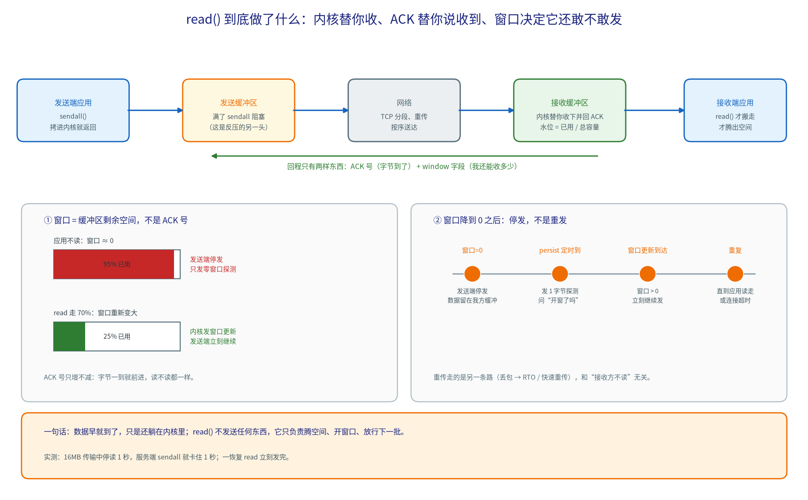

# read() 到底做了什么：内核代收、ACK、窗口与反压 笔记

> 这篇解决一个一直没想通的问题：服务端把数据发过来，我 `read` 到一半就停了，服务端怎么知道我没读完？
> 结论先给：**它不知道。** TCP 只提供「字节到没到」和「我还能收多少」，从不提供「应用读没读」。
> 顺带纠正一个常见误解：ACK 号不会因为你不读而不前进——不前进的是窗口。

---

## 一、先把问题摆清楚

直觉上的想象是这样：我 `read` 一次，服务端才知道我收了，才发下一段；我不 `read`，它就等着。

实际是这样：**你的内核一直在替你跟服务端对话，跟你的程序读不读没关系。** 你的程序只负责一件事——把已经躺在内核缓冲区里的字节搬走，顺便腾出空间。



所以「read 对底层没作用」这句只对一半：

- 对**收数据**没作用：数据早在你 `read` 之前就到了，ACK 也是内核发的；
- 对**能不能继续收**有决定性作用：`read` 腾出多少空间，窗口就开多大，发送端才敢发多少。

---

## 二、read 之前，数据在哪

在**内核的接收缓冲区**里（socket 对象上的 `SO_RCVBUF`）。它是 TCP 的「代收点」：

- 网卡收到包 → 协议栈校验、排序、去重 → 按序放进接收缓冲区 → **立刻回 ACK**；
- 应用调 `recv()`/`read()` → 从这块内存拷到用户态 → 拷贝掉多少，空间就空出多少。

所以「服务端一次把全部报文发过来」完全可能发生：只要总量不超过你这边缓冲区的容量。而且这个容量比多数人以为的大——Linux 会按 `tcp_rmem` 自动调优，缺省最大能涨到几 MB。

验证一下顺序其实很容易：连接建立后什么都不发，直接 `recv()`，会一直阻塞到一个字节都没有（HTTP 是客户端驱动，见 [NET-04](./NET-04-应用层-HTTP与TCP的分工.md)）；发完请求，数据才来。

---

## 三、ACK 确认的是字节，不是「应用处理了」

TCP 头的 ACK 号语义是：**「序号小于它的字节我都收到了，下一个我要这个」**，按字节累积。

| 量 | 含义 | 谁改它 | 受 read 影响吗 |
|---|---|---|---|
| ACK 号 | 字节已到达内核 | 接收端内核，随数据到达前进 | **不受影响** |
| window 字段 | 我还剩多少空间能接 | 接收端内核，随缓冲区占用变化 | **直接受影响** |
| seq 号 | 发送端这次发的起始字节 | 发送端 | 无关 |

关键点：**ACK 前进 ≠ 应用读完了**。字节进了缓冲区就回 ACK，此时你的程序可能一次 `recv` 都没调。这也是「服务端日志显示发送成功，但设备其实没处理」的根源——它得到的只是「字节进了你内核」这个事实。

反过来，ACK 号停滞也不代表「我没读」，只代表**数据没到**（丢了，或者还在路上）。

---

## 四、窗口 = 缓冲区剩余空间

窗口是 TCP 唯一的反压（backpressure）机制，值就是「接收缓冲区还能再塞多少字节」。

```
窗口 = 缓冲区总容量 − 已占用字节数
```

- 应用不读 → 占用越来越高 → 窗口越来越小；
- 窗口降到 0 → 发送端**停止发送**；
- 应用 `read()` 腾出空间 → 内核发一个**窗口更新**（本质是带新 window 值的 ACK）→ 发送端立刻恢复。

缓冲区大小是动态的：`tcp_rmem` 三个值（min / default / max），内核会根据带宽时延积自动往上调。手动 `SO_RCVBUF` 设得太小反而会压吞吐，一般只在嵌入式这种内存受限场景才去动它。

---

## 五、窗口降到 0 之后：停发，不是重发

窗口为 0 时发送端做的是：

1. **停止发送**，已发未确认的数据留着；
2. 启动 **persist timer**（坚持定时器），定期发一个极小的**零窗口探测包**，本质是问「窗口开了吗」；
3. 收到窗口更新 → 继续发；一直探测直到超时（`TCP_USER_TIMEOUT` 之类）判定连接坏了。

它**不会**循环重发已经确认过的数据。重传是另一条路：丢包触发 RTO 超时重传或快速重传，跟「接收方不读」没有关系。把这两件事混在一起，是很多人理解 TCP 时最卡的一步。

---

## 六、read 不是没意义：它决定链路能跑多快

实测（本机 16MB，服务端 `sendall`，客户端先只读 10 字节、停 1 秒、再恢复读）：

```
[停止 1s 后恢复读] 服务端 16MB 总共耗时 1.0s，客户端共读 16777206 字节
```

总耗时正好 1 秒——那 1 秒里服务端就卡在 `sendall`，客户端一恢复读，它立刻发完。也就是说：

**你的 `read` 速度 = 整条链路的实际速度。** 读得慢，发送端就被你拖慢；读得快，链路就跑满。这就是「反压」在工程上的样子，也是为什么大文件必须边收边写盘：

```python
from urllib.request import urlopen

with urlopen("https://example.com/fw.bin", timeout=30) as resp, \
        open("fw.bin", "wb") as f:
    for chunk in iter(lambda: resp.read(65536), b""):
        f.write(chunk)     # 边收边写：内核缓冲区持续被腾空
```

如果改成 `data = resp.read()` 再写盘，整包先进内存，几十 MB 的固件在嵌入式设备上直接 OOM。

---

## 七、服务端能不能知道你读没读完

**不能。** 它只能观察到两件事：连接关了没有、你的窗口还有多少。分三种情形：

| 你的行为 | 服务端看到什么 | 它「以为」什么 |
|---|---|---|
| 读一半，不关连接，数据量小于缓冲区 | 什么都没发生 | 发送成功，任务完成 |
| 读一半，不关连接，数据量大于缓冲区 | `send` 阻塞或 `EAGAIN`，窗口 0 | 对方暂时不收，等着 |
| 读一半就 `close()` | RST 或 FIN | 连接被复位/断开 |

实测两段（服务端发送，客户端只读 10 字节）：

```
[发送 200KB，客户端只读 10B 就停] 服务端 sendall: 完成 0.0s  | 再写一次: 成功（毫无察觉）
[发送 8MB，  客户端只读 10B 就停] 服务端 sendall: ConnectionResetError 1.2s | BrokenPipeError
```

第一段：200KB 全被对方内核收下并 ACK，服务端 `sendall` 立刻返回，甚至还能再写一次——它对「你只读了 10 字节」完全无感。

第二段：8MB 塞满窗口，`sendall` 卡住；客户端 `close()` 时因为**接收缓冲区还有未读数据**，Linux 发的是 **RST 而不是 FIN**，服务端下一次写才拿到 `ConnectionResetError` / `BrokenPipeError`。它看到的是「连接被复位」，依然不知道「你只读了一半」。

这条细节值得记住：**带未读数据关闭 → RST**。很多「服务端偶发 Connection reset by peer」都是客户端没读完就退出进程造成的。

---

## 八、工程结论

1. **慢 reader 会拖慢服务端**，不是「服务端自己发它的」。设备端处理慢（比如写 Flash），就要么提高 `read` 频率、要么加大缓冲、要么让服务端分包发送并等应用层确认。
2. **「发送成功」不等于「对方处理了」**。要确认处理，只能应用层回执：自定义协议的序号 + ACK、MQTT 的 QoS 1、HTTP 里就是再发一个请求（HTTP 本身没有消费回执）。
3. **只要一部分数据，用 Range 明确表达**（`Range: bytes=0-1023`，配合 `ETag` / `Last-Modified` 做断点续传），别指望服务端从窗口变化里猜你的意图。
4. **不读完就退出，等于给对面一个 RST**。抓包看到 RST 时，先查客户端是不是读了一半就关。
5. **别盲目调大 `SO_RCVBUF`**：内存吃紧的板子上，缓冲区大意味着长时间占着内存；而设得太小会限制吞吐。先算带宽时延积，再定值。
6. **反压是好事**：它让快的发送端等慢的接收端，而不是把数据丢了。真正要避免的是「读了不处理」和「处理了不读」。

---

## 九、速查表

| 现象 | 真正的原因 |
|---|---|
| 服务端 `send` 卡住不动 | 对方窗口为 0，在等对方 `read` |
| 客户端 `recv` 一直阻塞 | 请求还没发，或响应还没到 |
| ACK 号长时间不前进 | 丢包，或数据还在路上（与读不读无关） |
| 服务端报 `Connection reset by peer` | 客户端带着未读数据关闭了连接（RST） |
| 大数据 OOM | 用了 `read()` 全量，而不是流式分块 |
| 吞吐上不去 | 读得慢造成窗口收缩，或 `SO_RCVBUF` 太小 |

相关笔记：[HTTP 与 TCP 的分工](./NET-04-应用层-HTTP与TCP的分工.md)、[socket 与协议栈的关系](./NET-05-socket与协议栈的关系.md)、[TCP 三次握手与四次挥手](./NET-02-传输层-TCP三次握手与四次挥手.md)、[滑动窗口与 GBN](./NET-03-传输层-滑动窗口与GBN.md)。
