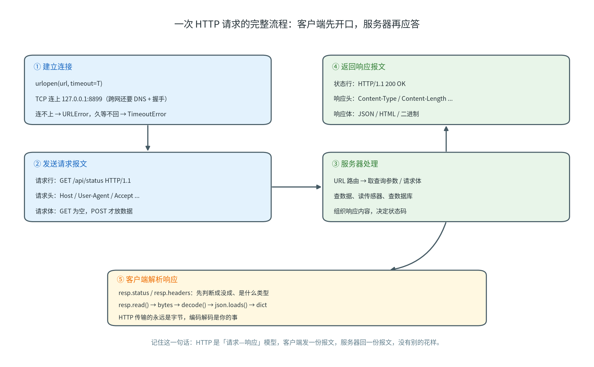
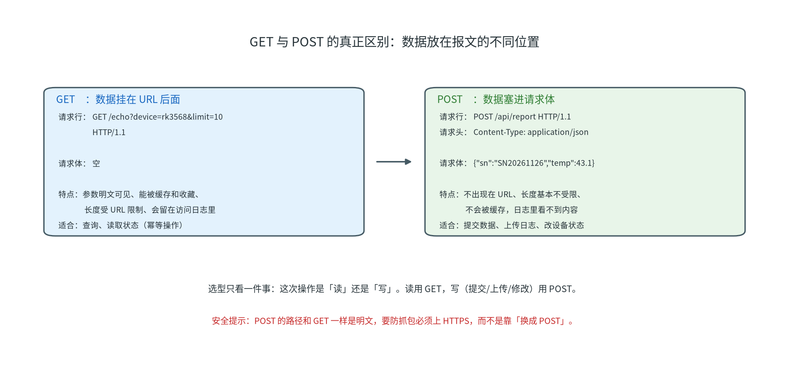
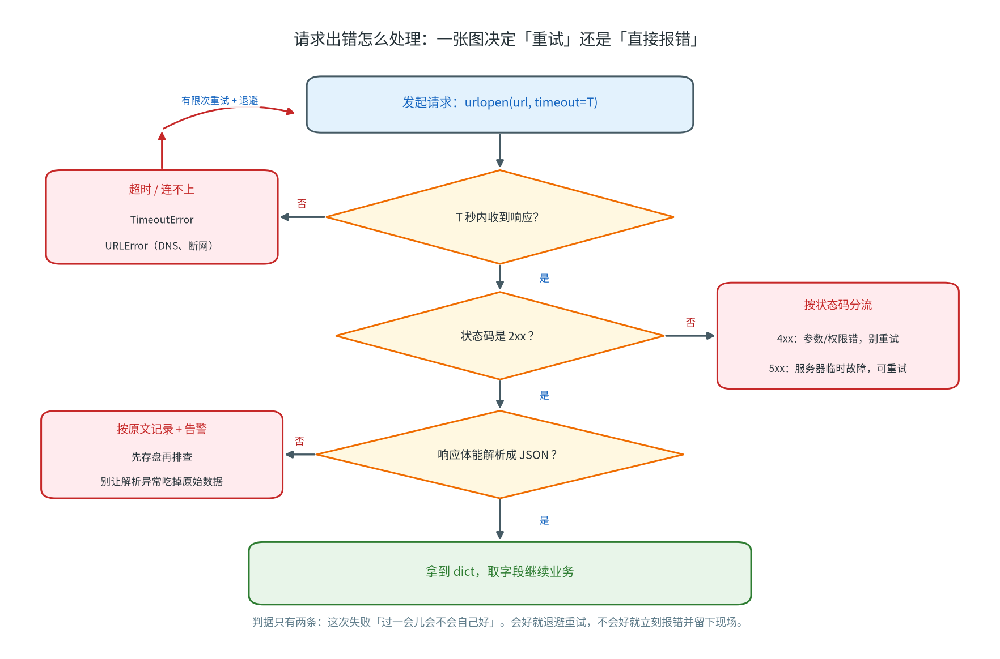

# Python 网络请求问答

> 从"程序怎么把网上的数据拿到手"讲起：先看清一份 HTTP 报文长什么样，再谈 urllib / requests 怎么写、JSON 怎么解、超时重试怎么设计。
> 讲解配图在 [images/](images/) 目录，可运行示例代码在 [code/Python网络请求学习代码.py](code/Python网络请求学习代码.py)（配套 `Python网络请求学习代码_config.txt`）。

---

## 目录

- 01 网络请求到底在干什么？
- 02 一次请求和响应分别长什么样？
- 03 urllib 怎么写？四行代码的事
- 04 requests 好在哪，什么时候还得用 urllib？
- 05 GET 和 POST 到底怎么选？
- 06 返回的是 JSON，怎么变成能用的数据？
- 07 为什么要 timeout，为什么还要重试？
- 08 下载固件、上传日志怎么做才不出事？
- 09 我在自己电脑上怎么练、怎么验证？
- 10 常见报错对照表

---

## 01 网络请求到底在干什么？

**问题：** 一直听说"网络请求"，但不知道 Python 发请求时到底发生了什么。

### 回答要点

先别想协议栈。**一次网络请求就是"寄一份格式固定的信，收回一份格式固定的回信"**——寄信的是客户端（你的脚本），回信的是服务器（开发板上的 Web 服务、云平台接口、OTA 服务器）。

嵌入式场景里它几乎无处不在：

- 开发板把传感器数据**上报**给云端；
- PC 端脚本**读取**开发板状态（`http://192.168.1.100:8080/api/status`）；
- 设备 **OTA**，从服务器**下载**固件包；
- 出问题时导出日志，**上传**到服务器。

这四件事对应的都是同一个模型，只是"信"里放的东西不同。

**用打电话类比：**

| 打电话 | HTTP 请求 |
|---|---|
| 拨号接通 | 建立 TCP 连接（`urlopen` 时自动做） |
| 说"我要查 3 号机器的状态" | 发送**请求报文** |
| 对方查完告诉你结果 | 服务器处理，返回**响应报文** |
| 挂断 | 关闭连接（`with` 语句退出时） |

**关键认知：** 你以为的"调个函数拿数据"，实际是——**你的程序按固定格式拼一段文本，通过网络发出去，再按固定格式解析对方回来的文本**。Python 库把拼文本、发字节、收字节这些脏活包好了，你只负责决定"要什么"和"怎么解释回来的东西"。

**心法：** 网络请求 = 发一份报文 + 收一份报文；所有库（urllib、requests、aiohttp）都只是这两步的不同写法。

---

## 02 一次请求和响应分别长什么样？

**问题：** 报文到底长什么样？为什么总说"请求行、请求头、请求体"？

### 回答要点

两份报文都是**纯文本**，格式极简单：**第一行说明要干什么，接着若干行"键: 值"，空一行之后是正文**。

**请求报文（客户端 → 服务器）：**

```
GET /api/status HTTP/1.1          ← 请求行：方法 + 路径 + 协议版本
Host: 192.168.1.100:8080          ← 请求头：一行一个"键: 值"
User-Agent: curl/8.5.0
Accept: */*

                                  ← 空行：头和体的分界线
                                  ← 请求体：GET 时为空，POST 时放数据
```

**响应报文（服务器 → 客户端）：**

```
HTTP/1.1 200 OK                   ← 状态行：协议版本 + 状态码 + 原因短语
Content-Type: application/json; charset=utf-8
Content-Length: 75

{"device": "RK3568", "online": true, "temperature": 42.5}
```

三段结构一次记住：**请求行/状态行 → 头 → 空行 → 体**。空行不能省，它就是"头到此结束、下面是正文"的分界符。



**状态码只需要记住 5 类：**

| 段 | 含义 | 典型码 | 你该做什么 |
|---|---|---|---|
| 2xx | 成功 | 200 OK、201 Created、204 No Content | 正常解析响应体 |
| 3xx | 重定向 | 301、302、304 | 库通常自动跟跳转，不用管 |
| 4xx | **你**的请求有问题 | 400 参数错、401 没认证、403 没权限、404 路径不存在 | **别重试**，先查自己的代码/权限 |
| 5xx | **服务器**出问题 | 500 内部错误、502 网关错、503 服务忙 | 可以退避重试 |
| 1xx | 过程信息 | 100 Continue | 基本见不到，忽略 |

**必须认识的请求头/响应头：**

- `Host`：请求发给哪台机器的哪个端口；
- `User-Agent`：你是什么客户端（很多服务端靠它区分 PC / 设备 / 浏览器）；
- `Content-Type`：**体里是什么格式**（`application/json`、`application/x-www-form-urlencoded`、`multipart/form-data`）；
- `Content-Length`：体的字节数（下载时用它算进度）；
- `Authorization`：令牌（如 `Bearer <token>`）；
- 响应里的 `Content-Type` 里的 `charset=utf-8`：决定你怎么 `decode`。

**心法：** 报文没有神秘之处，就是"一行行文本 + 一个空行 + 一段正文"。看不懂任何请求，先 `curl -v` 把报文打出来看一眼。

---

## 03 urllib 怎么写？四行代码的事

**问题：** Python 里最原始的发请求方式是什么？各参数什么意思？

### 回答要点

`urllib` 是标准库，**不用装任何东西**——这在开发板、内网、离线环境很关键。

```python
import urllib.request
import json

with urllib.request.urlopen("http://192.168.1.100:8080/api/status", timeout=5) as resp:
    print(resp.status)                                    # 200
    print(resp.headers.get("Content-Type"))               # application/json; charset=utf-8
    data = json.loads(resp.read().decode("utf-8"))        # resp 是个"类文件对象"
    print(data["temperature"])
```

四个细节：

1. **`resp` 是类文件对象**：`resp.read()` 拿到全部字节，也能 `resp.read(8192)` 分块读，还能 `for line in resp`。用 `with` 包住，退出时自动关闭连接。
2. **拿到的是 bytes，不是 str**：HTTP 只传字节，`decode("utf-8")` 是你的活。编码看响应头里的 `charset`。
3. **非 2xx 直接抛异常**：`urlopen` 遇到 4xx/5xx 会抛 `urllib.error.HTTPError`，不会安静返回。
4. **`timeout` 是必填的常识**：不写就沿用全局 socket 超时（默认是"永远等"），对方不回包你的程序就卡死。

**GET 带参数**：别手动拼字符串，中文和空格会出事，用 `urlencode`：

```python
import urllib.parse
params = {"device": "rk3568", "channel": "音频"}
query = urllib.parse.urlencode(params)     # device=rk3568&channel=%E9%9F%B3%E9%A2%89
url = f"http://host/api/log?{query}"
```

**POST 要自己组 Request 对象**：

```python
req = urllib.request.Request(
    "http://host/api/report",
    data=json.dumps({"sn": "SN001", "temp": 43.1}).encode("utf-8"),
    method="POST",
)
req.add_header("Content-Type", "application/json")
with urllib.request.urlopen(req, timeout=5) as resp:
    print(resp.status)
```

注意 `data=` 必须给 bytes，所以要 `json.dumps(...).encode("utf-8")`；`Content-Type` 必须自己写，`urlopen` 不会替你猜格式。

**心法：** urllib 的写法永远是——**GET 直接传 URL，POST 就组 Request + data + Content-Type**；读回的东西先 decode 再处理。

---

## 04 requests 好在哪，什么时候还得用 urllib？

**问题：** 大家都说用 `requests`，它到底省了什么事？

### 回答要点

同样是查状态，两边的差距一眼能看出来：

```python
# urllib
with urllib.request.urlopen(url, timeout=5) as resp:
    data = json.loads(resp.read().decode("utf-8"))

# requests
r = requests.get(url, timeout=5)
data = r.json()
```

具体省的活：

| 环节 | urllib | requests |
|---|---|---|
| 解码 + 转 JSON | 手动 `decode` + `json.loads` | `r.json()` 一步到位 |
| 拼查询参数 | `urlencode` 自己拼 | `params={"a": 1}` 自动编码 |
| POST JSON | 自己 dumps + 设头 | `json={...}` 自动设 Content-Type |
| 表单 / 文件上传 | 需要手写 multipart 边界 | `data=` / `files=` 一行 |
| 会话保持（Cookie） | 要自己装 `HTTPCookieProcessor` | `requests.Session()` 自动 |
| 超时 | 一个 `timeout` | 可分开设 `timeout=(连接, 读取)` |

**三个必须知道的差异（很容易踩）：**

1. **`requests` 遇到 4xx/5xx 不抛异常**，只把状态码放进 `r.status_code`。要抛就 `r.raise_for_status()`；否则你必须自己判断：

   ```python
   r = requests.get(url, timeout=5)
   if r.status_code != 200:
       print("failed:", r.status_code, r.text[:200])   # 错误页也要看
   ```

2. **`requests` 是第三方库**，要先 `python -m pip install requests`。开发板空间紧、要离线部署、或只想零依赖，就继续用 `urllib`——两者的协议行为完全一样，只是封装不同。

3. **`requests` 的 `timeout` 没有默认值**，不写就是无限等。它和 urllib 的坑是同一个。

**会话复用（连续请求同一台设备时很有用）：**

```python
with requests.Session() as s:
    s.headers.update({"User-Agent": "rk3568-logger/1.0", "Authorization": f"Bearer {token}"})
    s.get(url1)     # 复用 TCP 连接，头自动带上
    s.get(url2)
```

连着几十次请求时，`Session` 比每次新建连接快很多，也省设备端的连接数。

**心法：** 学协议用 `urllib`（看得见底层），干活用 `requests`（少写一半代码）；两者对 4xx/5xx 的处理方式不同，这一点必须记住。

---

## 05 GET 和 POST 到底怎么选？

**问题：** 什么时候用 GET、什么时候用 POST？除了"参数放哪"，还有别的区别吗？

### 回答要点



唯一的结构差异是**数据放在报文的不同位置**：

- **GET**：参数拼在 URL 的 `?` 后面，请求体为空；
- **POST**：参数放进请求体，URL 上只留路径。

由此带来的实际差别：

| | GET | POST |
|---|---|---|
| 参数可见性 | URL 里明文可见 | 体里，URL 上看不到 |
| 长度限制 | 受 URL 长度限制（服务端/代理各不相同） | 基本不受限 |
| 缓存 / 收藏 / 重放 | 浏览器和代理会缓存，能被直接重发 | 默认不缓存 |
| 日志 | 完整参数会写进服务器访问日志 | 日志只有路径 |
| 典型用途 | 查询、读状态、拉列表 | 提交数据、上传文件、改配置 |

**判断标准不是"数据多不多"，而是语义：**

- 这次操作**只是读**，重复执行结果不变（幂等）→ **GET**；
- 这次操作**会改状态**（新增记录、改配置、上传、下发命令）→ **POST**（REST 风格里还会用 PUT/PATCH/DELETE）。

**两个常见误区：**

1. **"用 POST 就安全了"是错的**。POST 只是把数据挪到体里，抓包一样看得见明文。要防窃听只能上 **HTTPS**。
2. **"GET 不能传中文"也是错的**。`urlencode` 会把中文转成 `%E9%9F%B3...`，服务端再解回来，没问题——前提是你用 `urlencode`，而不是手拼字符串。

**心法：** GET 读、POST 写；GET 参数在 URL、POST 参数在体；两者的安全性都靠 HTTPS，不靠方法名。

---

## 06 返回的是 JSON，怎么变成能用的数据？

**问题：** 服务端返回一大串 JSON，Python 里怎么取里面的字段？

### 回答要点

JSON 字符串 → Python 对象只有一步：`json.loads()`（requests 里是 `r.json()`）。

```python
raw_text = resp.read().decode("utf-8")
data = json.loads(raw_text)
print(type(data))          # dict
print(data["device"])      # RK3568
print(data["temperature"]) # 42.5
```

**类型映射（记住这张表就不会乱）：**

| JSON | Python |
|---|---|
| `{...}` 对象 | `dict` |
| `[...]` 数组 | `list` |
| `"abc"` 字符串 | `str` |
| `123` / `1.5` | `int` / `float` |
| `true` / `false` | `True` / `False` |
| `null` | `None` |

**取字段的三个习惯：**

```python
data["device"]                 # 键一定存在时用这个，缺了会 KeyError
data.get("temperature", 0)     # 键可能不存在时用 get，给默认值
data["sensors"][0]["value"]    # 嵌套就一层层取，别指望一次取到底
```

**四个高频坑：**

1. **忘了 decode**：`json.loads()` 要 str，直接塞 bytes 会报 `TypeError`（`json.loads` 其实接受 bytes，但编码不对时更麻烦，统一先 decode 更稳）。
2. **编码不是 UTF-8**：有些老设备返回 GBK，`decode("utf-8")` 会报 `UnicodeDecodeError`。看响应头 `charset`，或按 GBK 解。
3. **返回的是 HTML 错误页而不是 JSON**：服务端 500 时经常吐一段 `<html>...`，`json.loads` 直接抛 `JSONDecodeError`。所以**先判断状态码，再看 Content-Type，最后才解析**。
4. **`r.json()` 失败不代表请求失败**：requests 里 `r.json()` 抛异常，往往是"请求成功了但返回的不是 JSON"。把它和网络错误分开处理。

**心法：** 解析 JSON = 先确认"该拿到 JSON"（状态码 + Content-Type），再 decode + loads，取字段用 `get` 兜底。

---

## 07 为什么要 timeout，为什么还要重试？

**问题：** 示例代码里到处写 `timeout=5`，还写重试循环，有必要吗？

### 回答要点

**有必要，而且是嵌入式现场最容易踩的坑。**

**不设 timeout 的后果：** socket 默认是"无限等"。设备拔网线、服务器卡死、Wi-Fi 半连接，你的程序就永久卡在这一行，看门狗不重启就永远不动。**所以每一个网络调用都必须带 timeout。**

`timeout` 管的是什么：**建立连接、等待响应、读取数据这些阻塞动作各自最多等多久**。它不是"整个请求 5 秒必结束"，而是"任何一步卡住超过 5 秒就抛异常"。requests 里还能分开设：`timeout=(3, 10)` 表示连接最多 3 秒、读最多 10 秒。



**重试不是"失败了再试一次"这么随意，有四条规矩：**

1. **只重试"过一会儿可能自己好"的失败**：超时、连接被拒、DNS 暂时失败、5xx。**4xx 绝不重试**——参数错、没权限、路径不存在，重试 100 次还是错。
2. **次数有上限**：3～5 次足够，别写成 `while True`。
3. **退避递增**：第 n 次前等 `base * n` 秒（或指数 `base * 2**n`）。失败时服务器通常正忙，猛重试只会把它压死。
4. **重试前确认操作可重复**：GET 天然安全；POST 重试可能造成重复上报（要么服务端做幂等去重，要么别重试）。

**完整示例（对应代码第 10 节）：**

```python
attempt = 0
while attempt < 4:
    attempt += 1
    try:
        with urllib.request.urlopen(url, timeout=3) as resp:
            data = json.loads(resp.read().decode("utf-8"))
            break
    except urllib.error.HTTPError as e:
        if e.code < 500:          # 4xx：不重试
            raise
        time.sleep(0.5 * attempt)
    except (TimeoutError, urllib.error.URLError):
        time.sleep(0.5 * attempt)
else:
    print("give up, log it and let the caller decide")
```

示例代码里那段 `/flaky` 接口就是故意"前两次 503、第三次 200"，你能亲眼看到重试把故障救回来。

**心法：** 每个请求都带 timeout；只在"可能自愈"的错误上退避重试；重试次数有上限、失败要留日志。

---

## 08 下载固件、上传日志怎么做才不出事？

**问题：** 从服务器拉固件、把日志传上去，和普通的 GET/POST 有什么区别？

### 回答要点

**下载：别一次 `read()` 全塞内存。**

```python
with urllib.request.urlopen(url, timeout=10) as resp:
    total = int(resp.headers.get("Content-Length", 0))
    got = 0
    with open("firmware.bin.tmp", "wb") as f:      # wb：二进制写
        while True:
            chunk = resp.read(8192)                # 每次 8 KB，内存占用恒定
            if not chunk:
                break
            f.write(chunk)
            got += len(chunk)
```

三个工程习惯：

1. **分块读**：固件动辄几 MB，`read()` 一次读进内存，在 512 MB 的开发板上很容易 OOM。
2. **先写临时文件，校验通过再改名**：下到一半断电，`.tmp` 不会覆盖掉可用的旧固件；`os.replace(tmp, final)` 是原子操作。
3. **校验完整性**：比 `Content-Length` 是否相等，再算 MD5/SHA256 和服务端给的值对一下。**这一步不能省**——OTA 拿半个包刷进去，设备就砖了。

```python
import hashlib
sha256 = hashlib.sha256()
with open(target, "rb") as f:
    for chunk in iter(lambda: f.read(8192), b""):
        sha256.update(chunk)
print(sha256.hexdigest())
```

**断点续传（了解即可）：** 请求头加 `Range: bytes=1024-`，服务端返回 `206 Partial Content` 和对应片段。服务器支持才有用，自己写的接口一般不支持。

**上传：**

- 小段日志、状态：直接 POST JSON（`Content-Type: application/json`）；
- 文件：用 `multipart/form-data`。urllib 手写边界很痛苦，`requests` 一行搞定：

```python
with open("device.log", "rb") as f:
    r = requests.post(url, files={"file": f}, timeout=10)
```

**心法：** 下载分块 + 临时文件 + 校验，上传优先用现成库的 `files=`；凡是"改设备状态"的网络操作，都要想到断电和半包。

---

## 09 我在自己电脑上怎么练、怎么验证？

**问题：** 没有服务器、开发板也不在身边，怎么练网络请求？

### 回答要点

示例代码**自带一个迷你服务器**：脚本启动时用标准库 `http.server` 在 `127.0.0.1:8899` 起一个假设备，12 节示例全部打向它，**不依赖外网**，断网也能跑。

```bash
cd 12-Python/code
python3 "Python网络请求学习代码.py"
```

配置项都在 `Python网络请求学习代码_config.txt` 里（端口、超时、重试次数、下载目录、是否演示 requests）。**配置文件不存在时脚本会自动生成一份模板并提示先改再跑**——这是本仓库脚本的统一约定。

| 节 | 内容 | 对应的接口 |
|---|---|---|
| 1 | 认识本地服务器 | — |
| 2 | 最小 GET | `/api/status` |
| 3 | 响应体是字节 | `/` |
| 4 | 请求头怎么发出去 | `/api/whoami`（回显你发的头） |
| 5 | GET 查询参数 | `/echo` |
| 6 | POST 表单 / JSON | `/api/report` |
| 7 | JSON 转字典 | `/api/status` |
| 8 | 分块下载 | `/firmware.bin`（76 KB 假固件） |
| 9 | 404 是异常 | `/no_such_api` |
| 10 | 超时 + 重试 | `/slow`（慢 2 秒）、`/flaky`（503 两次后成功） |
| 11 | requests 对比 | 同上的接口 |
| 12 | 关闭服务器 | — |

**最关键的一步：用 `curl -v` 对着看报文。**

```bash
# 另开一个终端，先让服务器跑着（或直接 curl 开发板的接口）
curl -v http://127.0.0.1:8899/api/status
```

`-v` 会把 `> GET /api/status HTTP/1.1`、`> Host:`、`< HTTP/1.1 200 OK`、`< Content-Type:` 全部打出来——对照第 2 节的报文结构图，你会发现"请求头""响应头"这些名词突然就具体了。

其他常用对照：

```bash
curl -X POST http://127.0.0.1:8899/api/report -H "Content-Type: application/json" -d '{"sn":"SN001"}'
curl -I http://127.0.0.1:8899/api/status        # 只看响应头
curl -o fw.bin http://127.0.0.1:8899/firmware.bin   # 下载
```

**建议顺序：** 先跑代码看输出 → 再 `curl -v` 看报文 → 最后自己改脚本里的 URL，把请求打到真开发板上。

---

## 10 常见报错对照表

**问题：** 报错了怎么快速定位是网络问题还是我代码问题？

### 回答要点

看异常类型就能大致定位，别急着改代码。

| 报错 | 含义 | 怎么办 |
|---|---|---|
| `URLError: [Errno 111] Connection refused` | 端口没人监听 | 服务器没起 / 端口写错 / 防火墙 |
| `URLError: Name or service not known` | DNS 解析失败 | 域名拼错 / 设备没网 / 内网要用 IP |
| `TimeoutError` / `socket.timeout` | 连上或读超时 | 网络慢，加大 timeout；确认服务端没卡死 |
| `HTTPError: 404` | 路径不存在 | 核对 URL 和接口文档 |
| `HTTPError: 401 / 403` | 没认证 / 没权限 | 检查 token、`Authorization` 头 |
| `HTTPError: 502 / 503` | 网关错 / 服务忙 | 服务端问题，退避重试 |
| `JSONDecodeError` | 返回的不是合法 JSON | 看 `r.text` 原文，多半是 HTML 错误页或编码不对 |
| `UnicodeDecodeError` | 编码猜错 | 看 `Content-Type` 里的 `charset`，可能是 GBK |
| `SSLError` | 证书/握手失败 | 设备时间不对、证书过期；自签名证书要显式信任 |
| `ConnectionResetError` | 对方主动断开 | 服务端超时或限流，加超时 + 重试 |
| `RemoteDisconnected` | 对方一句话没说就挂了 | 常见于 `http.client`，服务端崩了或协议不对 |

**排查顺序（从下往上查，最省时间）：**

1. 同一台机器上 `curl` 能不能通？通 → Python 代码问题；不通 → 网络/服务端问题；
2. `curl -v` 看 Status 和响应头，确认状态码和 `Content-Type`；
3. Python 里把 `resp.status`、`resp.headers`、原始 `text` 都打印出来，别只看异常；
4. 最后才去怀疑代码逻辑。

**心法：** 先分清"根本没通"（URLError/Timeout）和"通了但不对"（HTTPError/JSONDecodeError），这两类问题的排查方向完全不同。

---

## 小结：这套东西的骨架

- **协议层**：请求报文（行+头+体）→ 服务器处理 → 响应报文（状态行+头+体），全是纯文本；
- **库层**：`urllib` 看得清底层，`requests` 少写一半代码；两者超时都必须显式给；
- **数据层**：响应体是 bytes，`decode` → `json.loads` → dict，取字段用 `get` 兜底；
- **工程层**：timeout 必给、只在可自愈错误上退避重试、下载分块+校验、先判断状态码再解析。

把示例代码跑一遍、再用 `curl -v` 对一遍报文，这套东西基本就通了。
